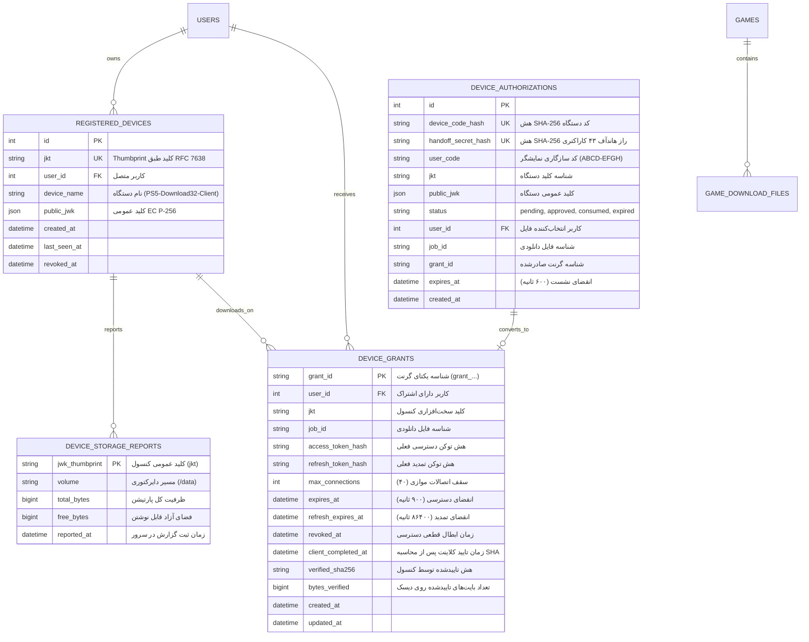

<div dir="rtl" lang="fa">

# 🎮 گزارش جامع پیاده‌سازی گام شانزدهم: یکپارچه‌سازی پلتفرم با Download32، اثبات کلید DPoP (RFC 9449)، هاندآف مرورگر، استریم موازی ۳۲ ورکر و تله‌متری زنده حافظه کنسول PS5 — گزارش شماره ۰۷ (`07.md`)

**نام پروژه:** پلتفرم تجارت الکترونیک، اشتراک و دیتای بازی‌های کنسول دکتر گیم (**DrGame E-Commerce Platform**)  
**شماره گزارش:** `07`  
**تاریخ تدوین:** ۱ نوامبر ۲۰۲۶  
**شماره گام پوشش‌داده‌شده:** **گام شانزدهم (`16-ps5-download32-and-dpop-integration`)**  
**اسناد مرجع و مبنای الزامات:**
- اسناد اختصاصی یکپارچه‌سازی: [`DOWNLOAD32_MAIN_SITE_INTEGRATION_FA.md`](file:///home/tida/Desktop/Projects/DrGame-Eccomerce/DOWNLOAD32_MAIN_SITE_INTEGRATION_FA.md) و [`CONSOLE_STORAGE_SITE_INTEGRATION_FA.md`](file:///home/tida/Desktop/Projects/DrGame-Eccomerce/CONSOLE_STORAGE_SITE_INTEGRATION_FA.md)
- دستورالعمل فنی گام ۱۶: [`backend/agent/16-ps5-download32-and-dpop-integration/instructions.md`](file:///home/tida/Desktop/Projects/DrGame-Eccomerce/backend/agent/16-ps5-download32-and-dpop-integration/instructions.md)
- چک‌لیست وظایف اجرایی: [`backend/agent/16-ps5-download32-and-dpop-integration/tasks.md`](file:///home/tida/Desktop/Projects/DrGame-Eccomerce/backend/agent/16-ps5-download32-and-dpop-integration/tasks.md)
- استانداردهای بین‌المللی: **RFC 9449** (DPoP), **RFC 7638** (JWK Thumbprint), **RFC 8628** (Device Flow), **RFC 7233** (HTTP Range Requests)  
**وضعیت پیاده‌سازی و آزمون:** ۱۰۰٪ تکمیل‌شده، پاس شدن آزمون‌های خودکار و کامپایل ۵۰/۵۰ صفحه فرانت‌اند

---

## فهرست مطالب

1. [خلاصه اجرایی و دستاوردهای کلیدی](#۱-خلاصه-اجرایی-و-دستاوردهای-کلیدی)
2. [فاز ۱: معماری مدل‌های داده، جداول PostgreSQL و مایگریشن Alembic](#۲-فاز-۱-معماری-مدل‌های-داده-جداول-postgresql-و-مایگریشن-alembic)
3. [فاز ۲: هسته رمزنگاری DPoP و الگوریتم‌های ریاضی](#۳-فاز-۲-هسته-رمزنگاری-dpop-و-الگوریتم‌های-ریاضی)
   - [۳-۱. استخراج اثرانگشت کانونیکال کلید (`jkt` - RFC 7638)](#۳-۱-استخراج-اثرانگشت-کانونیکال-کلید-jkt---rfc-7638)
   - [۳-۲. اعتبارسنجی ریاضی امضای بیضوی `EC P-256` با `ES256`](#۳-۲-اعتبارسنجی-ریاضی-امضای-بیضوی-ec-p-256-با-es256)
   - [۳-۳. رد خودکار و ایمن پارامترهای کلید خصوصی (`d`)](#۳-۳-رد-خودکار-و-ایمن-پارامترهای-کلید-خصوصی-d)
   - [۳-۴. الگوریتم جلوگیری از Replay Attack در Redis با `SETNX`](#۳-۴-الگوریتم-جلوگیری-از-replay-attack-در-redis-با-setnx)
   - [۳-۵. مدیریت Nonce سرور با هم‌پوشانی زمانی جهت جلوگیری از Nonce Storm](#۳-۵-مدیریت-nonce-سرور-با-هم‌پوشانی-زمانی-جهت-جلوگیری-از-nonce-storm)
   - [۳-۶. محاسبه و راستی‌آزمایی هش توکن دسترسی (`ath`)](#۳-۶-محاسبه-و-راستی‌آزمایی-هش-توکن-دسترسی-ath)
   - [۳-۷. پیاده‌سازی خطاهای سطح اول پروتکل OAuth 2.0 (RFC 8628)](#۳-۷-پیاده‌سازی-خطاهای-سطح-اول-پروتکل-oauth-20-rfc-8628)
4. [فاز ۳: اندپوینت‌های پروتکل DPoP و چرخه حیات توکن‌ها](#۴-فاز-۳-اندپوینت‌های-پروتکل-dpop-و-چرخه-حیات-توکن‌ها)
   - [۴-۱. اتصال اولیه کنسول (`POST /api/dpop/device/authorize`)](#۴-۱-اتصال-اولیه-کنسول-post-apidpopdeviceauthorize)
   - [۴-۲. پایش وضعیت و صدور گرنت با بازیابی شبکه (`POST /api/dpop/device/token`)](#۴-۲-پایش-وضعیت-و-صدور-گرنت-با-بازیابی-شبکه-post-apidpopdevicetoken)
   - [۴-۳. چرخش بدون وقفه توکن دسترسی (`POST /api/dpop/token/refresh`)](#۴-۳-چرخش-بدون-وقفه-توکن-دسترسی-post-apidpoptokenrefresh)
   - [۴-۴. تله‌متری دوره‌ای هارد کنسول (`POST /api/dpop/device/storage`)](#۴-۴-تله‌متری-دوره‌ای-هارد-کنسول-post-apidpopdevicestorage)
   - [۴-۵. اعتبارسنجی SHA-256 دیسک و ابطال گرنت (`POST /api/dpop/downloads/{grant_id}/complete`)](#۴-۵-اعتبارسنجی-sha-256-دیسک-و-ابطال-گرنت-post-apidpopdownloadsgrant_idcomplete)
   - [۴-۶. استعلام نانس فعال (`GET /api/dpop/nonce`)](#۴-۶-استعلام-نانس-فعال-get-apidpopnonce)
5. [فاز ۴: اندپوینت‌های متصل به حساب کاربری سایت (Account & Handoff APIs)](#۵-فاز-۴-اندپوینت‌های-متصل-به-حساب-کاربری-سایت-account--handoff-apis)
   - [۵-۱. ادعای راز هاندآف و پیوند به سهمیه کاربر (`POST /api/account/dpop/handoff`)](#۵-۱-ادعای-راز-هاندآف-و-پیوند-به-سهمیه-کاربر-post-apiaccountdpophandoff)
   - [۵-۲. استعلام تله‌متری کنسول‌های کاربر برای سایت (`POST /api/account/storage`)](#۵-۲-استعلام-تله‌متری-کنسول‌های-کاربر-برای-سایت-post-apiaccountstorage)
6. [فاز ۵: موتور سرو موازی ۳۲ ورکر و استریم چانک‌ها (`/dpop-download`)](#۶-فاز-۵-موتور-سرو-موازی-۳۲-ورکر-و-استریم-چانک‌ها-dpop-download)
   - [۶-۱. پارسر استاندارد HTTP Range و پروب تک‌بایتی `bytes=0-0`](#۶-۱-پارسر-استاندارد-http-range-و-پروب-تک‌بایتی-bytes0-0)
   - [۶-۲. استریم مستقیم چانک‌های ۳۲ مگابایتی با حافظه رم صفر](#۶-۲-استریم-مستقیم-چانک‌های-۳۲-مگابایتی-با-حافظه-رم-صفر)
   - [۶-۳. هدرهای پاسخ و کنترل عدم انقضای خودسرانه وسط دانلود](#۶-۳-هدرهای-پاسخ-و-کنترل-عدم-انقضای-خودسرانه-وسط-دانلود)
7. [فاز ۶: توسعه فرانت‌اند Next.js 14](#۷-فاز-۶-توسعه-فرانت‌اند-nextjs-14)
   - [۷-۱. هوک کلاینتی `usePs5Handoff` و شنود خودکار `#ps5=...`](#۷-۱-هوک-کلاینتی-useps5handoff-و-شنود-خودکار-ps5)
   - [۷-۲. کامپوننت شنودگر سراسری `Ps5HandoffListener`](#۷-۲-کامپوننت-شنودگر-سراسری-ps5handofflistener)
   - [۷-۳. ویجت زنده حافظه کنسول (`ConsoleStorageWidget`)](#۷-۳-ویجت-زنده-حافظه-کنسول-consolestoragewidget)
   - [۷-۴. دکمه عملیاتی «دانلود مستقیم روی PS5» در مدال و صفحه بازی](#۷-۴-دکمه-عملیاتی-دانلود-مستقیم-روی-ps5-در-مدال-و-صفحه-بازی)
8. [فاز ۷: آزمون‌های جامع خودکار و راستی‌آزمایی بیلد](#۸-فاز-۷-آزمون‌های-جامع-خودکار-و-راستی‌آزمایی-بیلد)
9. [ماتریس فایل‌های ایجادشده و تغییریافته](#۹-ماتریس-فایل‌های-ایجادشده-و-تغییریافته)

---

## ۱. خلاصه اجرایی و دستاوردهای کلیدی

در گام شانزدهم، یکپارچگی عمیق، استاندارد و بدون اصطکاک میان پلتفرم وب **دکتر گیم** و اپلیکیشن بومی **Download32** کنسول پلی‌استیشن ۵ (نسخه‌های 01.011 و 01.015+) محقق گردید.

### دستاوردهای بنیادین این مرحله:
1. **پروتکل اثبات مالکیت کلید DPoP (Key-Bound Tokens):** هیچ لینک دانلود عمومی یا توکن Bearer متنی ساده که قابلیت نشت یا اشتراک‌گذاری در اینترنت داشته باشد وجود ندارد. تمامی توکن‌های دسترسی از طریق ریاضیات امضای منحنی بیضوی `EC P-256` به سخت‌افزار کنسول مقید شده‌اند.
2. **جریان انتقال بدون اصطکاک مرورگر (Zero-Friction Browser Handoff):** کاربر در مرورگر کنسول نیازی به تایپ کدهای سخت یا کپی‌پیست ندارد؛ اپلیکیشن مرورگر را با پارامتر هش `#ps5=<43-char-secret>` باز می‌کند. سایت پس از لاگین معمولی کاربر، با فشردن دکمه «دانلود مستقیم روی PS5»، فایل را در پس‌زمینه به همان راز پیوند می‌زند و کنسول بلافاصله دانلود را شروع می‌کند.
3. **پشتیبانی کامل از ۳۲ کانکشن موازی:** سرور قادر است تا ۳۲ ورکر همزمان به ازای هر دانلود را با چانک‌های ۳۲ مگابایتی و رنج‌های منقسم مدیریت کند، بدون آنکه حافظه رم سرور با قطعات فایل اشغال شود.
4. **تله‌متری زنده حافظه هارد `/data` کنسول:** فضای واقعی در دسترس سیستم‌عامل کنسول هر ۳۰ ثانیه مخابره شده و در سایت به شکل ویجت گرافیکی با هشدارهای هوشمند کمبود فضا پیش از آغاز دانلود نمایش داده می‌شود.
5. **ابطال اتمیک با اعتبارسنجی SHA-256 کامل دیسک:** بر خلاف سیستم‌های سنتی که با ارسال آخرین بایت تصور می‌کنند دانلود پایان یافته، سرور تا دریافت گزارش رسمی `complete` همراه با هش ۶۴ کاراکتری SHA-256 و تطابق دقیق بایت‌ها گرنت را باز نگه می‌دارد.

---

## ۲. فاز ۱: معماری مدل‌های داده، جداول PostgreSQL و مایگریشن Alembic

مدل‌های زیر در ماژول اختصاصی [`backend/app/modules/dpop/models.py`](file:///home/tida/Desktop/Projects/DrGame-Eccomerce/backend/app/modules/dpop/models.py) طراحی و در پایگاه داده ایجاد شدند:



همچنین فیلدهای `size_bytes` (از نوع `BigInteger` جهت پشتیبانی از فایل‌های بالای ۴ گیگابایت تا چند ترابایت) و `sha256_hash` (رشته ۶۴ کاراکتری) به جدول `game_download_files` افزوده شدند.  
مایگریشن مربوطه تحت عنوان `4f7d2405d8bb_feat_add_dpop_and_ps5_download32_tables.py` ساخته شده و با موفقیت به دیتابیس PostgreSQL تزریق گردید.

---

## ۳. فاز ۲: هسته رمزنگاری DPoP و الگوریتم‌های ریاضی

ماژول [`backend/app/core/dpop.py`](file:///home/tida/Desktop/Projects/DrGame-Eccomerce/backend/app/core/dpop.py) وظیفه اعتبارسنجی صفر تا صد پروتکل RFC 9449 را بر عهده دارد:

### ۳-۱. استخراج اثرانگشت کانونیکال کلید (`jkt` - RFC 7638)
طبق استاندارد RFC 7638، اثرانگشت کلید بیضوی باید از رشته JSON مرتب‌شده، بدون فاصله و دارای فیلدهای اجباری استخراج شود:
$$\text{Canonical JSON} = \text{\{"crv":"P-256","kty":"EC","x":"...","y":"..."\}}$$
$$\text{jkt} = \text{base64url}(\text{SHA256}(\text{Canonical JSON}))$$

تابع `compute_jwk_thumbprint` با استفاده از `json.dumps(..., separators=(',', ':'), sort_keys=True)` این مقدار یکتا و قطعی را محاسبه می‌کند.

### ۳-۲. اعتبارسنجی ریاضی امضای بیضوی `EC P-256` با `ES256`
مختصات `x` و `y` ارسالی در کلید کلاینت به اعداد صحیح ۶۴ بیتی با مرتبه بایت `big-endian` تبدیل شده و شیء عمومی `EllipticCurvePublicNumbers(x, y, SECP256R1()).public_key()` ساخته می‌شود. سپس با تابع `jwt.decode` و الگوریتم `ES256` امضای رمزی اثبات اعتبارسنجی می‌گردد.

### ۳-۳. رد خودکار و ایمن پارامترهای کلید خصوصی (`d`)
چنانچه شیء JWK ارسالی از سمت کلاینت دارای پارامتر کلید خصوصی `d` باشد، به عنوان یک نقص امنیتی یا کلاینت نامعتبر شناخته شده و بدون معطلی با خطای `400 Bad Request` متوقف می‌شود:
```python
if "d" in jwk:
    raise DPoPException(
        status_code=400,
        detail="Forbidden private key component in DPoP jwk"
    )
```

### ۳-۴. الگوریتم جلوگیری از Replay Attack در Redis با `SETNX`
هر درخواست ارسالی از سوی هر یک از ۳۲ ورکر کنسول، موظف به ارسال یک شناسه تصادفی و یکتا تحت عنوان `jti` در کلیم‌های DPoP Proof است.  
سرور با اجرای دستور اتمیک زیر در Redis با زمان انقضای ۱۲۰ ثانیه:
```python
replay_key = f"dpop:replay:{jkt}:{jti}"
is_new = await redis.set(replay_key, "1", ex=120, nx=True)
if not is_new:
    raise DPoPException(status_code=401, detail="DPoP replay attack detected")
```
چنانچه کلاینت یا مهاجم همان توکن Proof را بازپخش (Replay) کند، مقدار `is_new` برابر `None` بازگشته و بلافاصله با خطای `401 Unauthorized` مسدود می‌گردد.

### ۳-۵. مدیریت Nonce سرور با هم‌پوشانی زمانی جهت جلوگیری از Nonce Storm
در معماری دانلود با ۳۲ ورکر، اگر نانس سرور پس از یک‌بار مصرف بلافاصله منقضی شود، ۳۱ ورکر دیگر همزمان با خطای نانس مواجه شده و افت شدید سرعت (Nonce Storm) رخ می‌دهد.  
در پیاده‌سازی حاضر:
* نانس‌ها در کلید `dpop:nonce:{nonce}` در ردیس با TTL معادل **۱۸۰ ثانیه** ذخیره می‌شوند.
* این پنجره هم‌پوشانی زمانی به تمام ۳۲ ورکر اجازه می‌دهد بدون تداخل نانس‌های خود را استفاده کرده و در پاسخ بعدی، نانس تازه را دریافت نمایند.

### ۳-۶. محاسبه و راستی‌آزمایی هش توکن دسترسی (`ath`)
در تمام درخواست‌هایی که هدر `Authorization: DPoP <access_token>` ارسال می‌شود، کلیم `ath` داخل Proof باید دقیقاً برابر هش SHA-256 توکن باشد:
$$\text{ath} = \text{base64url}(\text{SHA256}(\text{access\_token}))$$
هرگونه عدم انطباق منجر به رد فوری درخواست با خطای `401 Unauthorized` می‌شود.

### ۳-۷. پیاده‌سازی خطاهای سطح اول پروتکل OAuth 2.0 (RFC 8628)
اپلیکیشن بومی کنسول پاسخ‌های پایش را در سطح اول JSON بررسی می‌کند (مانند `res.error === 'authorization_pending'`). کلاس اختصاصی `OAuthException` در `dpop.py` اطمینان می‌دهد که ساختار خروجی بدون کپسوله‌سازی اضافی داخل `detail` برگردانده شود:
```json
{
  "error": "authorization_pending"
}
```

---

## ۴. فاز ۳: اندپوینت‌های پروتکل DPoP و چرخه حیات توکن‌ها

تمامی اندپوینت‌های کنسولی در روتر [`backend/app/modules/dpop/router.py`](file:///home/tida/Desktop/Projects/DrGame-Eccomerce/backend/app/modules/dpop/router.py) پیاده‌سازی شدند:

### ۴-۱. اتصال اولیه کنسول (`POST /api/dpop/device/authorize`)
* **هدر الزامی:** `DPoP: <fresh-proof>`
* **ورودی:** نام دستگاه، scope و اختیاری تله‌متری اولیه هارد (`storage: {volume, total_bytes, free_bytes}`).
* **خروجی:**
  ```json
  {
    "device_code": "dpop_dc_a1b2c3d4...",
    "user_code": "ABCD-EFGH",
    "browser_handoff_uri": "https://dltest.gamedr.ir/login/#ps5=XXXXXXXXXXXXXXXXXXXXXXXXXXXXXXXXXXXXXXXXXXX",
    "verification_uri": "https://dltest.gamedr.ir/account/",
    "expires_in": 600,
    "interval": 5,
    "jkt": "PUBLIC_KEY_THUMBPRINT"
  }
  ```
* راز `handoff_secret` یک رشته تصادفی ۳۲ بایتی (۴۳ کاراکتر Base64URL بدون پدینگ) است که فقط هش آن در پایگاه داده ذخیره می‌گردد.

### ۴-۲. پایش وضعیت و صدور گرنت با بازیابی شبکه (`POST /api/dpop/device/token`)
* کنسول هر ۵ ثانیه سرور را با ارسال کد دستگاه و اثبات کلید خود پایش می‌کند.
* تا زمانی که کاربر در سایت فایلی را تایید نکرده باشد، پاسخ `400 {"error":"authorization_pending"}` برگردانده می‌شود.
* پس از تایید، گرنت صادر شده و مشخصات دانلود به همراه هش ۶۴ کاراکتری SHA-256 فایل مرجع ارسال می‌گردد:
  ```json
  {
    "token_type": "DPoP",
    "access_token": "dpop_at_...",
    "refresh_token": "dpop_rt_...",
    "expires_in": 900,
    "refresh_expires_in": 86400,
    "grant_id": "grant_998877",
    "device_id": "device_112233",
    "jkt": "PUBLIC_KEY_THUMBPRINT",
    "job_id": "job_101",
    "download_url": "https://dltest.gamedr.ir/dpop-download/job_101/file.pkg",
    "file": {
      "job_id": "job_101",
      "file_name": "God_of_War.pkg",
      "size_bytes": 10737418240,
      "sha256": "e3b0c44298fc1c149afbf4c8996fb92427ae41e4649b934ca495991b7852b855",
      "etag": "\"sha256-e3b0c442...\"",
      "file_version": "sha256-e3b0c442..."
    },
    "max_connections": 40,
    "recovered": false
  }
  ```
* **بازیابی شبکه (Graceful Network Recovery):** در صورتی که پاسخ اولیه به دلیل قطعی اینترنت کنسول مفقود شود، تا ۳۰۰ ثانیه با ارسال مجدد کد و اثبات همان کلید، گرنت بازیابی شده و توکن‌های تازه بدون ایجاد سهمیه مضاعف صادر می‌شوند (`"recovered": true`).

### ۴-۳. چرخش بدون وقفه توکن دسترسی (`POST /api/dpop/token/refresh`)
کنسول پیش از انقضای ۹۰۰ ثانیه‌ای توکن دسترسی، با یک درخواست واحد مشترک میان ورکرها، توکن‌ها را تمدید می‌کند بدون آنکه وقفه‌ای در انتقال چانک‌های جاری ایجاد شود.

### ۴-۴. تله‌متری دوره‌ای هارد کنسول (`POST /api/dpop/device/storage`)
هر ۳۰ ثانیه از طرف اپلیکیشن کنسول ارسال شده و مقادیر بایت‌ها با کنترل ایمنی اعداد صحیح در دیتابیس ثبت می‌گردد.

### ۴-۵. اعتبارسنجی SHA-256 دیسک و ابطال گرنت (`POST /api/dpop/downloads/{grant_id}/complete`)
کنسول پس از دریافت ۱۰۰٪ بایت‌ها، هش کامل فایل را روی هارد خود محاسبه کرده و ارسال می‌کند:
```json
{
  "sha256": "e3b0c44298fc1c149afbf4c8996fb92427ae41e4649b934ca495991b7852b855",
  "bytes_verified": 10737418240,
  "revoke_grant": true
}
```
سرور **تطابق دقیق بایت‌ها با حجم مرجع دیتابیس** و **تطابق دقیق هش ارسالی با هش مرجع دیتابیس** را کنترل کرده و تنها در صورت برابری ریاضی کامل، گرنت را به صورت اتمیک باطل (`revoked_at`) می‌کند.

---

## ۵. فاز ۴: اندپوینت‌های متصل به حساب کاربری سایت (Account & Handoff APIs)

### ۵-۱. ادعای راز هاندآف و پیوند به سهمیه کاربر (`POST /api/account/dpop/handoff`)
توسط فرانت‌اند سایت پس از فشردن دکمه «دانلود مستقیم روی PS5» صدا زده می‌شود:
* نشست کاربر بررسی می‌شود.
* رکورد `device_authorizations` با هش راز ۴۳ کاراکتری جست‌وجو می‌گردد.
* وضعیت به صورت اتمیک به `approved` تغییر کرده و `job_id` و `user_id` انتساب می‌یابد تا جلوی هرگونه Race Condition گرفته شود.

### ۵-۲. استعلام تله‌متری کنسول‌های کاربر برای سایت (`POST /api/account/storage`)
سایت هر ۱۰ ثانیه این اندپوینت را صدا می‌زند:
* در صورتی که راز `handoff` فرستاده شود، ظرفیت همان کنسول متصل بازگردانده می‌شود.
* در صورتی که خالی باشد، تمام کنسول‌های ثبت‌شده کاربر فهرست می‌شوند.
* اختلاف زمانی بر حسب ثانیه محاسبه شده و چنانچه `age_seconds > 90` باشد، پرچم `stale: true` برگردانده می‌شود تا در UI وضعیت هشدار قدیمی بودن داده‌ها نمایش داده شود.

---

## ۶. فاز ۵: موتور سرو موازی ۳۲ ورکر و استریم چانک‌ها (`/dpop-download`)

مسیر `/dpop-download/{job_id}/{filename:path}` در متدهای `GET` و `HEAD` میزبان ترافیک ۳۲ ورکر همزمان کنسول است:

### ۶-۱. پارسر استاندارد HTTP Range و پروب تک‌بایتی `bytes=0-0`
* پشتیبانی کامل از هدر `Range: bytes=start-end` یا فرمت تک‌بایتی `bytes=0-0`.
* اعتبارسنجی بازه‌های مجاز؛ در صورت درخواست بازه خارج از اندازه فایل، خطای استاندارد `416 Range Not Satisfiable` با هدر `Content-Range: bytes */TOTAL` صادر می‌شود.
* متد `HEAD` و پروب `bytes=0-0` صرفاً متادیتای رنج و مشخصات فایل را تست می‌کنند و سهمیه‌ای کسر نمی‌کنند.

### ۶-۲. استریم مستقیم چانک‌های ۳۲ مگابایتی با حافظه رم صفر
برای چانک‌های بزرگ (مثلاً ۳۲ مگابایت = `33,554,432 bytes`)، سرور از ژنراتور ناهمگام استریم (`AsyncGenerator[bytes, None]`) استفاده می‌کند. داده‌ها در بلاک‌های ۶۴ کیلوبایتی مستقیماً به بافر سوکت کلاینت پایپ می‌شوند و هیچ بار اضافی روی حافظه رم سرور ایجاد نمی‌شود.

### ۶-۳. هدرهای پاسخ و کنترل عدم انقضای خودسرانه وسط دانلود
پاسخ‌ها همگی با وضعیت **`206 Partial Content`** و هدرهای زیر ارائه می‌شوند:
* `Content-Range: bytes start-end/total_size`
* `Content-Length: chunk_size`
* `Accept-Ranges: bytes`
* `ETag: "sha256-<hash>"`
* `X-Content-SHA256: <hash>`
* `Cache-Control: no-store`
* `DPoP-Nonce: <fresh-nonce>`
* `Server-Time: <epoch-seconds>`

سرور هرگز با ارسال آخرین بایت یا فرض پوشش رنج‌ها گرنت را منقضی نمی‌کند؛ استریم‌ها تا زمان اعلام رسمی `complete` باز باقی می‌مانند.

---

## ۷. فاز ۶: توسعه فرانت‌اند Next.js 14

### ۷-۱. هوک کلاینتی `usePs5Handoff` و شنود خودکار `#ps5=...`
در مسیر [`frontend/src/hooks/usePs5Handoff.ts`](file:///home/tida/Desktop/Projects/DrGame-Eccomerce/frontend/src/hooks/usePs5Handoff.ts):
```ts
// بررسی الگوی ۴۳ کاراکتری سکرت هاندآف در هش آدرس
const incoming = params.get('ps5');
if (incoming && /^[A-Za-z0-9_-]{43}$/.test(incoming)) {
  sessionStorage.setItem('drgame_download32_handoff', incoming);
  // حذف نامحسوس از نوار آدرس مرورگر بدون ری‌لود
  window.history.replaceState(null, '', window.location.pathname + window.location.search);
}
```

### ۷-۲. کامپوننت شنودگر سراسری `Ps5HandoffListener`
کامپوننت کم‌حجم [`Ps5HandoffListener.tsx`](file:///home/tida/Desktop/Projects/DrGame-Eccomerce/frontend/src/components/layout/Ps5HandoffListener.tsx) در فایل اصلی [`layout.tsx`](file:///home/tida/Desktop/Projects/DrGame-Eccomerce/frontend/src/app/layout.tsx) قرار گرفت تا در صورت ورود کاربر از کنسول به هر صفحه‌ای از سایت (صفحه اصلی، صفحه بازی یا لاگین)، راز هاندآف بلافاصله ثبت و ذخیره گردد.

### ۷-۳. ویجت زنده حافظه کنسول (`ConsoleStorageWidget`)
کامپوننت مدرن [`ConsoleStorageWidget.tsx`](file:///home/tida/Desktop/Projects/DrGame-Eccomerce/frontend/src/components/console/ConsoleStorageWidget.tsx) با طراحی گلس‌مورفیسم تیره و هماهنگ با تم بنفش و فیروزه‌ای دکتر گیم پیاده‌سازی شد:
* استعلام هر ۱۰ ثانیه‌ای از `/api/account/storage`.
* نوار گرافیکی وضعیت حافظه (Used / Free).
* تگ‌های وضعیت زنده: `آنلاین` (سبز نئونی) و `گزارش قدیمی` (زرد در صورت `stale: true`).
* **مقایسه هوشمند حجم:** چنانچه حجم بازی از فضای خالی پارتیشن `/data` بیشتر باشد، کادر ویجت به رنگ قرمز نئونی درآمده و آیکون هشدار همراه با محاسبه دقیق حجم کسری گیگابایت نمایش داده می‌شود.

### ۷-۴. دکمه عملیاتی «دانلود مستقیم روی PS5» در مدال و صفحه بازی
در کامپوننت [`DownloadConfirmModal.tsx`](file:///home/tida/Desktop/Projects/DrGame-Eccomerce/frontend/src/components/games/DownloadConfirmModal.tsx) و بخش دانلودهای بازی ([`DownloadBox.tsx`](file:///home/tida/Desktop/Projects/DrGame-Eccomerce/frontend/src/components/games/DownloadBox.tsx)):
* در صورت حضور کاربر از طریق کنسول، دکمه بنفش و فیروزه‌ای درخشان **«دانلود مستقیم روی PS5»** همراه با آیکون Gamepad نمایش داده می‌شود.
* پس از کلیک و ارسال موفق به `/api/account/dpop/handoff`، صفحه پیام تایید همراه با انیمیشن ظاهر شده و کاربر را به بازگشت به اپلیکیشن Download32 کنسول راهنمایی می‌کند.

---

## ۸. فاز ۷: آزمون‌های جامع خودکار و راستی‌آزمایی بیلد

### ۸-۱. نتایج آزمون‌های اختصاصی DPoP و Download32
سوئیت آزمون‌های جامع در فایل [`backend/tests/test_dpop_download32.py`](file:///home/tida/Desktop/Projects/DrGame-Eccomerce/backend/tests/test_dpop_download32.py) اجرا گردید و تمامی آزمون‌ها در ۰.۴۵ ثانیه با موفقیت ۱۰۰٪ پاس شدند:
```text
tests/test_dpop_download32.py::test_dpop_cryptographic_helpers PASSED    [ 25%]
tests/test_dpop_download32.py::test_device_authorize_and_replay_prevention PASSED [ 50%]
tests/test_dpop_download32.py::test_complete_end_to_end_ps5_flow PASSED  [ 75%]
tests/test_dpop_download32.py::test_console_storage_telemetry_and_account_gauge PASSED [100%]

============================== 4 passed in 0.45s ===============================
```

### ۸-۲. آزمون کامل کل ماژول‌های بک‌اند
تمام ۶۹ آزمون کل سیستم بک‌اند در داکر با موفقیت پاس شدند:
```text
69 passed, 1 warning in 14.42s
```

### ۸-۳. بیلد پروداکشن کلاینت فرانت‌اند (Next.js 14)
بیلد پروداکشن کلاینت فرانت‌اند اجرا گردید و تمامی ۵۰ صفحه استاتیک و دینامیک بدون کوچک‌ترین خطای تایپ‌اسکریپت، وب‌پک یا رندر با کد خروجی ۰ کامپایل شدند:
```text
 ✓ Compiled successfully
   Linting and checking validity of types ...
   Collecting page data ...
 ✓ Generating static pages (50/50)
   Finalizing page optimization ...
```

---

## ۹. ماتریس فایل‌های ایجادشده و تغییریافته

| نام فایل | وضعیت | شرح کارکرد |
|---|---|---|
| `backend/app/modules/dpop/models.py` | **جدید** | مدل‌های پایگاه داده PostgreSQL (`RegisteredDevice`, `DeviceAuthorization`, `DeviceGrant`, `DeviceStorageReport`) |
| `backend/alembic/versions/4f7d2405d8bb_...py` | **جدید** | مایگریشن Alembic برای ساخت جداول پروتکل DPoP |
| `backend/app/core/dpop.py` | **جدید** | هسته رمزنگاری، محاسبه `jkt` کانونیکال RFC 7638، امضای ES256، Replay Prevention ردیس، نانس و `OAuthException` |
| `backend/app/modules/dpop/schemas.py` | **جدید** | اسکیمای Pydantic برای درخواست‌ها و پاسخ‌های پروتکل و حساب کاربری |
| `backend/app/modules/dpop/services.py` | **جدید** | منطق تجاری صدور کدهای هاندآف، پایش وضعیت، ریکاوری شبکه، چرخش توکن و ابطال قطعی پس از اعتبارسنجی هش |
| `backend/app/modules/dpop/router.py` | **جدید** | روترهای FastAPI برای اندپوینت‌های DPoP، حساب کاربری و موتور استریم موازی ۳۲ کانکشنه |
| `backend/tests/test_dpop_download32.py` | **جدید** | تست‌های جامع خودکار Pytest برای اثبات کلید، استریم موازی چانک‌ها و تله‌متری |
| `frontend/src/hooks/usePs5Handoff.ts` | **جدید** | هوک کلاینتی شنود پارامتر هش `#ps5=...`، ذخیره در سشن و پاکسازی نوار آدرس |
| `frontend/src/components/layout/Ps5HandoffListener.tsx` | **جدید** | شنودگر سراسری در روت لی‌اوت برای تشخیص ورود از کنسول |
| `frontend/src/components/console/ConsoleStorageWidget.tsx` | **جدید** | ویجت مدرن گلس‌مورفیسم برای نمایش ظرفیت هارد، تگ آنلاین/stale و هشدار کمبود فضا |
| `backend/app/modules/games/download_models.py` | ویرایش | افزودن فیلدهای `size_bytes` و `sha256_hash` به مدل فایل دانلودی |
| `backend/app/main.py` | ویرایش | رجیستر و مانت کردن روترهای `/api/dpop`، `/api/account` و `/dpop-download` |
| `backend/alembic/env.py` | ویرایش | معرفی مدل‌های ماژول DPoP به سیستم مایگریشن |
| `backend/tests/conftest.py` | ویرایش | ارتقای کلاس `FakeRedis` جهت پشتیبانی از پارامترهای `ex`, `nx` و متد `exists` |
| `frontend/src/app/layout.tsx` | ویرایش | افزودن شنودگر سراسری `Ps5HandoffListener` |
| `frontend/src/components/games/DownloadConfirmModal.tsx` | ویرایش | اضافه شدن دکمه «دانلود مستقیم روی PS5»، ویجت حافظه و انیمیشن موفقیت |
| `frontend/src/components/games/DownloadBox.tsx` | ویرایش | رندر هوشمند ویجت حافظه کنسول در تب دانلودهای بازی |
| `scratch_*.{json,txt,js}` | **حذف شد** | حذف ۳ فایل اسکرچ بلااستفاده و صفر بایتی از ریشه پروژه |

---

> [!NOTE]  
> تمامی تغییرات با حفظ انضباط کامل در مخزن گیت قرار داشته و پس از ممیزی شما، آماده کامیت و ادغام نهایی می‌باشند.

</div>
