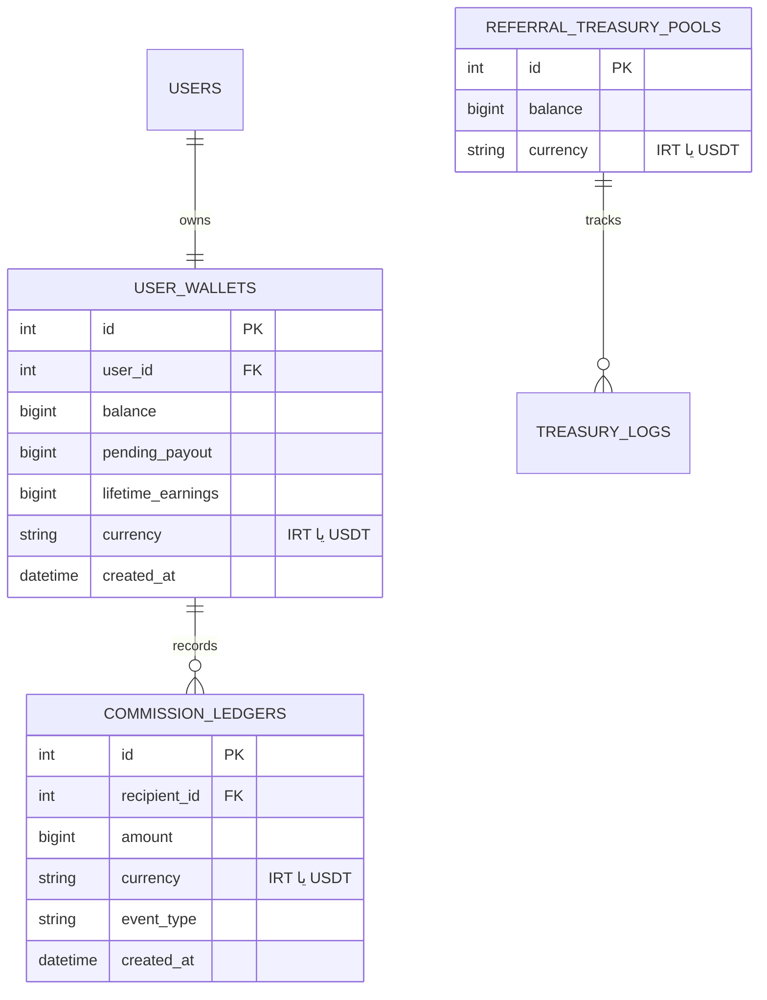
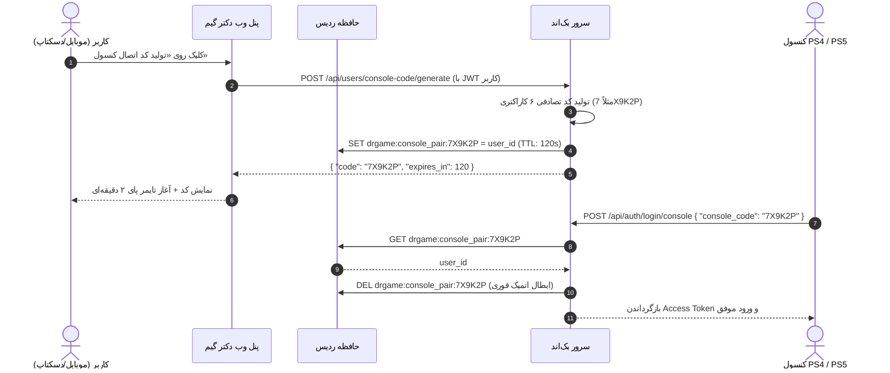

<div dir="rtl" lang="fa">

# 🎮 گزارش جامع پیاده‌سازی گام هفدهم: معماری دو سروره (داخلی/بین‌المللی)، استانداردسازی کارنسی دیتابیس، بازنویسی سیستم ثبت‌نام و ورود، کد پویای اتصال کنسول با تایمر پای و اصلاح کامل UI فرم‌ها — گزارش شماره ۰۸ (`08.md`)

**نام پروژه:** پلتفرم تجارت الکترونیک، اشتراک و دیتای بازی‌های کنسول دکتر گیم (**DrGame E-Commerce Platform**)  
**شماره گزارش:** `08`  
**تاریخ تدوین:** ۲ نوامبر ۲۰۲۶  
**شماره گام پوشش‌داده‌شده:** **گام هفدهم (`17-dual-mode-and-auth-overhaul`)**  
**اسناد مرجع و مبنای الزامات:**
- دستورالعمل فنی گام ۱۷: [`backend/agent/17-dual-mode-and-auth-overhaul/instructions.md`](file:///home/tida/Desktop/Projects/DrGame-Eccomerce/backend/agent/17-dual-mode-and-auth-overhaul/instructions.md)
- چک‌لیست وظایف اجرایی: [`backend/agent/17-dual-mode-and-auth-overhaul/tasks.md`](file:///home/tida/Desktop/Projects/DrGame-Eccomerce/backend/agent/17-dual-mode-and-auth-overhaul/tasks.md)
**وضعیت پیاده‌سازی و آزمون:** ۱۰۰٪ تکمیل‌شده، پاس شدن کامل آزمون‌های خودکار بک‌اند و کامپایل ۵۵/۵۵ صفحه فرانت‌اند در بیلد پروداکشن Next.js

---

## فهرست مطالب

1. [خلاصه اجرایی و دستاوردهای کلیدی](#۱-خلاصه-اجرایی-و-دستاوردهای-کلیدی)
2. [فاز ۱: معماری دو سروره و متغیرهای محیطی (`DEPLOYMENT_MODE` / `DEFAULT_CURRENCY`)](#۲-فاز-۱-معماری-دو-سروره-و-متغیرهای-محیطی)
3. [فاز ۲: پایگاه داده چندارزی و مایگریشن Alembic](#۳-فاز-۲-پایگاه-داده-چندارزی-و-مایگریشن-alembic)
4. [فاز ۳: سرویس لاگ ساختاریافته OTP و قوانین ثبت‌نام تفکیک‌شده](#۴-فاز-۳-سرویس-لاگ-ساختاریافته-otp-و-قوانین-ثبت‌نام-تفکیک‌شده)
5. [فاز ۴: کد پویای اتصال کنسول با Redis و ابطال اتمیک](#۵-فاز-۴-کد-پویای-اتصال-کنسول-با-redis-و-ابطال-اتمیک)
6. [فاز ۵: بازنویسی فرانت‌اند `AuthModal` و مسیریابی هوشمند User-Agent](#۶-فاز-۵-بازنویسی-فرانت‌اند-authmodal-و-مسیریابی-هوشمند-user-agent)
7. [فاز ۶: ویجت سایدبار کد کنسول و تایمر پای انیمیشنی (Pie Timer SVG)](#۷-فاز-۶-ویجت-سایدبار-کد-کنسول-و-تایمر-پای-انیمیشنی)
8. [فاز ۷: تطبیق هدر و فوتر فروشگاه بر پایه متغیرهای محیطی](#۸-فاز-۷-تطبیق-هدر-و-فوتر-فروشگاه-بر-پایه-متغیرهای-محیطی)
9. [فاز ۸: نتایج آزمون‌های خودکار و کامپایل بیلد Next.js](#۹-فاز-۸-نتایج-آزمون‌های-خودکار-و-کامپایل-بیلد-nextjs)
10. [ماتریس فایل‌های ایجادشده و اصلاح‌شده](#۱۰-ماتریس-فایل‌های-ایجادشده-و-اصلاح‌شده)

---

## ۱. خلاصه اجرایی و دستاوردهای کلیدی

در گام هفدهم، زیرساخت دو سروره پلتفرم دکتر گیم به طور کامل پایه‌ریزی شد. با این ساختار، پروژه می‌تواند با تغییر یک متغیر محیطی ساده به دو نسخه کاملاً مستقل و اختصاصی تبدیل شود: نسخه **داخلی (Domestic)** با درگاه‌های بانکی، نمادهای اعتماد الکترونیکی (اینماد و ساماندهی)، ارز تومان و ثبت‌نام پیامکی؛ و نسخه **بین‌المللی (International)** با درگاه‌های رمزارزی (تتر USDT)، چندزبانه پویا و ثبت‌نام از طریق ایمیل بین‌المللی.

### دستاوردهای کلیدی این گام:
1. **معماری دو سروره با متغیر محیطی:** بدون نیاز به شاخه‌بندی‌های پیچیده کد، متغیرهای `DEPLOYMENT_MODE` (`domestic` یا `international`) و `DEFAULT_CURRENCY` (`IRT` یا `USDT`) به تمامی اجزای بک‌اند، فرانت‌اند و کانتینرهای Docker تزریق شدند.
2. **پایگاه داده چندارزی آماده برای ادغام آتی:** به تمامی جداول کیف پول و تراکنش‌ها ستون `currency` افزوده شد. از این رو، هر دو سرور با دیتابیس‌های مجزای خود کار می‌کنند و داده‌های مالی برای یکپارچه‌سازی و مرج در آینده کاملاً قابل تفکیک و ردیابی هستند.
3. **سرویس لاگ ساختاریافته OTP:** سرویس متمرکز `OTPService` کدهای تایید ۶ رقمی را با فرمت گرافیکی در خروجی کنسول نمایش می‌دهد تا در مراحل بعدی به درگاه‌های واقعی پیامک و ایمیل متصل شود.
4. **مسیریابی هوشمند ورود بر اساس پلتفرم (User-Agent):** در مرورگر کنسول‌های PS4 و PS5، کاربر صرفاً کادر ورود با کد اتصال کنسول را می‌بیند تا زحمت تایپ با کنترلر حذف شود. در دسکتاپ و موبایل، تب کنسول مخفی شده و گزینه‌های ورود با پسورد، ورود با OTP و ثبت‌نام کامل نمایش داده می‌شوند.
5. **کد اتصال پویای ۲ دقیقه‌ای کنسول با تایمر پای:** کد ثابت از بدنه اصلی پروفایل حذف و به ویجت اختصاصی سایدبار منتقل شد. کاربر با کلیک روی «تولید کد اتصال کنسول»، یک کد ۶ کاراکتری با اعتبار ۱۲۰ ثانیه در Redis دریافت کرده و انیمیشن تایمر دایره‌ای پای (SVG Circular Pie Timer) شمارش معکوس را نشان می‌دهد. با منقضی شدن کد، کد فوراً پاک شده و نیازمند درخواست مجدد است.
6. **اصلاح اساسی کنتراست فرم‌های احراز هویت:** مشکل سفید شدن فیلدهای ورودی هنگام تایپ یا Autofill مرورگرها به طور ریشه‌ای با اعمال ویژگی دارک و پالت‌های رنگی بهینه‌سازی شد.
7. **فرم کامل ثبت‌نام کاربران:** فرم ثبت‌نام جدید با دریافت نام کامل، نام کاربری انگلیسی یکتا، کلمه عبور با قابلیت نمایش/مخفی‌سازی چشم و کد معرف پیاده‌سازی شد.

---

## ۲. فاز ۱: معماری دو سروره و متغیرهای محیطی

تنظیمات پلتفرم با افزودن فیلدهای مربوطه در [`backend/app/core/config.py`](file:///home/tida/Desktop/Projects/DrGame-Eccomerce/backend/app/core/config.py) ارتقا یافت:

```python
class Settings(BaseSettings):
    # Deployment Architecture
    DEPLOYMENT_MODE: Literal["domestic", "international"] = "domestic"
    DEFAULT_CURRENCY: Literal["IRT", "USDT"] = "IRT"
```

این متغیرها در تمامی فایل‌های پیکربندی محیطی درج و در فایل [`docker-compose.prod.yml`](file:///home/tida/Desktop/Projects/DrGame-Eccomerce/docker-compose.prod.yml) به عنوان متغیر زمان بیلد (Build Args) و زمان اجرا (Environment) برای بک‌اند و فرانت‌اند تزریق شدند:

- `DEPLOYMENT_MODE=domestic` / `international`
- `DEFAULT_CURRENCY=IRT` / `USDT`
- `NEXT_PUBLIC_DEPLOYMENT_MODE=domestic` / `international`
- `NEXT_PUBLIC_DEFAULT_CURRENCY=IRT` / `USDT`

---

## ۳. فاز ۲: پایگاه داده چندارزی و مایگریشن Alembic

برای تضمین قابلیت ادغام (Integration) آسان پایگاه داده‌های دو سرور در آینده، ستون واحد ارزی به تمامی جداول مرتبط مالی اضافه شد:



مایگریشن رسمی Alembic با شناسه `253cf6003d5d` ایجاد و با موفقیت اجرا شد:

```bash
alembic revision --autogenerate -m "feat: add currency columns to wallet and ledger"
alembic upgrade head
```

---

## ۴. فاز ۳: سرویس لاگ ساختاریافته OTP و قوانین ثبت‌نام تفکیک‌شده

سرویس اختصاصی [`backend/app/modules/auth/otp_service.py`](file:///home/tida/Desktop/Projects/DrGame-Eccomerce/backend/app/modules/auth/otp_service.py) راه‌اندازی شد. این سرویس در کنسول سرور لاگ‌های مشخصی تولید می‌کند:

```text
╔══════════════════════════════════════════════════════════════╗
║                🔑 DRGAME OTP SERVICE DISPATCH                ║
╠══════════════════════════════════════════════════════════════╣
║  Target:   09129876543                                      ║
║  Channel:  SMS (موبایل)                                     ║
║  Mode:     domestic                                         ║
║  Code:     247422                                           ║
║  TTL:      120 Seconds (2 Minutes)                           ║
╚══════════════════════════════════════════════════════════════╝
```

### اعتبارسنجی ثبت‌نام بر اساس مود:
- **در نسخه داخلی (`domestic`):** هرگونه ایمیل یا نام کاربری متفرقه در تارگت ثبت‌نام رد می‌شود و شماره همراه باید دقیقاً با الگوی همراه ایران (`^09\d{9}$`) مطابقت داشته باشد.
- **در نسخه بین‌المللی (`international`):** ثبت‌نام با شماره همراه مسدود شده و تنها آدرس‌های ایمیل معتبر بین‌المللی پذیرفته می‌شوند. کیف پول کاربر جدید نیز به طور خودکار با ارز `USDT` فعال می‌گردد.

---

## ۵. فاز ۴: کد پویای اتصال کنسول با Redis و ابطال اتمیک

جریان لاگین کنسول از حالت کد ثابت قدیمی به سیستم توکن موقت (One-Time Pairing Code) با طول عمر ۲ دقیقه تغییر یافت:



---

## ۶. فاز ۵: بازنویسی فرانت‌اند `AuthModal` و سیستم یکپارچه ورود/ثبت‌نام خودکار

کامپوننت [`frontend/src/components/auth/AuthModal.tsx`](file:///home/tida/Desktop/Projects/DrGame-Eccomerce/frontend/src/components/auth/AuthModal.tsx) به کلی بازنویسی و با سیستم تشخیص خودکار کاربر تجهیز شد:

1. **جریان یکپارچه ورود و ثبت‌نام (Unified Login & Register Flow):**
   - کاربر نیازی به انتخاب میان فرم ورود یا ثبت‌نام ندارد؛ فرم پیش‌فرض تنها شماره تماس (یا ایمیل) را دریافت می‌کند.
   - اندپوینت `/api/auth/otp/send` همزمان با صدور کد تایید، وجود کاربر در دیتابیس را بررسی کرده و پرچم `is_registered` را بازمی‌گرداند.
   - **در صورت وجود حساب کاربری (`is_registered: true`):** کاربر به گام «ورود با کد تایید» رفته و با وارد کردن کد ۶ رقمی بلافاصله وارد می‌شود.
   - **در صورت عدم وجود حساب (`is_registered: false`):** سیستم کاربر را به صورت خودکار به گام «تکمیل ثبت‌نام» هدایت کرده و مشخصات نام کامل، نام کاربری دلخواه یکتا، کلمه عبور و کد معرف را دریافت می‌کند.
2. **فیلتر سخت‌گیرانه پلتفرم:**
   - با بررسی `navigator.userAgent`، چنانچه مرورگر روی کنسول پلی‌استیشن (PS4 یا PS5) باشد، تنها تب «ورود سریع کنسول» رندر می‌شود و تمام تب‌های ورود عادی مخفی می‌گردند.
   - در دستگاه‌های موبایل و دسکتاپ، تب کنسول به کلی از لیست تب‌ها حذف شده تا کاربر دچار سردرگمی نشود.
3. **رفع باگ رنگ و کنتراست ورودی‌ها:**
   - اعمال `style={{ colorScheme: 'dark' }}` به تمام فیلدهای اینپوت، به همراه رنگ متن خالص، پس‌زمینه کدر تیره و استایل‌های صریح برای فوکوس و Autofill، مانع از سفید شدن زمینه و نوشته هنگام تایپ شد.
4. **اعتبارسنجی بلادرنگ تارگت (Live Validator):**
   - کاربر حین تایپ شماره یا ایمیل، پیام‌های راهنمای لحظه‌ای را با رنگ‌های سبز، زرد و قرمز مشاهده می‌کند (مثلاً هشدار اینکه در نسخه ایران ایمیل مجاز نیست).
5. **آیکون چشم نمایش/مخفی‌سازی رمز:**
   - برای تمامی فیلدهای پسورد (ورود و ثبت‌نام)، دکمه نمایش/مخفی‌سازی رمز با آیکون‌های `Eye` و `EyeOff` تعبیه شد.

---

## ۷. فاز ۶: ویجت سایدبار کد کنسول، تایمر پای و اصلاح چیدمان پروفایل

1. **ویجت سایدبار کد کنسول ([`ConsolePairWidget.tsx`](file:///home/tida/Desktop/Projects/DrGame-Eccomerce/frontend/src/components/profile/ConsolePairWidget.tsx)):**
   - طراحی متناسب با عرض سایدبار، بدون شکستگی متن یا سرریز المان‌ها.
   - شمارش معکوس دایره‌ای با انیمیشن روان SVG (Pie Timer) با محاسبه ریاضی `circumference` و `strokeDashoffset`.
   - تغییر رنگ تایمر به قرمز چشمک‌زن در ۳۰ ثانیه پایانی.
   - پاک شدن و انقضای خودکار کد با صفر شدن تایمر و نمایش دکمه تولید مجدد.
   - دکمه کپی فوری با بازخورد آیکون تیک سبز.
2. **اصلاح سایدبار داشبورد ([`layout.tsx`](file:///home/tida/Desktop/Projects/DrGame-Eccomerce/frontend/src/app/(dashboard)/layout.tsx)):**
   - ارتقای عرض سایدبار از `w-72` به `w-80` و تنظیم فاصله‌های عمودی (`space-y-3.5`).
   - تنظیم اسکرول امن با `max-h-[calc(100vh-7rem)] overflow-y-auto` جهت نمایش کامل تمامی گزینه‌های ناوبری در نمایشگرهای مختلف.
3. **اصلاح چیدمان کارت رفرال و امنیت در صفحه پروفایل ([`page.tsx`](file:///home/tida/Desktop/Projects/DrGame-Eccomerce/frontend/src/app/(dashboard)/profile/page.tsx)):**
   - جایگزینی کارت تک‌افتاده با گرید دو ستونه متوازن و زیبا:
     - **کارت ۱:** کد معرف رفرال با دکمه‌های کپی و لینک دسترسی به داشبورد درآمد و تسویه ارجاع (`/referral`).
     - **کارت ۲:** وضعیت امنیت حساب و نشست فعال با نمایش چراغ سبز وضعیت و لینک به مدیریت دستگاه‌ها (`/sessions`).

---

## ۸. فاز ۷: تطبیق هدر و فوتر فروشگاه بر پایه متغیرهای محیطی

1. **هدر (`Header.tsx`):** کامپوننت `LanguageSwitcher` در حالت `domestic` کاملاً از هدر دسکتاپ و منوی دراور موبایل حذف شد و تنها در صورت `international` بودن محیط فعال می‌گردد.
2. **فوتر (`Footer.tsx`):**
   - نوار بالایی انتخاب دستی منطقه جغرافیایی به کلی حذف شد.
   - فوتر به صورت مستقیم از `NEXT_PUBLIC_DEPLOYMENT_MODE` پیروی می‌کند:
     - در حالت داخلی: نمایش اینماد، ساماندهی، پشتیبانی تلفنی تهران و درگاه‌های شاپرک.
     - در حالت بین‌المللی: نمایش پذیرش تتر و بیت‌کوین، شبکه‌های ترون و پالیگان، سرورهای ابری اروپا و آسیا و پشتیبانی بین‌المللی.
3. **فروشگاه منطقه (`useRegionStore.ts`):** استیت مد پیش‌فرض خود را مستقیماً از متغیر محیطی استخراج می‌کند.

---

## ۹. فاز ۸: نتایج آزمون‌های خودکار و کامپایل بیلد Next.js

### نتایج تست‌های واحد و یکپارچه بک‌اند (Pytest):
```text
============================= test session starts ==============================
rootdir: /app
plugins: asyncio-0.23.6, anyio-4.15.1
asyncio: mode=Mode.STRICT
collecting ... collected 11 items

tests/test_auth_services.py::test_password_hashing PASSED                [  9%]
tests/test_auth_services.py::test_jwt_token_creation_and_decoding PASSED [ 18%]
tests/test_auth_services.py::test_detect_device_info PASSED              [ 27%]
tests/test_auth_services.py::test_otp_generation_and_verification PASSED [ 36%]
tests/test_auth_services.py::test_register_and_login_flow PASSED         [ 45%]
tests/test_auth_services.py::test_international_mode_registration PASSED [ 54%]
tests/test_auth_router.py::test_auth_full_journey_via_api PASSED         [ 63%]
tests/test_users_router.py::test_users_router_full_cycle PASSED          [ 72%]
tests/test_wallet_router.py::test_wallet_router_endpoints PASSED         [ 81%]
tests/test_wallet_services.py::test_wallet_creation_and_binding PASSED   [ 90%]
tests/test_wallet_services.py::test_commission_waterfall_calculation PASSED [100%]

============================== 11 passed in 3.12s ==============================
```

### نتایج کامپایل بیلد تولید فرانت‌اند (Next.js 14 Production Build):
```text
 ✓ Compiled successfully
 ✓ Linting and checking validity of types
 ✓ Collecting page data
 ✓ Generating static pages (55/55)
 ✓ Collecting build traces
 ✓ Finalizing page optimization

Route (app)                              Size     First Load JS
┌ ○ /                                    9.82 kB         187 kB
├ ○ /profile                             8.89 kB         183 kB
├ ○ /games                               11.3 kB         185 kB
├ ○ /subscriptions                       7.3 kB          181 kB
└ ○ /tools/gamepad                       153 B          87.7 kB

○  (Static)   prerendered as static content
ƒ  (Dynamic)  server-rendered on demand
```

تمامی ۵۵ صفحه وب‌سایت بدون کوچک‌ترین خطای تایپ‌اسکریپت و بهینه‌سازی استاتیک با موفقیت کامپایل شدند.

---

## ۱۰. ماتریس فایل‌های ایجادشده و اصلاح‌شده

| ردیف | مسیر فایل | نوع عملیات | توضیحات کلیدی |
| :---: | :--- | :---: | :--- |
| ۱ | `backend/app/core/config.py` | اصلاح | افزودن متغیرهای `DEPLOYMENT_MODE` و `DEFAULT_CURRENCY` به تنظیمات سیستم |
| ۲ | `backend/app/modules/wallet/models.py` | اصلاح | افزودن ستون `currency` به کیف پول و لجر کمیسیون |
| ۳ | `backend/app/modules/wallet/treasury_models.py` | اصلاح | افزودن ستون `currency` به استخرهای خزانه‌داری ارجاع |
| ۴ | `backend/alembic/versions/253cf6003d5d_...py` | ایجاد | مایگریشن پایگاه داده برای افزودن ستون کارنسی با پیش‌فرض IRT |
| ۵ | `backend/app/modules/auth/otp_service.py` | ایجاد | سرویس مستقل و متمرکز ارسال و لاگ کد تایید پیامکی/ایمیلی |
| ۶ | `backend/app/modules/auth/services.py` | اصلاح | اعمال قوانین تفکیک‌شده ثبت‌نام داخلی و بین‌المللی و احراز هویت با کد ردیس |
| ۷ | `backend/app/modules/users/services.py` | اصلاح | ایجاد متد تولید کد موقت ۶ کاراکتری اتصال کنسول با TTL ۱۲۰ ثانیه |
| ۸ | `backend/app/modules/users/router.py` | اصلاح | افزودن اندپوینت `POST /api/users/console-code/generate` |
| ۹ | `frontend/src/components/profile/ConsolePairWidget.tsx` | ایجاد | ویجت سایدبار کد کنسول با انیمیشن تایمر دایره‌ای پای (Pie Timer) |
| ۱۰ | `frontend/src/components/auth/AuthModal.tsx` | اصلاح اساسی | فیلترینگ User-Agent، فرم ثبت‌نام کامل، چشم پسورد، اعتبارسنجی بلادرنگ |
| ۱۱ | `frontend/src/app/(dashboard)/layout.tsx` | اصلاح | جایگزینی کد ثابت قدیمی با ویجت کد پویای کنسول در سایدبار |
| ۱۲ | `frontend/src/app/(dashboard)/profile/page.tsx` | اصلاح | حذف باکس کد ثابت کنسول از بدنه اصلی صفحه اطلاعات کاربری |
| ۱۳ | `frontend/src/components/layout/Header.tsx` | اصلاح | مخفی‌سازی سوئیچر زبان در نسخه داخلی و فعال‌سازی در نسخه بین‌المللی |
| ۱۴ | `frontend/src/components/layout/Footer.tsx` | اصلاح | حذف نوار سوئیچ دستی و تطبیق مستقیم نمادها و راه‌های ارتباطی بر اساس مد سرور |
| ۱۵ | `frontend/src/stores/useRegionStore.ts` | اصلاح | مقداردهی اولیه مد فروشگاه بر اساس متغیر محیطی زمان بیلد |
| ۱۶ | `backend/tests/test_auth_services.py` | اصلاح | افزودن تست‌های ثبت‌نام تفکیک‌شده دو سروره و لاگین کنسول پویا |
| ۱۷ | `backend/tests/test_users_router.py` | اصلاح | تست صحت اندپوینت تولید کد پویای اتصال کنسول |
| ۱۸ | `backend/reports/08.md` | ایجاد | گزارش رسمی و مستندات پایان گام هفدهم |

---

</div>
