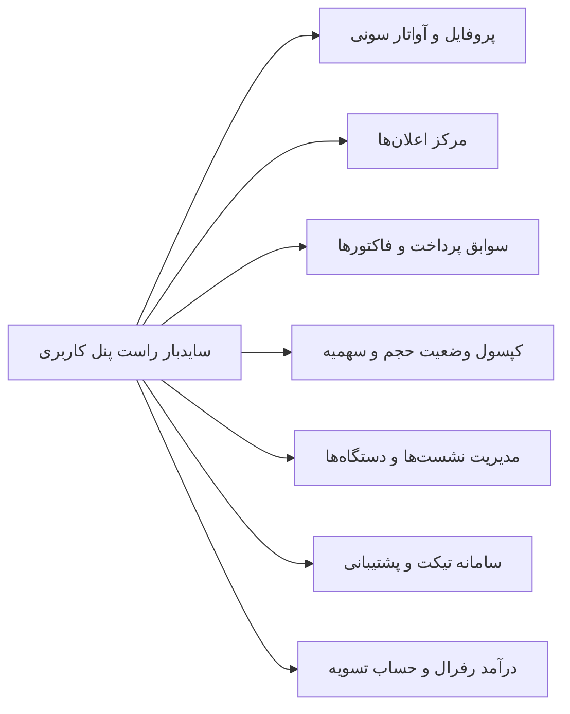

# 📘 سند جامع نیازمندی‌ها، معماری و مشخصات فنی پلتفرم دکتر گیم (DrGame Build Specification)

> **عنوان سند:** مشخصات تفصیلی، معماری بخش‌ها، جریان‌های کاربری، پنل‌ها و پایگاه داده پلتفرم دکتر گیم  
> **مرجع اصلی:** برگرفته از سند تحلیلی `build.txt` به همراه انطباق با خط‌مشی توسعه (`agent/development-policy.md`)  
> **نسخه:** ۱.۰ (آماده‌سازی برای برنامه‌ریزی استپ‌های اجرایی هوش مصنوعی)  
> **مخاطب:** ایجنت‌های هوش مصنوعی (AI Agents)، تیم‌های توسعه فرانت‌اند و بک‌اند، مهندسین تست و معمار نرم‌افزار  
> **محل قرارگیری:** `build.md` در ریشه پروژه  

---

## ۱. فهرست ساختاری بخش‌های پلتفرم (Platform Modules Breakdown)

### ۱.۱. دارایی‌های گرافیکی و نمادهای رسمی پروژه (Official Graphic Assets)
در کل پروژه، تمام ایجنت‌ها و ماژول‌ها باید منحصراً از فایل‌های گرافیکی رسمی زیر که در ریشه پروژه قرار دارند استفاده کنند:
1. **پترن پس‌زمینه سایت (`bg-pattern-dark.svg`):** پس‌زمینه وکتور سراسری پلتفرم با موتیف‌های گیمینگ و شفافیت کنترل‌شده.
2. **لوگوی اصلی دکترگیم (`logo.png`):** نشان رسمی برند در هدر، فوتر، پنل‌ها و پیش‌نمایش‌ها.
3. **آیکون‌های وکتور کنسول‌ها (`ps5.svg`, `ps4.svg`, `psvr2.svg`, `xbox360.svg`, `switch.svg`):** در تمامی دکمه‌های فیلتر، کارت‌ها، جزئیات بازی و بخش‌های انتخاب کنسول.
4. **طرح آواتارهای سونی (`121.png` و `1131.png`):** برای گالری آواتارها و بنرهای هیرو در پنل کاربری.

```mermaid
graph TD
    Root["پلتفرم دکتر گیم (DrGame Platform)"]
    Root --> Public["۱. بخش عمومی پلتفرم\n(Public Storefront)"]
    Root --> User["۲. ناحیه کاربری\n(User Dashboard)"]
    Root --> Admin["۳. ناحیه مدیریت کلان\n(Admin Panel - ایزوله)"]

    Public --> Header["هدر سراسری دو وضعیتی"]
    Public --> Footer["فوتر منعطف داخلی / بین‌المللی"]
    Public --> Home["صفحه خانه با کاروسل‌های ژانری"]
    Public --> Games["کاتالوگ جامع و فیلتر پیشرفته بازی‌ها"]
    Public --> Tools["ابزار تست دسته و آموزش جیلبریک"]
    Public --> Subs["مرکز ۴ پلن اشتراک و سهمیه"]
    Public --> Blog["مجله و مقالات گیمینگ"]

    User --> UProf["پروفایل، آواتار و بنر اختصاصی"]
    User --> UNotif["مرکز اعلان‌های سیستمی"]
    User --> UHistory["سوابق پرداخت و اشتراک‌ها"]
    User --> UQuota["کپسول وضعیت سهمیه و انقضا"]
    User --> USessions["دستگاه‌ها و سشن‌های فعال"]
    User --> UTickets["سامانه تیکتینگ و گفت‌وگو"]
    User --> UReferral["میزکار درآمد رفرال و تسویه حساب"]

    Admin --> AUsers["مدیریت کاربران و ویرایش سهمیه"]
    Admin --> AGames["مدیریت کاتالوگ و تصاویر بازی‌ها"]
    Admin --> ATaxonomy["تنظیمات دسته‌بندی و ویژگی‌ها"]
    Admin --> ASubs["تنظیمات پلن‌ها و بازی‌های رایگان"]
    Admin --> AFinance["مانیتورینگ امور مالی (ریالی / ارزی)"]
    Admin --> APayout["کارتابل تسویه پورسانت رفرال"]
    Admin --> ABanks["تایید شماره حساب‌های بانکی"]
    Admin --> ATickets["مدیریت و پاسخ‌گویی به تیکت‌ها"]
    Admin --> ADiscounts["سیستم کدهای تخفیف"]
```

---

## ۲. بخش عمومی سایت (Public Storefront)

### ۲.۱. هدر سراسری سایت (Global Header)
هدر سایت به صورت شناور (Sticky) با پس‌زمینه شیشه‌ای بلورین (`backdrop-filter: blur(16px)`) در بالای تمامی صفحات نمایش داده می‌شود:

* **سمت راست هدر (Right Section - در حالت RTL):**
  1. دکمه **«بازی‌ها»** به همراه آیکون گیم‌پد (هدایت به کاتالوگ بازی‌ها `/games`).
  2. دکمه **«ابزار»** به همراه آیکون آچار/کنترلر (هدایت به هاب ابزارها `/tools`).
  3. دکمه **«مقالات»** به همراه آیکون کتاب/روزنامه (هدایت به مجله `/blog`).
* **مرکز هدر (Center Section):**
  - نشان تجاری لوگوی دکتر گیم (آیکون بنفش نئونی با درخشش) همراه با تایپوگرافی رسمی **DrGame**.
* **سمت چپ هدر (Left Section - در حالت RTL):**
  1. **وضعیت احراز هویت:**
     - *در صورت عدم ورود:* دکمه درخشان **«ورود / ثبت‌نام»** (باز شدن مودال یا هدایت به `/auth/login`).
     - *در صورت لاگین بودن:* آیکون پروفایل کاربر (نمایش آواتار دایره‌ای با حاشیه بنفش و کلیک برای رفتن به داشبورد `/dashboard`).
  2. **وضعیت اشتراک:**
     - *در صورت لاگین بودن و داشتن اشتراک فعال:* نمایش عنوان اشتراک فعال (مثلاً `طلایی` یا `نقره‌ای`) با رنگ مربوط به همان سطح، لینک شده به صفحه اشتراک‌ها.
     - *در صورت عدم ورود یا نداشتن اشتراک:* دکمه **«خرید اشتراک»** با گرادینت کهکشانی و لینک مستقیم به صفحه پلن‌ها (`/subscriptions`).
  3. **دکمه اعلان‌ها:** زنگوله اعلان با بج قرمز/بنفش تعداد اعلان‌های خوانده‌نشده (کلیک برای باز شدن پنل سریع اعلان‌ها).
  4. **دکمه سوئیچ زبان:** تغییر وضعیت بین فارسی (`FA`) و انگلیسی (`EN`) با پرچم یا برچسب متنی (تغییر کل ساختار سایت به `LTR` در صورت انتخاب انگلیسی).

---

### ۲.۲. فوتر منعطف دوگانه (Dual Dynamic Footer)
برای ارائه یکپارچه خدمات به کاربران داخل ایران و کاربران خارجی، دو ساختار فوتر پیاده‌سازی شده است. در نسخه دمو و محیط تست، یک **دکمه سوئیچ دستی** در فوتر برای تغییر بین دو حالت تعبیه شده است؛ اما در نسخه نهایی، ساختار فوتر به صورت خودکار بر اساس لوکیشن جغرافیایی (GeoIP) یا در صورت عدم دسترسی از روی IP کلاینت تعیین می‌گردد:

| المان‌های فوتر | مدل ۱: فوتر کاربران داخلی (ایران) | مدل ۲: فوتر کاربران بین‌المللی (خارج از کشور) |
| :--- | :--- | :--- |
| **لوگوی درگاه پرداخت** | لوگوی پلیس‌هولدر شاپرک / درگاه‌های بانکی داخلی (زیبال، زرین‌پال و...) | لوگوی پلیس‌هولدر ویزا، مسترکارت، استرایپ یا کریپتو |
| **مجوزهای قانونی** | لوگوی پلیس‌هولدر نماد اعتماد الکترونیکی (اینماد) و ساماندهی | فاقد اینماد (حذف نمادهای داخلی) |
| **اطلاعات تماس** | شماره تلفن پشتیبانی رسمی + آدرس فیزیکی دفتر شرکت | صرفاً آدرس ایمیل پشتیبانی بین‌المللی |
| **برندینگ** | لوگوی رسمی دکتر گیم با شعار فارسی | لوگوی رسمی دکتر گیم با شعار انگلیسی |
| **شبکه‌های اجتماعی** | لینک مستقیم کانال تلگرام و پیج اینستاگرام با آیکون اختصاصی | لینک تلگرام، اینستاگرام، دیسکورد و ایکس (توییتر) |
| **دسترسی سریع** | لینک‌های سریع عینا مطابق هدر (بازی‌ها، ابزارها، مقالات، اشتراک‌ها) | لینک‌های سریع با عناوین انگلیسی |

---

### ۲.۳. ساختار صفحه اصلی (Homepage Architecture)
صفحه اصلی از بخش‌های پیوسته و هوشمند زیر تشکیل شده است:

1. **کارت خلاصه درآمد رفرال (Referral Banner Widget):**
   - *شرط نمایش:* منحصراً در صورتی که کاربر وارد حساب خود شده باشد نمایش داده می‌شود.
   - *محل قرارگیری:* در بالاترین نقطه صفحه اصلی، دقیقاً **بالای بنر هیرو اصلی**.
   - *محتوا:* نمایش درآمد کل کسب‌شده، موجودی کیف پول، کد رفرال اختصاصی کاربر (با دکمه کپی سریع)، و لینک هدایت به داشبورد رفرال.
2. **بنر اصلی هیرو (Hero Showcase Banner):**
   - طراحی سینمایی الهام‌گرفته از کد تصویر `1131.png` با پس‌زمینه عریض پوستر بازی روز، تگ پلتفرم، عنوان تماشایی، دکمه بنفش اکشن و خلاصه‌ای جذاب.
3. **بخش بازی‌های مورد علاقه من (User Wishlist Highlights):**
   - *شرط نمایش:* در صورت لاگین بودن کاربر نمایش داده می‌شود.
   - *محتوا:* ۵ بازی آخر اضافه شده به لیست علاقه‌مندی‌های کاربر به همراه دکمه «بیشتر» با لینک به صفحه ویش‌لیست در پنل کاربری.
4. **کاروسل ۵ بازی تازه منتشر شده (New Releases):**
   - ۵ بازی جدید بر اساس تاریخ انتشار رسمی (`released`) با دکمه هدایت به کاتالوگ همراه با اعمال فیلتر سورت تاریخ.
5. **سکشن ۵ بلاگ برتر آموزشی (Top 5 Tutorial Blogs):**
   - **محل دقیق:** طبق دستور، دقیقاً **بین سکشن ۴ (بازی‌های تازه) و سکشن ۵ (بازی‌های دو نفره)** قرار می‌گیرد.
   - کارت مقالات همراه با پوستر، عنوان، تگ آموزشی، و دکمه «بیشتر» که به بخش مقالات با فیلتر دسته‌بندی آموزش لینک می‌شود.
6. **کاروسل ۵ بازی پرلایک دو نفره / دو دسته (Top 2-Player Local Co-op Games):**
   - بازی‌های محبوب که از حالت بازی همزمان با دو کنترلر روی یک کنسول پشتیبانی می‌کنند + دکمه بیشتر به کاتالوگ با فیلتر دو نفره.
7. **کاروسل‌های ۵تایی بازی‌های پرلایک به تفکیک ژانرها:**
   - ۵ بازی پرلایک در ژانر **اکشن ماجراجویی (Action-Adventure)**
   - ۵ بازی پرلایک در ژانر **مبارزه‌ای (Fighting)**
   - ۵ بازی پرلایک در ژانر **ترسناک (Horror)**
   - ۵ بازی پرلایک در ژانر **ایندی و مستقل (Indie)**
   - ۵ بازی پرلایک در ژانر **مهمانی و پارتی (Party)**
   - ۵ بازی پرلایک در ژانر **پلتفرمر و معمایی (Platformer & Puzzle)**
   - ۵ بازی پرلایک در ژانر **نقش‌آفرینی (RPG)**
   - ۵ بازی پرلایک در ژانر **شوتر (Shooter)**
   - ۵ بازی پرلایک در ژانر **ورزشی و مسابقه‌ای (Sports & Racing)**
   - ۵ بازی پرلایک در ژانر **استراتژی (Strategy)**
   - ۵ بازی پرلایک در ژانر **بقا و جهان‌باز (Survival & Open World)**
   - ۵ بازی پرلایک دارای قابلیت **واقعیت مجازی (VR Support)**

---

### ۲.۴. بخش کاتالوگ و جزئیات بازی‌ها (Games Catalog & Details)

#### ۲.۴.۱. فیلتربار و نوار وضعیت کاتالوگ
صفحه `/games` از چیدمان استاندارد زیر پیروی می‌کند:
* **نوار ابزار بالا:**
  - نوار جستجوی کپسولی Live Search برای سرچ آنی عنوان، ژانر یا استودیو.
  - **نوار سهمیه کاربر (Quota Status Bar):** در صورت ورود کاربر و داشتن اشتراک فعال، حجم کل اشتراک، حجم باقیمانده و درصد مصرفی نمایش داده می‌شود.
* **سایدبار فیلترها (سمت راست در حالت فارسی):**
  1. فیلتر ژانرهای مختلف (اکشن، نقش‌آفرینی، ترسناک و...).
  2. فیلتر پلتفرم‌ها همراه با آیکون اختصاصی:
     - پلی‌استیشن ۵ (`ps5.svg`)
     - پلی‌استیشن ۴ (`ps4.svg`)
     - ایکس‌باکس (`xbox360.svg`)
     - نینتندو سوییچ (`switch.svg`)
  3. اسلایدر یا بازه حجم بازی (مثلاً از ۰ تا ۱۵۰ گیگابایت).
  4. بازه امتیاز بازی (امتیاز کاربران و نمره متاکریتیک).
  5. وضعیت انتشار (منتشر شده، به زودی و...).
  6. حالت بازی: تفکیک تک‌نفره (تک دسته) یا دونفره/چندنفره (دو دسته / چند دسته). بازی‌هایی که در داده‌های RAWG دارای برچسب `co-op` یا `multiplayer` هستند مستقیماً در این فیلتر قرار می‌گیرند.
  7. قابلیت واقعیت مجازی (VR Support): فیلتر بازی‌های دارای تگ `vr` یا پلتفرم‌های واقعیت مجازی سونی (`PlayStation VR` / `PSVR2`).

#### ۲.۴.۲. ساختار کارت‌های بازی (Game Card Design)
* **ابعاد و نسبت:** کارت‌ها با نسبت ابعاد **۳ در ۴ عمودی** به صورت مستطیل استاندارد کاور کنسول‌های بازی طراحی می‌شوند.
* **عناصر روی کارت:** تصویر باکیفیت کاور بازی، نشان پلتفرم، عنوان بازی، امتیاز متاکریتیک، حجم دانلود و دکمه واضح «جزئیات بیشتر».

#### ۲.۴.۳. صفحه اختصاصی جزئیات بازی (Game Detail View)
مسیر `/games/[id]` شامل بخش‌های ساختاریافته زیر است:
1. **هیرو بنر سینمایی:**
   - پس‌زمینه محو پوستر بازی با گرادینت تاریک کهکشانی.
   - پوستر باکیفیت اصلی بازی، عنوان کامل فارسی و انگلیسی.
   - تگ‌های دسته‌بندی و رده‌بندی سنی (مانند PEGI 18 یا ESRB M).
   - دکمه بنفش درخشان **«دانلود بازی»** که با کلیک، صفحه را به نرمی (Smooth Scroll) به سمت باکس دانلود هدایت می‌کند.
   - **دکمه‌های لایک (سبز نئونی) و دیس‌لایک (قرمز نئونی):**
     - *قانون دسترسی:* منحصراً برای **کاربران لاگین‌کرده** فعال است؛ کلیک کاربران مهمان پیام هدایت به فرم ورود را نمایش می‌دهد.
     - *رفتار تاگل (Toggle):* با کلیک مجدد روی لایک، رای پس گرفته می‌شود. در صورت کلیک روی دیس‌لایک، لایک قبلی خنثی شده و دیس‌لایک ثبت می‌گردد.
   - دکمه **«افزودن به علاقه‌مندی‌ها» (Wishlist)** با آیکون قلب و نمایش تعداد کاربرانی که بازی را ذخیره کرده‌اند (ویژه کاربران لاگین‌کرده).
2. **گالری تصاویر گیم‌پلی:** کاروسل و اسلایدر شیشه‌ای اسکرین‌شات‌های 4K و تریلرهای بازی.
3. **توضیحات و جزئیات بازی:** جدول مشخصات فنی، تاریخ انتشار، پلتفرم‌ها و زبان‌های پشتیبانی‌شده.
4. **داستان کامل بازی (Lore & Storyline):** متن غنی تشریح داستان و دنیای بازی به زبان فارسی روان.
5. **ویژگی‌های فنی و امتیازات:** فیدبک لمسی دوئل‌سنس، صدای سه‌بعدی، حجم خالص دیتا و گرافیک.
6. **مشخصات استودیو و کمپانی:** نام ناشر، استودیو سازنده و فهرست جوایز رسمی کسب‌شده توسط بازی.
7. **باکس دانلود داینامیک اشتراکی (Dynamic Download Hub):**
   - شامل ۵ بخش دانلود تفکیک‌شده:
     1. دانلود دیتای اصلی بازی (Game Base PKG / Files)
     2. بسته‌های الحاقی (DLCs)
     3. فایل زیرنویس فارسی اختصاصی (Subtitles)
     4. فایل صوتی دوبله فارسی (Dubbing)
     5. ترینر و کدهای تقلب (Cheats / Modded Saves)
   - **قانون طلایی دسترسی:** فعال یا غیرفعال بودن هر دکمه به سطح اشتراک کاربر بستگی دارد. اگر اشتراک کاربر اجازه دانلود آیتمی (مانند DLC یا زیرنویس در پلن برنز) را ندهد، دکمه به رنگ خاکستری غیرفعال درآمده و با کلیک پیام ارتقای اشتراک نمایش داده می‌شود.
   - **مکانیسم کسر سهمیه دانلود (Quota Deduction Flow):** کسر حجم سهمیه **تحت اکشن مستقیم کلیک کاربر در فرانت‌اند رخ نمی‌دهد**؛ بلکه سیستم دانلود از طریق یک سرویس خارجی (Download Proxy / Server / CDN) پردازش شده و پس از انتقال موفق دیتا، سرویس خارجی یک وب‌هوک/ریکوئست امن به اندپوینت داخلی بک‌اند ارسال کرده و حجم دقیق مصرف‌شده از سهمیه کاربر کسر می‌گردد.
8. **پیشنهاد بازی‌های مشابه:** نمایش ۵ بازی پرلایک دارای تگ‌ها و سبک مشابه با بازی در انتهای صفحه.

---

### ۲.۵. بخش ابزارها (Tools Hub)
مسیر `/tools` شامل دو ابزار اصلی با دکمه‌ها و پوسترهای بزرگ است:
1. **ابزار تست سلامت دسته (Gamepad Tester):**
   - سامانه تعاملی تست کلیدها، شوکرها، تریگرهای L2/R2، لرزش (Vibration)، و ژیروسکوپ دسته‌های PS4 و PS5 از طریق Gamepad API مرورگر (سورس در `source/gamapad-test/`).
2. **بخش و راهنمای جیلبریک کنسول (PS Jailbreak Hub):**
   - راهنمای گام‌به‌گام تصویری جیلبریک کنسول.
   - کاربر آدرس DNS اختصاصی سرور دکتر گیم را در تنظیمات شبکه کنسول وارد می‌کند.
   - در کنسول وارد بخش User's Guide (راهنمای کاربر) شده و به همین صفحه منتقل می‌شود.
   - با زدن دکمه بزرگ **«جیلبریک (Jailbreak)»** پی‌لود مربوط به نسخه فریمور کنسول فعال و دستگاه کپی‌خور می‌شود.

---

### ۲.۶. مرکز پلن‌های اشتراک (Subscription Tiers)
مسیر `/subscriptions` شامل ۴ کارت بزرگ مقایسه‌ای کنار هم با نمایش آیکون‌های وکتور نمادهای پلی‌استیشن در پس‌زمینه کارت‌ها است. تمامی اشتراک‌ها اعتبارزمانی **یک‌ماهه (۳۰ روزه)** دارند:

| مشخصه / پلن | 🥉 پلن برنز (Bronze) | 🥈 پلن نقره‌ای (Silver) | 🥇 پلن طلایی (Gold) | 🆓 پلن رایگان (Free) |
| :--- | :--- | :--- | :--- | :--- |
| **سهمیه دانلود ماهیانه** | ۵۰۰ گیگابایت | ۱ ترابایت (۱۰۰۰ گیگابایت) | ۲.۲ ترابایت (۲۲۰۰ گیگابایت) | نامحدود برای ۵ بازی مجاز |
| **سرعت دانلود** | حداکثر سرعت | حداکثر سرعت | حداکثر سرعت و اولویت پهنای باند | سرعت استاندارد |
| **پلتفرم‌های مجاز** | منحصراً PS4 و PS5 | کنسول‌های PS3 تا PS5 | تمامی نسل‌ها (PS1 تا PS5، نینتندو و ایکس‌باکس) | ۵ بازی منتخب سیستمی |
| **دانلود زیرنویس و DLC** | ❌ عدم دسترسی | ✅ امکان دانلود زیرنویس و DLC | ✅ دسترسی کامل به زیرنویس و DLC | ❌ عدم دسترسی |
| **تم‌های کنسول پلی‌استیشن** | ❌ ندارد | ❌ ندارد | ✅ امکان خرید و فعال‌سازی تم‌ها | ❌ ندارد |
| **نحوه نمایش ویژگی‌ها** | چک‌لیست با تیک و ضربدر | چک‌لیست با تیک و ضربدر | چک‌لیست با تیک و ضربدر | صرفاً لیست ۵ بازی رایگان فعال |
| **رنگ تم کارت** | برنز / کهربایی نئونی | نقره‌ای / سفید متالیک | طلایی نئونی درخشان | خاکستری / سنگی مات |

---

### ۲.۷. بخش وبلاگ و اخبار (Blog & Gaming News)
* **لیست مقالات (`/blog`):**
  - فیلتربار در سمت راست (دسته‌بندی‌ها: آموزش، اخبار، نقد و بررسی، جدیدترین و داغ‌ترین مقالات).
  - چیدمان گرید ۳ ستونه از کارت‌های عمودی با نسبت ابعاد **۵ در ۶**.
  - هر کارت شامل: عکس اصلی مقاله، عنوان جذاب، تگ‌های دسته‌بندی، تاریخ انتشار شمسی/میلادی، ۵۰ کاراکتر اول متن مقاله و دکمه «مطالعه مقاله».
* **صفحه جزئیات مقاله (`/blog/[id]`):**
  - متن کامل با پشتیبانی از مارک‌داون، تصاویر باکیفیت و ویدیوها.
  - دکمه‌های بازخورد لایک سبز و دیس‌لایک قرمز به همراه آمار دقیق لایک‌ها.

---

## ۳. ناحیه کاربری (User Dashboard)

معماری رابط کاربری داشبورد در مسیر `/dashboard` به صورت **سایدبار ناوبری جمع‌شونده در سمت راست (در تم فارسی)** و پنل نمایش محتوا در سمت چپ طراحی شده است:

### ۳.۱. اطلاعات پروفایل کاربری (Profile Settings)
* بنر عریض هیرو در بالای پروفایل به همراه آواتار دایره‌ای کاربر.
* **قابلیت شخصی‌سازی طبق طرح `121.png`:** کاربر می‌تواند هیرو بنر و آواتار خود را از میان گالری طرح‌های رسمی آماده سونی (پلی‌استیشن) انتخاب کرده یا تصویر دلخواه خود را آپلود نماید.
* فرم ویرایش مشخصات فردی (نام کامل، شماره موبایل، ایمیل و کلمه عبور).

### ۳.۲. مرکز اعلان‌های کاربری (Notification Center)
* فهرست اعلان‌های سیستمی، اطلاعیه‌های تمدید اشتراک و تراکنش‌ها.
* قابلیت حذف اعلان، علامت‌گذاری به عنوان خوانده‌شده به صورت تکی یا دسته‌جمعی.
* کلیک روی هر اعلان یک مودال اختصاصی باز کرده، متن کامل پیام را نشان داده و وضعیت آن را خودکار به «خوانده‌شده» تغییر می‌دهد.

### ۳.۳. سوابق اشتراک و پرداخت‌ها (Payment & Subscription History)
* جدول جامع خریدهای قبلی شامل: تاریخ خرید، عنوان پلن، کد پیگیری تراکنش، درگاه پرداختی، و مبلغ پرداخت‌شده.
* کلیک روی هر ردیف، مودال فاکتور رسمی الکترونیکی را همراه با ریز جزئیات و تخفیف‌ها باز می‌کند.

### ۳.۴. وضعیت پلن و سهمیه دانلود (Current Plan & Quota Status)
* کارت ویجت پیشرفته شامل: حجم کل پلن، حجم مصرف‌شده تا این لحظه، حجم باقیمانده، و تاریخ دقیق انقضای پلن.
* دکمه اقدام سریع جهت ارتقا یا تمدید اشتراک که مستقیماً به صفحه پلن‌ها هدایت می‌کند.

### ۳.۵. نشست‌ها و دستگاه‌های متصل (Active Login Sessions)
* پایش زنده دستگاه‌هایی که به این حساب وارد شده‌اند با تفکیک User-Agent دقیق (مرورگر کنسول PS4/PS5، موبایل، ویندوز و...).
* نمایش تاریخ و ساعت ورود، آی‌پی، و وضعیت فعلی اتصال.
* کلیک روی دستگاه، مودال جزئیات دستگاه را باز می‌کند و دکمه **«خروج از این دستگاه (Revoke Session)»** امکان سلب دسترسی سشن را فراهم می‌سازد.

### ۳.۶. سامانه پشتیبانی و تیکتینگ (Support Tickets)
* فهرست تیکت‌های ثبت‌شده با فیلتر موضوعی و فیلتر وضعیت (در انتظار پاسخ، پاسخ داده شده، بسته شده).
* کلیک روی هر تیکت، مودال تاریخچه چت دوطرفه کاربر و تیم پشتیبانی را باز کرده و امکان ارسال پاسخ جدید یا ضمیمه کردن فایل را فراهم می‌کند.

### ۳.۷. میزکار کسب درآمد رفرال (Referral Program Hub)
بر اساس متدولوژی کسب‌وکار و الگوریتم کامل در `source/referral/SYSTEM-PROPOSAL-FA.md`:
* **نمایش لینک و کد رفرال اختصاصی:** در بالاترین بخش صفحه با دکمه کپی آسان و QR Code جهت معرفی سریع.
* **کارت‌های آماری مالی:** نمایش درآمد کل حاصل از کمیسیون‌ها، موجودی فعال و قابل برداشت کیف پول، و مجموع مبالغ تسویه‌شده پیشین.
* **جدول تاریخچه تراکنش‌ها:** لیست تراکنش‌های کیف پول با صفحه‌بندی (Pagination)، تاریخ، مبلغ سهم کاربر از خرید اشتراک زیرمجموعه و شناسه فروش.
* **نمایش بصری درخت و سطوح رفرال:** مشاهده مستقیم شبکه زیرمجموعه‌ها (فرمول تسهیم سهمیه: ۵۰٪ معرف مستقیم، ۲۵٪ معرف دوم، ۱۲.۵٪ معرف سوم و نصف شدن متوالی در لایه‌های بالاتر).
* **مدیریت اطلاعات و متدهای تسویه‌حساب (Dual Settlement):**
  - **کاربران داخلی (ریالی):** ثبت شماره شبا (با پیش‌شماره IR)، شماره کارت ۱۶ رقمی، نام و نام خانوادگی صاحب حساب و نام بانک.
  - **کاربران بین‌المللی (ارزی / کریپتو):** ثبت آدرس کیف پول رمزارز (Crypto Wallet Address نظیر USDT TRC20 / ERC20) و نوع شبکه جهت انتقال بدون مرز.
  - *وضعیت تایید:* رکورد ثبت‌شده در ابتدا وضعیت «در انتظار تایید» دارد و پس از بازبینی ادمین در پنل مدیریت، به وضعیت «فعال» تغییر می‌یابد.
* **ثبت درخواست برداشت وجه:** کاربر با انتخاب حساب تاییدشده، مبلغ درخواستی را از موجودی کیف پول ثبت کرده و فرآیند تسویه در کارتابل ادمین قرار می‌گیرد.

---

## ۴. ناحیه مدیریت کلان سیستم (Admin Panel)

پنل ادمین در یک حوزه کاملاً ایزوله با جدول پایگاه داده مجزا (`admins`)، لاگین مستقل و توکن‌های دسترسی با سطح اختیارات بالا توسعه می‌یابد. چیدمان شامل سایدبار تاشو در سمت راست و صفحه کاری در سمت چپ است:

### ۴.۱. مدیریت کاربران (User Management)
* جدول کاربران با قابلیت جستجو، فیلتر بر اساس داشتن یا نداشتن اشتراک فعال، ویرایش اطلاعات، غیرفعال‌سازی یا حذف حساب.
* **مودال پرونده کاربر:** مشاهده مشخصات کامل، کد رفرال، سوابق اشتراک‌ها، تاریخچه پرداخت‌ها، وضعیت کیف پول رفرال، و **قابلیت افزودن یا ویرایش دستی سهمیه حجم کاربر توسط ادمین**.

### ۴.۲. مدیریت کاتالوگ بازی‌ها (Game Catalog Management)
* مدیریت چرخه کامل (CRUD) بازی‌ها، افزودن و مرتب‌سازی تصاویر گیم‌پلی، مدیریت لینک‌های دانلود ۵ تکه (دیتا، DLC، زیرنویس، دوبله، چیت).
* فیلتربندی مشابه کاتالوگ عمومی سایت به همراه صفحه اختصاصی ویرایش جزئیات بازی.

### ۴.۳. پیکربندی ویژگی‌های داینامیک بازی‌ها (Taxonomy & Attributes)
* ماژول CRUD برای مدیریت دسته‌بندی‌ها، ژانرها، پلتفرم‌ها، برچسب‌های کنترلر (تک دسته / دو دسته)، و وضعیت‌های انتشار.

### ۴.۴. مدیریت پلن‌های اشتراک (Subscription Management)
* ویرایش سهمیه، سرعت، پلتفرم‌ها، قیمت و تخفیف پلن‌های ۴گانه.
* **مدیریت بازی‌های پلن رایگان:** بخش اختصاصی برای انتخاب، افزودن یا حذف ۵ بازی مجاز در اشتراک رایگان به صورت کاملاً پویا.

### ۴.۵. مدیریت اشتراک‌های فعال کاربران (User Subscriptions Registry)
* جدول کل اشتراک‌های فعال کاربران در سراسر سیستم به همراه مودال ویرایش زمان انقضا و وضعیت ابطال یا تمدید.

### ۴.۶. مانیتورینگ تراکنش‌ها و امور مالی (Financial Monitoring)
* کارتابل مانیتورینگ صرف (فقط خواندنی بدون امکان تغییر دستی) برای شفافیت مالی سیستم.
* تفکیک دقیق پرداخت‌های ریالی (درگاه‌های داخلی) و پرداخت‌های ارزی (کاربران خارجی).
* نمایش وضعیت تراکنش‌ها، سرجمع درآمدهای دوره‌ای و مودال مشاهده جزئیات پرداخت بانکی.

### ۴.۷. کارتابل درخواست‌های تسویه رفرال (Referral Payout Requests)
* مدیریت درخواست‌های برداشت وجه کاربران از کیف پول رفرال با وضعیت‌های: در انتظار بررسی، تایید شده، واریز شده، یا رد شده به همراه مودال ثبت فیش واریزی.

### ۴.۸. اعتبارسنجی حساب‌های بانکی کاربران (Bank Account Verification)
* کارتابل بررسی شماره شبا و حساب‌های ثبت‌شده توسط کاربران جهت فعال‌سازی و تایید پیش از تسویه‌حساب.

### ۴.۹. مدیریت تیکت‌های پشتیبانی (Ticket Management)
* کارتابل تیکت‌های دریافتی، فیلتر وضعیت پاسخ، و مودال ارسال پاسخ برای کاربر و بستن تیکت.

### ۴.۱۰. مدیریت کدهای تخفیف (Discount Codes Engine)
* سامانه CRUD کدهای تخفیف با امکان تعیین: درصد تخفیف، سقف مبلغ، تاریخ انقضا، محدودیت تعداد استفاده، و تخصیص کد تخفیف به کاربران مجاز خاص.

---

## ۵. ویژگی‌های عملکردی، امنیت، سرویس‌های خارجی و داده‌ها (Technical Specifications)

### ۵.۱. سیستم دو زبانه کامل (Bilingual Architecture - FA / EN)
* تمامی کامپوننت‌ها و بخش‌های سیستم با ساختار دو زبانه طراحی شده و به محض تغییر زبان به انگلیسی:
  - جهت صفحه از راست‌چین (`RTL`) به چپ‌چین (`LTR`) آینه‌وار (Mirror) تغییر می‌یابد.
  - تمامی فیلترها و سایدبارها به سمت چپ منتقل می‌شوند.
  - محتوا، متون، برچسب‌ها و عناوین به زبان انگلیسی لود می‌گردند.

### ۵.۲. فرآیند ثبت‌نام و ورود سه‌گانه (Authentication Flows)
1. **ثبت‌نام کاربران:**
   - ثبت‌نام با شماره تلفن همراه یا ایمیل.
   - ارسال کد تایید یکبار مصرف (OTP) پیامکی یا ایمیلی جهت احراز شماره/ایمیل.
   - ثبت نام و نام خانوادگی، نام کاربری منحصر‌به‌فرد (`username`) و رمز عبور امن (Bcrypt).
2. **ورود کاربران (۳ روش):**
   - **روش ۱ (ورود بدون رمز با OTP):** ارسال کد یکبار مصرف به شماره موبایل یا ایمیل ثبت‌شده و ورود آنی.
   - **روش ۲ (ورود متداول):** ورود با نام کاربری و رمز عبور.
   - **روش ۳ (ورود اختصاصی کنسول با کد دائمی ۷ رقمی - Console Quick Auth):**  
     - *مکانیسم:* هر کاربر پس از ورود به حساب خود در موبایل یا دسکتاپ، در بخش پروفایل کاربری یک **کد یکتای ثابت ۷ رقمی (متشکل از حروف و اعداد انگلیسی)** مشاهده می‌کند.
     - *تشخیص هوشمند کنسول:* فرم ورود با این کد ۷ رقمی **منحصراً زمانی نمایش داده می‌شود که User-Agent درخواست، مرورگر کنسول بازی (مانند PlayStation 4 / PlayStation 5 Browser) باشد**.
     - *تجربه کاربری:* کاربر پشت تلویزیون به جای تایپ سخت ایمیل و رمز طولانی با کنترلر، صرفاً این کد کوتاه ۷ رقمی را با کیبورد مجازی کنسول وارد کرده و بلافاصله احراز هویت می‌شود.

### ۵.۳. فرآیند پرداخت و تسویه‌حساب (Checkout Flow)
* در نسخه جاری تا زمان اتصال رسمی درگاه‌های بانکی، کاربر پس از انتخاب اشتراک به صفحه `/checkout` می‌رود.
* امکان اعمال کد تخفیف، بررسی سلامت کد، و بازنگری آنی قیمت کل وجود دارد.
* با فشردن دکمه پرداخت، اشتراک به صورت شبیه‌سازی‌شده فعال گشته و وضعیت سهمیه کاربر شارژ می‌گردد.

### ۵.۴. زبان طراحی و هویت بصری (Design Language & Theme)
* برگرفته از سیستم طراحی کهکشانی پوشه `source/figma/`:
  - **تم تاریک اولد (Dark OLED):** پس‌زمینه `#070709`، کارت‌های شیشه‌ای بلورین `#101116` با شفافیت ۸۰٪ (`backdrop-filter: blur(16px)`).
  - **رنگ‌های تاکید کهکشانی:** بنفش `#7C3AED`، بنفش نئونی هاور `#A855F7` و درخشش‌های کهکشانی `box-shadow: 0 0 20px rgba(139, 92, 246, 0.45)`.
  - **استاندارد رابط کاربری ۱۰ فوتی (10-Foot UI):** پشتیبانی کامل از گیم‌پد و D-Pad برای تلویزیون ۶۰ اینچ.

### ۵.۵. موتور جمع‌آوری و همگام‌سازی دیتای بازی‌ها از RAWG API
* **کلید معتبر API:**  
  `rawg api key: 91c0c1c9c30c4796bbff63a7471fdfdd`
* **مستندات مرجع:** فایل `reports/rawg.json` حاوی شِمای کامل OpenAPI 2.0.
* **فاز ۱ (مقداردهی اولیه - Initial Seed):**
  - استخراج دیتای کامل ۵۰۰ الی ۶۰۰ بازی محبوب پلی‌استیشن به همراه تصاویر، رتبه‌ها، استودیوها و متادیتا.
  - واکشی و ثبت کامل فهرست ژانرها (`/genres`) در دیتابیس لوکال.
* **فاز ۲ (همگام‌سازی روزانه - Daily Cron Sync):**
  - اجرای کرون‌جاب خودکار یک‌بار در روز (Daily Scheduler) جهت استعلام بازی‌های جدید، به‌روزرسانی رتبه‌ها و همگام‌سازی در دیتابیس با کشینگ فعال ردیس.

