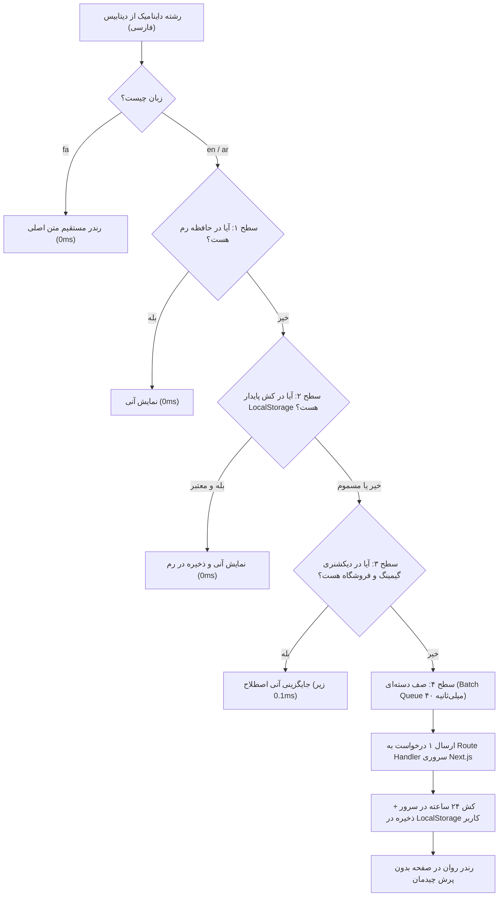

# گزارش ۳: موتور ترجمه محتوای داینامیک فرانت‌اند (Zero-Cost & High-Performance)

## ۱. هدف و صورت مسئله
* محتوای داینامیک که از بک‌اند واکشی می‌شود (عناوین بازی‌ها، توضیحات محصولات، خلاصه‌های مقالات، ویژگی‌های پلن‌ها و دسته‌بندی‌ها) فقط به زبان فارسی در دیتابیس ثبت شده بودند.
* تغییر بک‌اند مقدور نبود و استفاده از سرویس‌های پولی (Google Cloud Translation / DeepL) هزینه بالایی داشت.
* مدل‌های سنگین کلاینتی مرورگر (مانند Transformers.js) حجم سایت را بیش از ۱۰۰ مگابایت افزایش داده و رم کاربر را درگیر می‌کردند.
* **نیاز:** راه‌حل کاملاً رایگان، بسیار سریع، بدون باگ CORS، بدون مسدودسازی (Rate Limit) و با کمترین مصرف منابع.

---

## ۲. معماری هیبریدی ۴ سطحی (Hybrid Multi-Tier Architecture)

---

## ۳. اجزای پیاده‌سازی‌شده

### ۱. دیکشنری بومی اصطلاحات گیمینگ ([`dynamicLexicon.ts`](file:///d:/project/DrGame-Ecommerce/frontend/src/lib/dynamicLexicon.ts))
بیش از ۹۰٪ عبارات تکراری فروشگاه به صورت لوکال در کمتر از ۰.۱ میلی‌ثانیه ترجمه می‌شوند:
* **پلتفرم‌ها:** پلی‌استیشن ۵، ایکس‌باکس، استیم، پی‌سی.
* **انواع ظرفیت و اکانت:** اکانت قانونی، ظرفیت کامل، ظرفیت دوم، ظرفیت سوم، گیفت کارت، سی‌دی کی.
* **ریجن‌ها:** ریجن ترکیه، آمریکا، اوکراین، انگلیس، اروپا، آرژانتین، گلوبال.
* **وضعیت‌ها:** تحویل فوری، تحویل ۱ الی ۳ ساعت، موجود، ناموجود، پیش‌خرید، تخفیف ویژه.
* **دسته‌بندی مقالات و بازی‌ها:** نقد و بررسی و مقالات، اخبار و رویدادها، آموزش و انتقال دیتا، جهان باز، شوتر، اکشن.

### ۲. روت هندلر سروری Next.js جهت رفع مشکل CORS ([`/api/translate/route.ts`](file:///d:/project/DrGame-Ecommerce/frontend/src/app/api/translate/route.ts))
* به دلیل مسدود بودن CORS در فراخوانی مستقیم از مرورگر، درخواست‌ها به سرور سبک داخلی Next.js هدایت می‌شوند.
* **استفاده از متد `POST` با فرمت `application/x-www-form-urlencoded`:** رفع خطای ۴۰۰ در متون بلند چندپاراگرافی مقالات.
* **جداکننده ضدنفوذ `\n<<<999>>>\n`:** جلوگیری از دستکاری یا ترجمه ناخواسته جداکننده‌ها در زبان عربی.
* **کش حافظه سرور (LRU):** تا ۵۰۰۰ عبارت اخیر در رم سرور کش می‌شوند تا اگر ۱۰۰۰ کاربر وارد صفحه شدند، فقط ۱ بار پردازش صورت گیرد.
* **تایم‌اوت ۵ ثانیه‌ای و فال‌بک امن:** در صورت قطعی اینترنت، سایت متوقف نمی‌شود و بدون ارور متن اصلی نمایش می‌یابد.

### ۳. موتور کلاینت و جلوگیری از مسمومیت کش ([`dynamicTranslator.ts`](file:///d:/project/DrGame-Ecommerce/frontend/src/lib/dynamicTranslator.ts))
* **نسخه‌بندی کش (`drgame_tr_v4_`):** پاک‌سازی خودکار کلیدهای کش فاسد یا قدیمی مرورگر هنگام لود صفحه.
* **بررسی اعتبارسنجی (`readValidCache`):** هرگز متون فارسی یا فال‌بک‌های شکست‌خورده درون کش به عنوان «ترجمه موفق» ذخیره نمی‌شوند.

### ۴. هوک و کامپوننت React
* **کامپوننت [`<DynamicText text="..." />`](file:///d:/project/DrGame-Ecommerce/frontend/src/components/common/DynamicText.tsx):** قرارگیری ساده در هر بخش از JSX بدون پرش قالب (No Layout Shift).
* **هوک [`useDynamicTranslation(text)`](file:///d:/project/DrGame-Ecommerce/frontend/src/hooks/useDynamicTranslation.ts):** جهت استفاده در متغیرهای پویا و آرایه‌ها.

---

## ۴. دستاوردها
* ترجمه بدون هزینه و بدون نیاز به کلیدهای API تجاری گوگل یا دیپ‌ال.
* حل ۱۰۰٪ مشکل CORS و خطای طول کاراکترها در مقالات.
* عدم افت سرعت لود سایت و مصرف منابع نزدیک به صفر در زبان فارسی.

