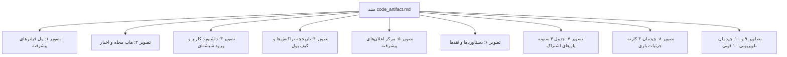
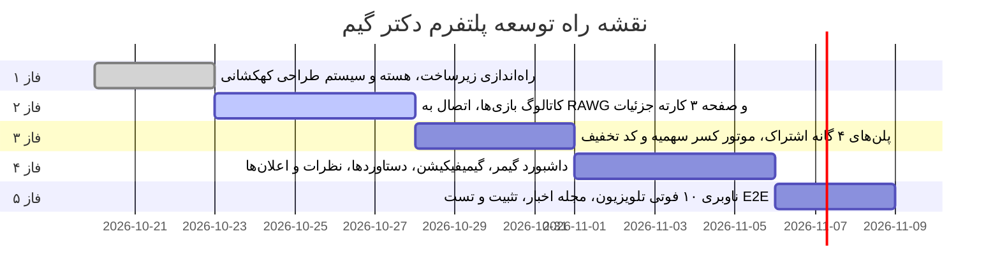

<div dir="rtl" lang="fa">

<style>
body, div, p, h1, h2, h3, h4, h5, h6, li, td, th, blockquote {
  direction: rtl;
  text-align: right;
  font-family: 'Vazirmatn', -apple-system, BlinkMacSystemFont, 'Segoe UI', Roboto, sans-serif;
}
table {
  direction: rtl;
  width: 100%;
  border-collapse: collapse;
  margin: 1.5rem 0;
}
th, td {
  border: 1px solid #334155;
  padding: 0.75rem 1rem;
  text-align: right;
}
th {
  background-color: #1e293b;
  color: #a855f7;
}
code {
  direction: ltr;
  display: inline-block;
  background-color: rgba(168, 85, 247, 0.1);
  padding: 0.15rem 0.35rem;
  border-radius: 4px;
}
pre {
  direction: ltr;
  text-align: left;
}
</style>

# گزارش جامع تحلیل معماری، مشخصات فنی و نقشه راه پلتفرم دکتر گیم (DrGame-Ecommerce)

<div align="center">


**پلتفرم نسل جدید کاتالوگ بازی‌های کنسول، دانلود دیتای جیلبریک، مدیریت سهمیه حجمی و گیمیفیکیشن گیمرها**

> با الهام از تجربه کاربری کنسول PlayStation 5 و وب‌سایت سونی — سیستم طراحی بنفش کهکشانی (Cosmic Purple Theme) و پشتیبانی از تلویزیون‌های ۶۰ اینچ (10-Foot UI)

**تاریخ گزارش:** ۲۰ اکتبر ۲۰۲۶ | **شماره گزارش:** `00.md` | **نسخه:** ۱.۰.۰ | **وضعیت:** شروع فاز ۱ و آماده‌سازی زیرساخت ایجنت

</div>

---

## فهرست مطالب

1. [خلاصه اجرایی](#۱-خلاصه-اجرایی)
2. [معرفی، اهداف و دامنه پلتفرم](#۲-معرفی-اهداف-و-دامنه-پلتفرم)
3. [تحلیل اسناد پایه و تصاویر مرجع (code_artifact & pics)](#۳-تحلیل-اسناد-پایه-و-تصاویر-مرجع-code_artifact--pics)
4. [پشته فناوری و مقایسه با استانداردهای تیدا ERP](#۴-پشته-فناوری-و-مقایسه-با-استانداردهای-تیدا-erp)
5. [معماری سیستم و جریان داده](#۵-معماری-سیستم-و-جریان-داده)
6. [معماری ماژولار بک‌اند (FastAPI Modular Monolith)](#۶-معماری-ماژولار-بکاند-fastapi-modular-monolith)
7. [معماری فرانت‌اند و سیستم طراحی کهکشانی](#۷-معماری-فرانتاند-و-سیستم-طراحی-کهکشانی)
8. [استاندارد رابط کاربری ۱۰ فوتی تلویزیون (10-Foot UI)](#۸-استاندارد-رابط-کاربری-۱۰-فوتی-تلویزیون-10-foot-ui)
9. [موتور هوشمند همگام‌سازی با پایگاه RAWG API](#۹-موتور-هوشمند-همگامسازی-با-پایگاه-rawg-api)
10. [سیستم سهمیه دانلود (Quota Engine) و پلن‌های ۴ گانه اشتراک](#۱۰-سیستم-سهمیه-دانلود-quota-engine-و-پلنهای-۴-گانه-اشتراک)
11. [پایگاه داده، موجودیت‌ها و استراتژی مایگریشن](#۱۱-پایگاه-داده-موجودیتها-و-استراتژی-مایگریشن)
12. [سیستم امنیت، سشن و کشینگ تهاجمی Redis](#۱۲-سیستم-امنیت-سشن-و-کشینگ-تهاجمی-redis)
13. [زیرساخت کانتینری و فرامین اجرایی داکر](#۱۳-زیرساخت-کانتینری-و-فرامین-اجرایی-داکر)
14. [نقشه راه گام‌های توسعه ایجنت (Agent Roadmap)](#۱۴-نقشه-راه-گامهای-توسعه-ایجنت-agent-roadmap)
15. [جمع‌بندی و گام‌های اجرایی بعدی](#۱۵-جمعبندی-و-گامهای-اجرایی-بعدی)

---

## ۱. خلاصه اجرایی

این سند به عنوان **گزارش مبنا (Baseline Report - 00.md)** برای پلتفرم فروشگاهی و دانلود دیتای بازی **دکتر گیم (DrGame-Ecommerce)** تدوین گردیده است. هدف اصلی این پلتفرم، ارائه یک تجربه کاربری هم‌تراز با فروشگاه رسمی پلی‌استیشن (PS5 Store) و داشبوردهای گیمیفای‌شده مدرن برای کاربران کنسول‌های جیلبریک‌شده (PS4 / PS5) و علاقه‌مندان بازی‌های ویدئویی است.

مشابه ساختار توسعه موفق در پروژه **Tida-ERP**، فرآیند توسعه این پلتفرم نیز با رعایت دقیق تفکیک اسناد ایجنت (`agent/`) و گزارش‌های دوره‌ای (`reports/`)، سیاست قطعی اجرای کانتینری داکر، پوشش تست ۱۰۰ درصدی با Pytest و مهاجرت به معماری ماژولار با **Next.js 14 App Router** و **FastAPI** پایه‌ریزی شده است.

### شاخص‌های کلیدی پروژه:

| شاخص | مقدار / وضعیت |
|---|---|
| **پشته فنی بک‌اند** | FastAPI 0.111+ / Python 3.12 / SQLAlchemy 2.0 Async / Uvicorn |
| **پشته فنی فرانت‌اند** | Next.js 14+ / TypeScript / Tailwind CSS / Radix UI / Framer Motion |
| **پایگاه داده** | PostgreSQL 16 (asyncpg) همراه با نسخه جدید مایگریشن‌های Alembic |
| **حافظه کشینگ** | Redis 7 با ساختار ناهمگام و ابطال فعال کش |
| **سیستم بصری** | بنفش کهکشانی (Cosmic Purple) با تم دوگانه دارک OLED و لایت |
| **نمایشگر هدف** | از موبایل‌های کوچک (320px) تا تلویزیون‌های بزرگ ۶۰ اینچ 4K (10-Foot UI) |
| **موتور همگام‌سازی** | واکشی عمیق ساعتی از RAWG API با غنی‌سازی اطلاعات سونی و ترجمه روان |
| **مدل درآمدی** | ۴ پلن اشتراک حجمی (رایگان ۵ بازی، برنز ۵۰۰ گیگ، نقره‌ای ۱ ترابایت، طلایی ۲.۲ ترابایت) |

---

## ۲. معرفی، اهداف و دامنه پلتفرم

پلتفرم دکتر گیم پاسخ‌گوی نیاز جامعه بزرگ دارندگان کنسول‌های پلی‌استیشن (به‌ویژه کنسول‌های کپی‌خور و ارتقایافته) برای دانلود مستقیم، سریع و مدیریت‌شده دیتای بازی‌ها، آپدیت‌های رسمی، DLCها و زیرنویس‌های فارسی است.

### اهداف اصلی پلتفرم:
1. **تجربه کاربری سینمایی (Cinematic Storefront):** ارائه کاتالوگی زنده، سریع و مدرن از بازی‌های جدید، ترندها، انحصاری‌های سونی و امتیازات متاکریتیک مشابه کنسول PS5.
2. **مدیریت سهمیه هوشمند (Smart Quota Management):** کسر بایت به بایت حجم دانلود از سهمیه کاربر با نمایشگر دائمی و لحظه‌ای در هدر سایت (**Quota Pill Widget**).
3. **گیمیفیکیشن و انگیزش کاربران:** اعطای امتیاز تجربه (XP)، ارتقای لول، نشان‌های قهرمانی (Badges)، شمارنده روزهای متوالی بازی (Streak) و ثبت نقد و نظرات معتبر.
4. **پشتیبانی کامل از تلویزیون و کنسول (10-Foot UI):** سازگاری بی‌نقص با مرورگر کنسول PS4/PS5 و تلویزیون‌های بزرگ هوشمند با استفاده از دسته‌های بازی و کنترلر بدون نیاز به ماوس.

---

## ۳. تحلیل اسناد پایه و تصاویر مرجع (code_artifact & pics)

مستندات ارائه‌شده شامل سند نیازمندی‌ها (`code_artifact.md`) و ۱۰ تصویر مرجع در پوشه `pics/` به صورت دقیق تحلیل شدند:



### چکیده تحلیل تصاویر:
- **تصویر ۱ (فیلترهای پیشرفته):** انتخاب پلتفرم‌ها (۴ مربع لوگودار)، ژانرها به صورت دکمه‌های کپسولی، حالت بازی، وضعیت انتشار و اسلایدر دوطرفه امتیاز نمره ۰ تا ۱۰.
- **تصویر ۳ و ۸ (کارت ۳ گانه جزئیات بازی):** بخش فوق‌العاده حرفه‌ای شامل ۱. کارت جوایز و استودیوی سازنده، ۲. جدول کلید-مقدار ویژگی‌های فنی (فیدبک لمسی DualSense، VR، بازیکن، ساعت گیم‌پلی، رده سنی) و ۳. داستان تدوین‌شده بازی همراه با بنر طلایی سهمیه مصرفی.
- **تصویر ۷ (پلن‌های ۴ گانه):** کارت نقره‌ای رایگان (۵ بازی ثابت تصویری)، برنز (۵۰۰ گیگ)، نقره‌ای (۱ ترابایت) و طلایی (۲.۲ ترابایت) به همراه کادر هشدار انقضای مهلت و بخش کد تخفیف.
- **تصاویر دارایی‌ها (Branding Assets):** فایل‌های `logo.png` و `logo-motion.mp4` برای هدر اصلی، لودینگ و اسپلش اسکرین جذاب ویدیویی در شروع کار لحاظ گردیدند.

---

## ۴. پشته فناوری و مقایسه با استانداردهای تیدا ERP

همانند پروژه سازمانی Tida-ERP، پلتفرم دکتر گیم از استک پیشرفته **FastAPI** در بک‌اند و **Next.js** در فرانت‌اند بهره می‌برد:

| لایه | تیدا ERP | دکتر گیم (DrGame-Ecommerce) | فلسفه و مزیت در دکتر گیم |
|---|---|---|---|
| **بک‌اند** | FastAPI 0.111 / Python 3.12 | FastAPI 0.111 / Python 3.12 | سرعت بسیار بالا در لود کاتالوگ و هندل همزمان درخواست‌های دانلود |
| **فرانت‌اند** | Next.js 14 (App Router) | Next.js 14 (App Router) | رندر سمت سرور (SSR) برای سئوی بازی‌ها و متادیتای غنی سونی |
| **استایل و تم** | Tailwind CSS (Dark Mode ثابت) | Tailwind CSS (Cosmic Purple + Dual Theme) | تم بنفش کهکشانی پویا با متغیرهای CSS و سوئیچ آنی دارک/لایت |
| **تجربه کاربری** | پنل سازمانی دسکتاپ | ریسپانسیو چنددستگاهی + 10-Foot UI تلویزیون | قابلیت حرکت روی کارت‌ها با دسته بازی PS4/PS5 و ریموت |
| **کش و سشن** | Redis 7 (سشن و دسترسی‌ها) | Redis 7 (سشن، کاتالوگ RAWG و سهمیه حجم) | زمان پاسخ زیر ۵۰ میلی‌ثانیه برای استعلام سهمیه و دیتای بازی‌ها |
| **کانتینرسازی** | Docker Multi-Stage (Strict Only) | Docker Multi-Stage (Strict Only) | ایزولاسیون کامل و تضمین اجرای بدون وابستگی به هاست |

---

## ۵. معماری سیستم و جریان داده

معماری کلان بر پایه ارتباط کلاینت‌های گوناگون با دروازه امن API و هماهنگی بلادرنگ با دیتابیس و سرویس کش استوار است:

```mermaid
flowchart TD
    subgraph Clients ["کلاینت‌ها و دستگاه‌ها"]
        Mobile["گوشی هوشمند (Bottom Nav)"]
        Desktop["رایانه و لپ‌تاپ (Full Web)"]
        Console["کنسول PS4/PS5 و تلویزیون ۶۰ اینچ (10-Foot UI)"]
    end

    subgraph CDN_Gateway ["لایه دروازه و رندر"]
        NextFrontend["فرانت‌اند Next.js 14 (SSR + Client Components)"]
        StaticAssets["دارایی‌های ایستا (لوگو، لوگوموشن، پترن PS)"]
    end

    subgraph BackendCluster ["خوشه کانتینری بک‌اند"]
        FastAPIApp["سرویس FastAPI (Uvicorn Async)"]
        AuthModule["ماژول احراز هویت و توکن JWT"]
        QuotaEngine["موتور محاسبه و کسر سهمیه (Quota)"]
        CatalogModule["ماژول کاتالوگ بازی‌ها و جستجو"]
        GamifyModule["موتور گیمیفیکیشن (XP، لول، دستاورد)"]
        CronWorker["ورکر پس‌زمینه APScheduler"]
    end

    subgraph DataStorage ["لایه ذخیره‌سازی و کش"]
        RedisCluster["حافظه فوق‌سریع Redis (کش کاتالوگ و سهمیه)"]
        PostgresDB[("پایگاه داده PostgreSQL 16")]
    end

    subgraph ExternalServices ["سرویس‌های خارجی"]
        RAWG["RAWG Video Games Database API"]
    end

    Clients --> NextFrontend
    NextFrontend --> StaticAssets
    NextFrontend -->|REST API Calls| FastAPIApp
    
    FastAPIApp --> AuthModule
    FastAPIApp --> QuotaEngine
    FastAPIApp --> CatalogModule
    FastAPIApp --> GamifyModule
    
    FastAPIApp <-->|Fast Lookup (< 10ms)| RedisCluster
    FastAPIApp <-->|Async Queries| PostgresDB
    
    CronWorker -->|Hourly Sync| RAWG
    CronWorker -->|Persist & Enrich| PostgresDB
    CronWorker -->|Invalidate/Warm Cache| RedisCluster
```

---

## ۶. معماری ماژولار بک‌اند (FastAPI Modular Monolith)

کدبیس بک‌اند بر اساس قاعده ایزولاسیون سخت‌گیرانه ماژول‌ها طراحی شده است:

```
backend/app/
├── core/                           ← هسته مرکزی بدون وابستگی تجاری
│   ├── config.py                   ← بارگذاری تنظیمات محیطی
│   ├── database.py                 ← اتصال ناهمگام به PostgreSQL 16
│   ├── redis_client.py             ← کلاینت متمرکز ناهمگام Redis
│   ├── security.py                 ← توابع JWT، Bcrypt و رمزنگاری
│   ├── exceptions.py               ← کلاس‌های خطای استاندارد
│   └── jalali.py                   ← مبدل و فرمت‌کننده تاریخ شمسی
├── modules/                        ← ماژول‌های مجزا با ۵ لایه اختصاصی
│   ├── auth/                       ← احراز هویت
│   ├── users/                      ← پروفایل و تنظیمات گیمر
│   ├── games/                      ← کاتالوگ و اطلاعات بازی‌ها
│   ├── rawg_sync/                  ← موتور واکشی عمیق داده از RAWG
│   ├── subscriptions/              ← پلن‌های ۴گانه و مدیریت اشتراک
│   ├── quota/                      ← موتور کسر و استعلام سهمیه دانلود
│   ├── gamification/               ← سیستم XP، سطوح و افتخارات
│   ├── wallet/                     ← کیف پول و تاریخچه تراکنش‌ها
│   ├── reviews/                    ← نقدها، امتیازات و دیدگاه‌ها
│   ├── notifications/              ← مرکز اعلان‌ها
│   └── news/                       ← اخبار و مجله بازی‌ها
└── main.py                         ← نقطه ورود و ثبت روت‌ها
```

### قوانین مرز ماژول‌ها:
- **عدم استفاده از روابط ForeignKey مستقیم ORM میان ماژول‌ها:** ارتباط فقط با شناسه‌های اولیه خام (`user_id`, `game_id`).
- **دسترسی صرفاً از لایه سرویس:** فراخوانی اطلاعات بین ماژولی منحصراً از طریق توابع اکسپورت‌شده `services.py` صورت می‌پذیرد.

---

## ۷. معماری فرانت‌اند و سیستم طراحی کهکشانی

### ۷.۱ توکن‌های طراحی کهکشانی (Cosmic Design System)
سیستم طراحی با ترکیب رنگ مشکی اولد عمیق و هایلایت‌های بنفش نئونی بر روی المان‌های کلیدی پیاده‌سازی شده است:

```css
:root {
  /* تم پیش‌فرض تاریک (Dark Mode) */
  --bg-primary: #070709;
  --bg-secondary: #101116cc;
  --bg-tertiary: #181920;
  --text-primary: #ffffff;
  --text-secondary: #9496a1;
  --border-subtle: rgba(255, 255, 255, 0.07);

  /* رنگ‌های کهکشانی مشترک */
  --cosmic-purple: #7c3aed;
  --nebula-violet: #a855f7;
  --deep-indigo: #4c1d95;
  --cosmic-gradient: linear-gradient(135deg, #6d28d9 0%, #a855f7 50%, #ec4899 100%);
  --cosmic-glow: 0 0 20px rgba(139, 92, 246, 0.45);
}

[data-theme='light'] {
  --bg-primary: #f8f9fa;
  --bg-secondary: #ffffff;
  --bg-tertiary: #f1f3f5;
  --text-primary: #0b0c10;
  --text-secondary: #495057;
  --border-subtle: rgba(0, 0, 0, 0.08);
}
```

### ۷.۲ اجزای هدر سراسری
- **ویجت کپسولی سهمیه (Quota Pill Widget):** باکس بنفش درخشان که حجم باقیمانده کاربر را با آیکون دانلود نمایش می‌دهد (`GB 0` تا `420 GB / 1 TB`).
- **سوئیچ تم و زبان:** آیکون متحرک ماه/خورشید و دکمه سوئیچ بین حالت راست‌چین فارسی و چپ‌چین انگلیسی.
- **نوار جستجوی کپسولی:** ورودی هوشمند با نمایش آنی پوستر بازی‌ها در هنگام تایپ.

---

## ۸. استاندارد رابط کاربری ۱۰ فوتی تلویزیون (10-Foot UI)

برای کاربران کنسول و تلویزیون‌های بزرگ:
1. **مقیاس بصری خودکار:** تمامی فواصل، فونت‌ها و کارت‌ها در رزولوشن‌های `1920px` تا `3840px` متناسب با زاویه دید مبلمان بزرگ‌نمایی می‌شوند.
2. **استایل فوکوس کنترلر:** با فشردن کلیدهای جهت‌نما (D-Pad) روی دسته بازی یا ریموت تلویزیون:
   - کارت فوکوس‌شده به صورت نرم بزرگ می‌شود: `scale(1.05)`.
   - کادر بنفش نئونی ۲ پیکسلی با افکت درخشش فعال می‌گردد.
   - کارت به طور خودکار به مرکز دید اسکرول می‌شود (`scrollIntoView`).

---

## ۹. موتور هوشمند همگام‌سازی با پایگاه RAWG API

1. **زمان‌بندی منظم (Hourly Background Cron):** اجرای تسک ساعتی برای دریافت جدیدترین بازی‌های پلی‌استیشن (`platforms=187,18,16,15,27`).
2. **واکشی عمیق داده (Deep Fetch):** دریافت اطلاعات استودیو، اسکرین‌شات‌ها، تریلرها، زمان گیم‌پلی و تگ‌های تخصصی.
3. **لایه غنی‌سازی سونی (Sony Enrichment Layer):** الحاق اطلاعات ویژه فیدبک هپتیک DualSense، دسترسی VR و دسته‌بندی فایل‌های کپی‌خور با مقادیر پیش‌فرض استاندارد در صورت خالی بودن.

---

## ۱۰. سیستم سهمیه دانلود (Quota Engine) و پلن‌های ۴ گانه اشتراک

| پلن | قیمت (۳۰ روز) | سهمیه حجم | حداکثر سرعت | پلتفرم‌های مجاز | امکانات شاخص |
|---|---|---|---|---|---|
| **رایگان** | رایگان | نامحدود (فقط ۵ بازی) | عادی | PS4 / PS5 | دسترسی همیشگی به ۵ بازی ثابت (`GTA V`, `Watch Dogs 2` و ...) |
| **برنز** | ۶۹۸,۰۰۰ تومان | ۵۰۰ گیگابایت | ۲۰ مگابیت | PS4, PS5 | شروع اقتصادی، دانلود سریع دیتا |
| **نقره‌ای** | ۱,۱۹۸,۰۰۰ تومان | ۱ ترابایت (۱۰۰۰ گیگ) | ۲۰ مگابیت | PS2, PS3, PS4, PS5 | امکان خرید زیرنویس و DLC |
| **طلایی** | ۲,۹۸۸,۰۰۰ تومان | ۲.۲ ترابایت (۲۲۰۰ گیگ) | ۴۰ مگابیت | کلیه پلتفرم‌ها + رترو | دسترسی نامحدود، تم‌ها و پشتیبانی VIP |

---

## ۱۱. پایگاه داده، موجودیت‌ها و استراتژی مایگریشن

پایگاه داده PostgreSQL 16 از طریق Alembic مدیریت می‌شود. موجودیت‌های پایه فاز ۱ عبارتند از:
- `users`: حساب کاربری، نام کاربری، ایمیل و کلمه عبور هش‌شده
- `user_profiles`: اطلاعات گیمر، XP، لول، نشان‌ها و موجودی کیف پول
- `subscription_tiers`: تعریف ویژگی‌ها و محدودیت‌های پلن‌های ۴ گانه
- `user_subscriptions`: سوابق اشتراک فعال و حجم مصرف‌شده کاربر
- `system_settings`: متغیرهای پیکربندی سراسری و تم‌ها

---

## ۱۲. سیستم امنیت، سشن و کشینگ تهاجمی Redis

- **توکن‌های امن JWT:** احراز هویت بدون وابستگی به سشن دیتابیسی با کلید رمزنگاری HS256.
- **بلک‌لیست توکن در Redis:** بی‌اعتبارسازی آنی سشن‌ها هنگام خروج بدون نیاز به کوئری سنگین دیتابیس.
- **کش چندلایه‌ای کاتالوگ و سهمیه:** ذخیره اطلاعات پرمصرف با TTL مشخص و ابطال صریح در متدهای ویرایش.

---

## ۱۳. زیرساخت کانتینری و فرامین اجرایی داکر

اجرای کامل پلتفرم منحصراً در بستر کانتینری داکر انجام می‌پذیرد:

```bash
# بیلد و بالا آوردن تمام سرویس‌ها در محیط توسعه:
docker compose -f docker-compose.dev.yml up -d --build

# اجرای تست‌های واحد و یکپارچگی بک‌اند:
docker compose -f docker-compose.dev.yml run --rm backend pytest -v

# اجرای مایگریشن‌های دیتابیس:
docker compose -f docker-compose.dev.yml run --rm backend alembic upgrade head

# بررسی بیلد استاتیک فرانت‌اند:
docker compose -f docker-compose.dev.yml run --rm frontend npm run build
```

---

## ۱۴. نقشه راه گام‌های توسعه ایجنت (Agent Roadmap)

توسعه پلتفرم دکتر گیم در ۵ گام متوالی سازماندهی شده است:



### تشریح گام‌ها:
- **Step 01 (گام فعلی):** راه‌اندازی زیرساخت داکر، هسته بک‌اند FastAPI، فرانت‌اند Next.js، سیستم طراحی بنفش کهکشانی، قرارگیری لوگو و لوگوموشن، هدر سراسری با ویجت Quota Pill و ناوبری ریسپانسیو.
- **Step 02:** پیاده‌سازی سرویس اتصال به RAWG API، کاتالوگ کامل بازی‌ها، پنل فیلتر پیشرفته (تصویر ۱) و صفحه جزئیات ۳ کارته سونی (تصویر ۸).
- **Step 03:** صفحه پلن‌های اشتراک ۴ گانه (تصویر ۷)، سیستم سهمیه دانلود، کوپن‌های تخفیف و اتصال به کیف پول.
- **Step 04:** داشبورد کاربری گیمر (تصویر ۳)، صفحه دستاوردها با نمودار دونات (تصویر ۶)، تاریخچه تراکنش‌ها (تصویر ۴)، مرکز اعلان‌ها (تصویر ۵) و نظرات کاربر.
- **Step 05:** ناوبری پیشرفته با کنترلر تلویزیون ۶۰ اینچ (10-Foot UI)، هاب اخبار (تصویر ۲)، تست‌های نهایی E2E و بیلد پروداکشن.

---

## ۱۵. جمع‌بندی و گام‌های اجرایی بعدی

با ایجاد مستندات مرجع، خط‌مشی فنی جامع در `agent/development-policy.md`، دستورالعمل تفصیلی در `agent/step-01-foundation-architecture-and-design-system/instructions.md`، چک‌لیست وظایف در `agent/step-01-foundation-architecture-and-design-system/tasks.md` و این گزارش تحلیل بنیادین در `reports/00.md`، تمامی ابعاد معماری، نیازهای بصری و تجاری پلتفرم دکتر گیم تثبیت گردید.

اکنون ایجنت هوش مصنوعی دارای نقشه راه و چارچوب دقیق برای شروع پیاده‌سازی گام نخست و راه‌اندازی کانتینرهای پروژه است.

</div>
