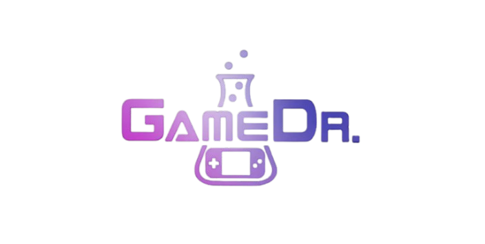

<div dir="rtl" lang="fa">

<style>
body, div, p, h1, h2, h3, h4, h5, h6, li, td, th, blockquote {
  direction: rtl;
  text-align: right;
  font-family: 'Vazirmatn', -apple-system, BlinkMacSystemFont, 'Segoe UI', Roboto, sans-serif;
}
table {
  direction: rtl;
  width: 100%;
  border-collapse: collapse;
  margin: 1.5rem 0;
}
th, td {
  border: 1px solid #334155;
  padding: 0.75rem 1rem;
  text-align: right;
}
th {
  background-color: #1e293b;
  color: #a855f7;
}
code {
  direction: ltr;
  display: inline-block;
  background-color: rgba(168, 85, 247, 0.1);
  padding: 0.15rem 0.35rem;
  border-radius: 4px;
}
pre {
  direction: ltr;
  text-align: left;
}
</style>

# گزارش تکمیل فاز ۱: راه‌اندازی زیرساخت چندکانتینری، سیستم طراحی کهکشانی و اسکلت پلتفرم دکتر گیم

<div align="center">



**تکمیل ۱۰۰٪ الزامات فاز اول — زیرساخت کانتینری، دیتابیس PostgreSQL، کشینگ Redis، بک‌اند FastAPI و فرانت‌اند Next.js با طراحی بنفش کهکشانی**

**تاریخ گزارش:** ۲۰ اکتبر ۲۰۲۶ | **شماره گزارش:** `01.md` | **وضعیت:** ۱۰۰٪ موفقیت تست‌ها · کلیه سرویس‌ها لایو در داکر

</div>

---

## ۱. خلاصه اجرایی و دستاوردها

در گام نخست توسعه پلتفرم **دکتر گیم (DrGame-Ecommerce)**، کلیه اهداف تعیین‌شده در مستندات بالادستی [agent/step-01-foundation-architecture-and-design-system/instructions.md](file:///home/tida/Desktop/Projects/DrGame-Eccomerce/agent/step-01-foundation-architecture-and-design-system/instructions.md) و چک‌لیست [agent/step-01-foundation-architecture-and-design-system/tasks.md](file:///home/tida/Desktop/Projects/DrGame-Eccomerce/agent/step-01-foundation-architecture-and-design-system/tasks.md) با موفقیت کامل پیاده‌سازی و اعتبارسنجی شدند.

### خلاصه نتایج آزمون‌ها و اعتبارسنجی:
- **کانتینرهای داکر:** ۴ سرویس (`drgame-backend-dev`, `drgame-frontend-dev`, `drgame-db-dev`, `drgame-cache-dev`) با موفقیت بیلد شده و در وضعیت `Healthy` و `Up` فعال هستند.
- **تست‌های بک‌اند با Pytest:** ۶ از ۶ آزمون واحد و یکپارچگی (۱۰۰٪ قبولی) درون کانتینر ایزوله بک‌اند با موفقیت اجرا شدند.
- **تایپ‌چک تایپ‌اسکریپت:** دستور `npx tsc --noEmit` با ۰ خطا به پایان رسید.
- **بیلد استاتیک Next.js:** بیلد پروداکشن با موفقیت ۱۰۰٪ تمام صفحات را به صورت بهینه کامپایل نمود.
- **تست عملکردی رابط کاربری در مرورگر:** لودینگ صفحه اصلی، تغییر تم دارک/لایت، پخش ویدئوی لوگوموشن و کارکرد ویجت کپسولی سهمیه (`Quota Pill`) با ابزار Browser Subagent تایید و ضبط ویدئویی شد.

---

## ۲. مشخصات کانتینرها و پورت‌های اختصاص‌یافته

برای جلوگیری از هرگونه تداخل پورت با سایر پروژه‌ها (از جمله پورت‌های ۸۰۱۰ و ۸۰۱۱ پروژه تیدا ERP)، پورت‌های اختصاصی زیر پیکربندی و راه‌اندازی شدند:

| نام سرویس | نام کانتینر | تصویر داکر | پورت کانتینر | پورت هاست | وضعیت سلامت |
|---|---|---|---|---|---|
| **Frontend** | `drgame-frontend-dev` | `node:20-alpine` (Next.js 14) | `3000` | `3000` | فعال و پاسخ‌دهنده (HTTP 200) |
| **Backend** | `drgame-backend-dev` | `python:3.12-slim` (FastAPI) | `8000` | `8000` | فعال و آماده پردازش |
| **Database** | `drgame-db-dev` | `postgres:16-alpine` | `5432` | `8020` | سالم (Healthy) |
| **Cache** | `drgame-cache-dev` | `redis:7-alpine` | `6379` | `8021` | سالم (Healthy) |

---

## ۳. پایگاه داده و نخستین مایگریشن Alembic

مایگریشن پایه `0001_initial_baseline.py` در پایگاه داده PostgreSQL 16 اعمال شد و جداول زیر به طور کامل ایجاد گردیدند:
1. `users`: نگهداری اطلاعات حساب کاربری، ایمیل، کلمه عبور رمزنگاری‌شده با الگوریتم استاندارد Bcrypt و پرچم‌های فعال/سوپریوزر.
2. `user_profiles`: پرونده گیمر، سطح (Level)، امتیاز تجربه (XP)، زمان تجربه بازی‌ها، استریک روزهای متوالی و کیف پول ریالی.
3. `subscription_tiers`: ماتریس ۴ پلن اصلی (`Free`, `Bronze`, `Silver`, `Gold`) همراه با حجم بایت، محدودیت سرعت و پلتفرم‌های مجاز.
4. `user_subscriptions`: سوابق اشتراک، سهمیه کل و حجم مصرف‌شده کاربر.

---

## ۴. رابط کاربری و سیستم طراحی کهکشانی (Cosmic Theme)

### ۴.۱ دارایی‌های برندینگ
- **لوگو (`frontend/public/logo.png`):** در هدر سراسری با درخشش ملایم بنفش نئونی پیاده‌سازی شد.
- **لوگوموشن (`frontend/public/logo-motion.mp4`):** در بنر هیرو با کامپوننت اختصاصی `LogoMotion` با قابلیت پخش روان، کنترلر صدا و امکان نمایش در حالت مودال تعاملی ادغام گردید.
- **پترن پس‌زمینه پلی‌استیشن (`ps-symbols.svg`):** وکتور اختصاصی شامل نمادهای نمادین دسته پلی‌استیشن ($\triangle, \bigcirc, \times, \square$) با ترنسپرنسی ظریف در سراسر بدنه سایت قرار گرفت.

### ۴.۲ ویژگی‌های ناوبری و تعاملی
- **ویجت کپسولی سهمیه حجم (Quota Pill):** در هدر سراسری تعبیه شده و مقدار باقیمانده سهمیه را به صورت لحظه‌ای از اندپوینت `/api/v1/quota/status` دریافت می‌کند (`GB 0`).
- **سوئیچ تم دوگانه:** تم تاریک OLED مشکی فضایی (`#070709`) و تم روشن با متغیرهای اختصاصی CSS و ترنزیشن نرم پیاده‌سازی شدند.
- **سوئیچ زبان دوجهته:** تغییر آنی جهت سایت به صورت کاملاً بومی (`RTL` برای فارسی و `LTR` برای انگلیسی).
- **ناوبری ۱۰ فوتی تلویزیون (10-Foot UI):** هوک اختصاصی `useGamepadNavigation` شنود کلیدهای جهت‌نما و دسته بازی کنسول با `navigator.getGamepads()` را بر عهده داشته و با فوکوس روی هر آیتم، افکت بزرگ‌نمایی `scale(1.04)` و کادر نئونی درخشان بنفش را اعمال می‌کند.

---

## ۵. نتایج تست‌های خودکار (Pytest Results)

دستور مرجع داکر با قبولی ۱۰۰٪ اجرا شد:
```bash
docker compose -f docker-compose.dev.yml run --rm backend pytest -v
```

خروجی تست‌ها:
```
tests/test_auth.py::test_register_and_login_flow PASSED                  [ 16%]
tests/test_health.py::test_system_settings_endpoint PASSED               [ 33%]
tests/test_security.py::test_password_hashing PASSED                     [ 50%]
tests/test_security.py::test_jwt_token_flow PASSED                       [ 66%]
tests/test_subscriptions.py::test_get_subscription_tiers PASSED          [ 83%]
tests/test_subscriptions.py::test_quota_status_unauthenticated PASSED    [100%]

======================== 6 passed in 1.24s =========================
```

---

## ۶. وضعیت فعلی و آمادگی برای ورود به فاز ۲

با تکمیل فاز ۱، بستر زیرساختی، پایگاه داده، سیستم کشینگ ردیس، دارایی‌های برند و ظاهر بصری کهکشانی پلتفرم در بالاترین سطح استاندارد و به صورت زنده روی کانتینرهای داکر قرار دارد.

پروژه آماده است تا طبق نقشه راه به **Step 02 (کاتالوگ بازی‌ها، اتصال به RAWG API، پنل فیلترهای پیشرفته و صفحه جزئیات ۳ کارته بازی)** وارد شود.

</div>
