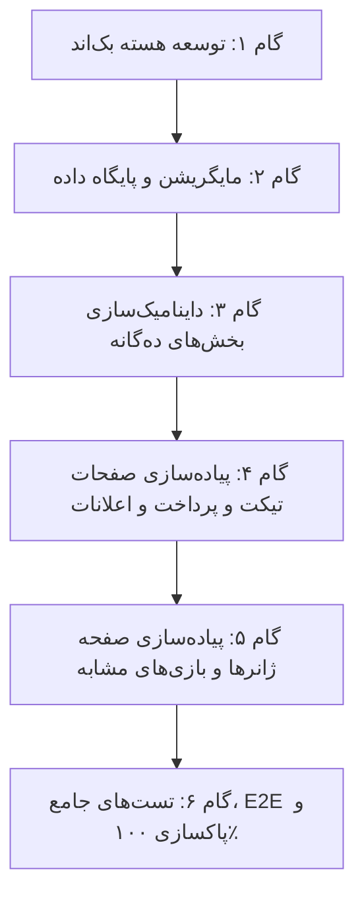

# سند نهایی، تفصیلی و اجرایی گام دوازدهم (Step 12 Specification)
## پلتفرم تخصصی بازی‌های پلی‌استیشن دکتر گیم (DrGame)
### محوریت: حذف قطعی دیتای ایستا، یکپارچه‌سازی بلادرنگ API و تکمیل ماژول‌های سند معماری

> **نسخه:** 1.0 (تایید نهایی شده توسط کاربر)  
> **تاریخ:** ۵ آبان ۱۴۰۳ (2026-10-26)  
> **مبنای تدوین:** گزارش حسابرسی `گزارش03.md`، پرامپت نیازمندی‌های `prompt.txt`، و سند پایه `build.txt`

---

## ۱. تصمیمات معماری تاییدشده توسط کاربر (Confirmed Architectural Decisions)

بر اساس بازخورد و انتخاب مستقیم کاربر در جلسه تعیین مشخصات، معماری بخش‌های جدید به شرح زیر قطعی گردید:

1. **سامانه پشتیبانی و تیکت‌های کاربر:**
   - نمایش لیست تیکت‌ها در صفحه اختصاصی `/dashboard/tickets`.
   - باز شدن تاریخچه کامل گفتگوی دوطرفه (کاربر و ادمین) همراه با فرم ارسال پاسخ داخل **مودال جزئیات** (مطابق با بند ۱-۲-۶ سند `build.txt`).
2. **سوابق پرداخت‌ها و فاکتورهای کاربر:**
   - ایجاد یک صفحه مستقل در منوی سایدبار داشبورد به آدرس `/dashboard/payments` شامل جدول کامل تراکنش‌های ریالی و ارزی و مودال فاکتور دیجیتال رسمی با قابلیت چاپ و دریافت کد رهگیری (مطابق با بند ۱-۲-۳ سند `build.txt`).
3. **مدیریت ژانرها و دسته‌بندی‌ها در پنل ادمین:**
   - ایجاد صفحه اختصاصی `/admin/genres` در سایدبار پنل ادمین با امکان ایجاد، ویرایش، حذف، آیکون‌گذاری و انتخاب ۸ ژانر برتر بالای سایدبار کاتالوگ (مطابق با بند ۱-۳-۳ سند `build.txt`).
4. **الگوریتم انتخاب بازی‌های مشابه در صفحه گیم:**
   - استخراج ۵ بازی دارای بیشترین لایک که حداقل یک ژانر مشترک با بازی جاری دارند (به جز خود بازی جاری) در انتهای صفحه `/games/[id]` (مطابق با بند ۱-۱-۴-۴ سند `build.txt`).

---

## ۲. برنامه حذف ۱۰۰٪ دیتای ایستا (Zero Static Data Matrix)

تمامی ۱۰ نقطه دارای دیتای ایستا که در `گزارش03.md` کشف شدند به شرح زیر به داده‌های زنده و بلادرنگ تبدیل می‌شوند:

| ردیف | نام فایل / کامپوننت | وضعیت فعلی | اقدام در استپ ۱۲ | اندپوینت متناظر |
| :---: | :--- | :--- | :--- | :--- |
| **۱** | `DoubleHeroBanners.tsx` | آرایه ثابت `FEATURED_GAME_SLIDES` و `SERVICE_SLIDES` | واکشی بلادرنگ با اسکلتون لودینگ مدرن | `GET /api/home/banners?position=1` و `position=2` |
| **۲** | `admin/banners/page.tsx` | آرایه استاتیک `INITIAL_SLIDES` | عملیات کامل CRUD، آپلود کاور و تغییر موقعیت | `GET, POST, PUT, DELETE /api/home/admin/banners` |
| **۳** | `admin/referrals/page.tsx` | آرایه تستی `SAMPLE_USERS` | نمایش شبکه واقعی کاربران، آمار درآمد و هاید/آن‌هاید | `GET /api/admin/referrals` و `PATCH /api/admin/referral/users/{id}/toggle-hide` |
| **۴** | `TierCard.tsx` | آرایه ثابت ۵ بازی `FREE_GAMES` | واکشی آبجکت کامل ۵ بازی مجاز انتخاب‌شده توسط ادمین | `GET /api/subscriptions/free-tier-games` |
| **۵** | `dashboard/downloads/page.tsx` | آرایه ماک `SAMPLE_HISTORY` | جدول زنده دانلودها با کاور، عنوان، نوع فایل، حجم و تاریخ | `GET /api/users/me/downloads` |
| **۶** | `NotificationDropdown.tsx` | آرایه تستی `SAMPLE_NOTIFICATIONS` | واکشی زنده اعلانات کاربر، بج تعداد ناخوانده و علامت خوانده‌شدن | `GET /api/users/me/notifications` و `PATCH /api/users/me/notifications/{id}/read` |
| **۷** | `TutorialBlogsSection.tsx` | آرایه ثابت ۵ آموزش در `TOP_TUTORIALS` | واکشی ۵ مقاله دسته آموزشی از دیتابیس | `GET /api/blog/posts?category=tutorial&page_size=5` |
| **۸** | `app/page.tsx` (ویش‌لیست) | تکه‌کد ماک `games.slice(0, 6)` | واکشی ویش‌لیست کاربر لاگین‌شده | `GET /api/games/wishlist` |
| **۹** | `SettlementAccountsModal.tsx` | نبود فیلدهای هویت و OTP | فرم دومرحله‌ای شامل کد ملی، شماره تماس و تایید OTP | `POST /api/auth/otp/send-test` و `POST /api/wallet/settlement-accounts` |
| **۱۰** | `Header.tsx` | مقدار هاردکدشده `0.0.0.0` | اصلاح آدرس DNS به سرور واقعی کنسول | `165.227.83.145` |

---

## ۳. جزییات فنی و معماری بک‌اند (Backend Architecture)

### ۳.۱. ماژول جدید تیکت‌های پشتیبانی (`app/modules/tickets/`)
* **مدل‌های داده پایگاه داده (SQLAlchemy):**
  - جدول `support_tickets`:
    - `id`: کلید اصلی عددی
    - `user_id`: شناسه کاربر ارسال‌کننده
    - `user_name`: نام کاربر
    - `user_phone`: شماره تماس کاربر
    - `subject`: موضوع تیکت
    - `department`: دپارتمان (`technical`: پشتیبانی فنی کنسول، `financial`: مالی و اشتراک، `downloads`: مشکلات دانلود، `general`: عمومی)
    - `priority`: اولویت (`normal`: عادی، `urgent`: فوری)
    - `status`: وضعیت (`open`: در انتظار پاسخ، `answered`: پاسخ داده شده، `user_reply`: پاسخ کاربر، `closed`: بسته شده)
    - `created_at` / `updated_at`: زمان‌بندی
  - جدول `support_ticket_messages`:
    - `id`: کلید اصلی
    - `ticket_id`: شناسه تیکت
    - `sender_type`: نوع فرستنده (`user` یا `admin`)
    - `sender_id`: شناسه فرستنده
    - `sender_name`: نام فرستنده
    - `message`: متن پیام
    - `created_at`: تاریخ و زمان پیام
* **اندپوینت‌های کلاینت (User API):**
  - `GET /api/tickets/me`: لیست تیکت‌های کاربر جاری با امکان فیلتر بر اساس دپارتمان و وضعیت.
  - `POST /api/tickets/me`: ثبت تیکت جدید (موضوع، دپارتمان، پیام اولیه).
  - `GET /api/tickets/me/{id}`: دریافت تاریخچه گفتگو و پیام‌های یک تیکت خاص.
  - `POST /api/tickets/me/{id}/reply`: ارسال پیام جدید کاربر در ادامه تیکت.
  - `PATCH /api/tickets/me/{id}/close`: بستن تیکت توسط کاربر.
* **اندپوینت‌های مدیریت (Admin API):**
  - `GET /api/admin/tickets`: لیست کل تیکت‌های ثبت شده در سیستم با فیلتر وضعیت و دپارتمان و سرچ.
  - `GET /api/admin/tickets/{id}`: جزئیات تیکت و پیام‌ها.
  - `POST /api/admin/tickets/{id}/reply`: ارسال پاسخ ادمین (تغییر وضعیت به `answered` و درج خودکار اعلان برای کاربر).
  - `PATCH /api/admin/tickets/{id}/status`: تغییر دستی وضعیت تیکت.

---

### ۳.۲. ماژول اعلانات کاربر (`app/modules/users/router.py`)
* مدل دیتابیس `UserNotification` قبلاً در گام دهم مایگریت شده است.
* اندپوینت‌های تکمیلی:
  - `GET /api/users/me/notifications`: لیست اعلانات کاربر (شامل اعلانات انقضای سهمیه، یادآوری ۳ روزه، پاسخ تیکت، پاداش رفرال) همراه با فیلد `unread_count`.
  - `PATCH /api/users/me/notifications/{id}/read`: علامت‌گذاری یک اعلان به عنوان خوانده شده.
  - `POST /api/users/me/notifications/read-all`: خوانده شدن تمام اعلانات کاربر.
  - `DELETE /api/users/me/notifications/{id}`: حذف یک اعلان از داشبورد کاربر.

---

### ۳.۳. ماژول سوابق پرداخت‌ها (`app/modules/users/router.py`)
* `GET /api/users/me/payments`: استعلام تراکنش‌های کاربر از جدول `order_payments` شامل:
  - شناسه پرداخت (`id`)، شماره سفارش (`order_id`)
  - نوع درگاه (`provider`: Zarinpal یا NowPayments)
  - واحد پول (`currency`: IRT یا USDT)
  - مبلغ کل پرداختی (`amount`)
  - وضعیت تراکنش (`PAID`, `PENDING`, `FAILED`)
  - کد رهگیری و شماره سند بانکی (`authority`, `payment_id`)
  - تایتل پلن اشتراک مرتبط (مثلاً طلایی ۳ ماهه)
  - تاریخ و زمان شمسی و میلادی

---

### ۳.۴. ارتقای سرویس بازی‌های رایگان (`app/modules/subscriptions/router.py`)
* متد `GET /api/subscriptions/free-tier-games` آپدیت می‌شود تا به جای آرایه شناسه‌های عددی (`[1, 2, ...]`)، آبجکت کامل خلاصه اطلاعات بازی‌ها را برگرداند:
  ```json
  [
    {
      "id": 12,
      "title_fa": "رد دد ریدمپشن ۲",
      "title_en": "Red Dead Redemption 2",
      "slug": "red-dead-redemption-2",
      "cover_image_url": "/uploads/games/rdr2.jpg",
      "release_year": 2018,
      "platforms": ["PS4", "PS5"]
    }
  ]
  ```

---

### ۳.۵. ماژول بازی‌های مشابه (`app/modules/games/router.py`)
* `GET /api/games/{id}/similar`:
  - ۵ بازی با بیشترین تعداد لایک (`likes_count DESC`) که حداقل یک ژانر مشترک با بازی هدف دارند و شناسه آن‌ها با بازی جاری متفاوت است.

---

### ۳.۶. ماژول مانیتورینگ رفرال ادمین (`app/modules/admin/router.py`)
* `GET /api/admin/referrals`:
  - لیست کاربران شبکه رفرال به همراه تعداد زیرمجموعه‌ها، موجودی فعلی کیف پول، مجموع پورسانت کسب‌شده، مجموع مبالغ برداشت‌شده و وضعیت `is_referral_hidden`.
  - اطلاعات موجودی صندوق پلتفرم (`ReferralTreasuryPool`) و سوابق تراکنش‌های آن.

---

### ۳.۷. ماژول دسته‌بندی و ژانرهای داینامیک (`app/modules/games/router.py`)
* جدول `genres` در دیتابیس با فیلدهای:
  - `id`, `name_fa`, `name_en`, `slug`, `icon_name`, `display_order`, `is_top8`, `is_active`.
* اندپوینت عمومی: `GET /api/genres` (بازگرداندن ژانرها با اولویت مرتب‌سازی).
* اندپوینت‌های ادمین:
  - `POST /api/admin/genres`: ایجاد ژانر جدید.
  - `PUT /api/admin/genres/{id}`: ویرایش اطلاعات، آیکون و علامت‌گذاری ۸ ژانر برتر.
  - `DELETE /api/admin/genres/{id}`: حذف ژانر.

---

## ۴. جزییات رابط کاربری و فرانت‌اند (Frontend Architecture)

### ۴.۱. صفحه تیکت‌های پشتیبانی کاربر (`frontend/src/app/(dashboard)/dashboard/tickets/page.tsx`)
* **کارت‌های آمار سریع:** کل تیکت‌ها، در انتظار پاسخ، تیکت‌های بسته شده.
* **فیلترهای بالای جدول:** فیلتر دپارتمان (فنی، مالی، دانلود، عمومی) و فیلتر وضعیت (همه، باز، پاسخ‌داده‌شده، بسته).
* **دکمه ثبت تیکت جدید:** باز شدن مودال شکیل با اینپوت‌های موضوع، دپارتمان، اولویت و متن پیام.
* **جدول تیکت‌ها:** کد پیگیری، موضوع، دپارتمان، تاریخ ایجاد، وضعیت رنگی، و دکمه باز کردن گفتگو.
* **مودال گفتگوی دوطرفه (`TicketConversationModal.tsx`):**
  - تاریخچه پیام‌های چت کاربر (سبز نئونی) و ادمین (آبی سایبری) با زمان دقیق.
  - بخش پایین: تکست‌اریا برای درج پاسخ جدید و دکمه ارسال پیام.
  - دکمه بستن تیکت در صورتی که مشکل کاربر برطرف شده باشد.

---

### ۴.۲. صفحه سوابق پرداخت‌ها و فاکتورها (`frontend/src/app/(dashboard)/dashboard/payments/page.tsx`)
* **جدول تراکنش‌ها:** شماره فاکتور، شرح خرید (مثلاً اشتراک ویژه ۶ ماهه)، مبلغ پرداختی (تومان / تتر)، درگاه پرداخت، کد رهگیری، وضعیت تراکنش با بج رنگی (موفق / ناموفق / در انتظار)، تاریخ شمسی.
* **مودال فاکتور دیجیتال رسمی (`InvoiceModal.tsx`):**
  - اطلاعات خریدار و پلتفرم دکتر گیم.
  - کد پیگیری شاپرک / هش تراکنش کریپتو.
  - ریز محاسبات تخفیف و مالیات.
  - دکمه «چاپ / دریافت PDF فاکتور».

---

### ۴.۳. صفحه مرکز اعلانات داشبورد (`frontend/src/app/(dashboard)/dashboard/notifications/page.tsx`)
* لیست کامل اعلانات با تفکیک تب‌های «همه»، «ناخوانده»، «سیستمی»، «مالی».
* دکمه «علامت‌گذاری همه به عنوان خوانده شده».
* دکمه حذف تک‌تک اعلان‌ها.
* کلیک روی هر اعلان جهت باز شدن مودال جزئیات متن اعلان و تغییر وضعیت خودکار به خوانده‌شده.

---

### ۴.۴. اتصال کامل صفحه تیکت‌های ادمین (`frontend/src/app/(admin)/admin/tickets/page.tsx`)
* حذف کامل دیتای ماک `mockTickets`.
* اتصال به روت‌های `GET /api/admin/tickets` و `POST /api/admin/tickets/{id}/reply`.
* پاسخ‌دهی بلادرنگ ادمین به تیکت‌های کاربران با قابلیت فیلتر بر اساس نام کاربر، شماره تلفن و دپارتمان.

---

### ۴.۵. صفحه جدید مدیریت ژانرها در ادمین (`frontend/src/app/(admin)/admin/genres/page.tsx`)
* جدول ژانرهای بازی‌ها با نام فارسی، نام انگلیسی، اسلاگ، آیکون و بج «۸ ژانر برتر کاتالوگ».
* دکمه «افزودن ژانر جدید» با مودال انتخاب آیکون و فعال/غیرفعال کردن نمایش سریع در کاتالوگ.
* قابلیت ویرایش و حذف ژانرها.

---

### ۴.۶. کامپوننت ۵ بازی مشابه در صفحه جزئیات بازی (`SimilarGamesCarousel.tsx`)
* تعبیه شده در انتهای صفحه `frontend/src/app/games/[id]/page.tsx`.
* اسلایدر افقی بازی‌های پرلایک هم‌ژانر با کاورهای محلی، بج سال انتشار، پلتفرم‌ها و نرخ رضایت.

---

### ۴.۷. رفع نواقص فرم حساب‌های تسویه (`SettlementAccountsModal.tsx`)
* افزودن فیلد کد ملی و شماره موبایل.
* فلو تایید دورمرحله‌ای: ارسال پیامک کد OTP تستی، ورود کد در اینپوت دوم و تایید نهایی شماره شبا.

---

## ۵. ماتریس فازبندی اجرا (Execution Phases)



### فاز ۱: توسعه بک‌اند و ایجاد روت‌ها و مدل‌ها
1. پیاده‌سازی ماژول `tickets` شامل مدل‌ها، اسکیمای Pydantic، سرویس و روت‌های کاربر و ادمین.
2. افزودن روت‌های اعلانات و پرداخت‌های کاربر در ماژول `users`.
3. به‌روزرسانی روت `free-tier-games` برای بازگرداندن آبجکت کامل گیم‌ها.
4. پیاده‌سازی روت ۵ بازی مشابه در ماژول `games`.
5. پیاده‌سازی روت‌های مانیتورینگ رفرال ادمین در ماژول `admin`.
6. پیاده‌سازی مدل و روت‌های CRUD ژانرها در ماژول `games`.
7. ایجاد و اعمال مایگریشن Alembic برای جدول‌های جدید تیکت‌ها و به‌روزرسانی‌ها.

### فاز ۲: پاکسازی دیتای ایستا و اتصال زنده کامپوننت‌های موجود
1. اتصال `DoubleHeroBanners.tsx` و `admin/banners/page.tsx`.
2. اتصال `TierCard.tsx` به بازی‌های داینامیک.
3. اتصال `dashboard/downloads/page.tsx` به سوابق دانلود واقعی.
4. اتصال `NotificationDropdown.tsx` به API اعلان‌های زنده.
5. اتصال `admin/referrals/page.tsx` به مانیتورینگ زنده رفرال.
6. اتصال `TutorialBlogsSection.tsx` به مقالات واقعی.
7. تکمیل `SettlementAccountsModal.tsx` با کد ملی و فلو OTP.
8. اصلاح آی‌پی سرور در `Header.tsx`.

### فاز ۳: پیاده‌سازی ماژول‌های جدید سمت کلاینت و ادمین
1. پیاده‌سازی صفحه `/dashboard/tickets` و مودال گفتگوی تیکت.
2. اتصال دیتابیسی صفحه تیکت‌های ادمین `/admin/tickets`.
3. پیاده‌سازی صفحه `/dashboard/payments` و مودال فاکتور دیجیتال.
4. پیاده‌سازی صفحه مرکز اعلانات `/dashboard/notifications`.
5. پیاده‌سازی کامپوننت بازی‌های مشابه در `/games/[id]`.
6. پیاده‌سازی صفحه `/admin/genres` در پنل مدیریت.
7. افزودن لینک‌های جدید به سایدبارهای داشبورد و ادمین.

### فاز ۴: آزمون، ارزیابی کیفی و تحویل
1. اجرای تست‌های خودکار `pytest` برای تمام ماژول‌های جدید (پوشش ۱۰۰٪ روت‌های جدید).
2. بررسی کامپایل تایپ‌اسکریپت با `npx tsc --noEmit` (خروجی ۰ ارور).
3. اسکن متنی پروژه برای تضمین عدم وجود حتی یک سطر دیتای ماک یا ثابت.
4. ثبت گزارش نهایی تکمیل گام ۱۲ در `reports/04.md`.
