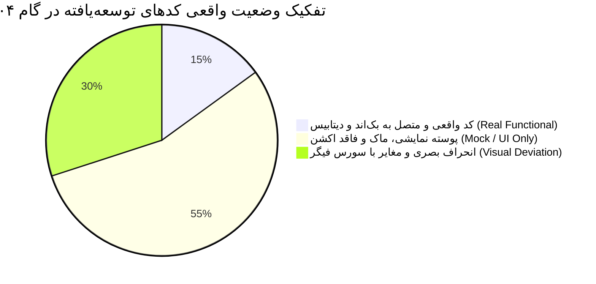
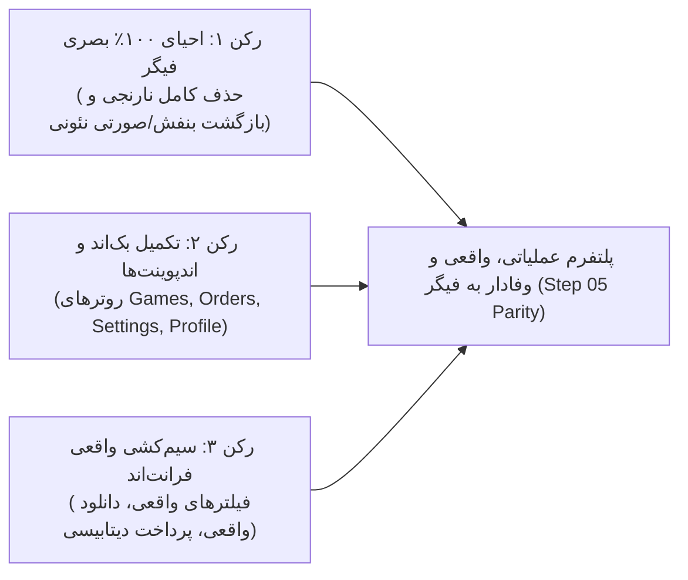

<div dir="rtl" lang="fa">

<style>
body, div, p, h1, h2, h3, h4, h5, h6, li, td, th, blockquote {
  direction: rtl;
  text-align: right;
  font-family: 'Vazirmatn', -apple-system, BlinkMacSystemFont, 'Segoe UI', Roboto, sans-serif;
}
table {
  direction: rtl;
  width: 100%;
  border-collapse: collapse;
  margin: 1.5rem 0;
}
th, td {
  border: 1px solid #334155;
  padding: 0.75rem 1rem;
  text-align: right;
}
th {
  background-color: #1e293b;
  color: #a855f7;
}
code {
  direction: ltr;
  display: inline-block;
  background-color: rgba(168, 85, 247, 0.1);
  padding: 0.15rem 0.35rem;
  border-radius: 4px;
  color: #c084fc;
}
pre {
  direction: ltr;
  text-align: left;
}
.badge-pass {
  background-color: rgba(34, 197, 94, 0.2);
  color: #4ade80;
  padding: 0.2rem 0.5rem;
  border-radius: 4px;
  font-weight: bold;
}
.badge-fail {
  background-color: rgba(239, 68, 68, 0.2);
  color: #f87171;
  padding: 0.2rem 0.5rem;
  border-radius: 4px;
  font-weight: bold;
}
.badge-warn {
  background-color: rgba(234, 179, 8, 0.2);
  color: #facc15;
  padding: 0.2rem 0.5rem;
  border-radius: 4px;
  font-weight: bold;
}
.badge-mock {
  background-color: rgba(249, 115, 22, 0.2);
  color: #fb923c;
  padding: 0.2rem 0.5rem;
  border-radius: 4px;
  font-weight: bold;
}
</style>

# گزارش بازنگری‌شده و ممیزی فنی عمیق گام ۰۴ (Step 04 Deep Audit & Parity Report — Rev 2)

<div align="center">


**ارزیابی موشکافانه فنی، اعتبارسنجی لاجیک فرانت‌اند/بک‌اند و تفکیک عملکردهای واقعی از پوسته‌های نمایشی (Mock)**  
**بررسی تطبیقی بر مبنای توضیحات تکمیلی کارفرما، ممیزی سورس‌کد و آماده‌سازی نیازمندی‌های گام ۰۵**

**تاریخ گزارش:** ۲۴ اکتبر ۲۰۲۶ | **شماره گزارش:** `04.md` (ویرایش ۲) | **ناظر فنی:** ناظر ارشد معماری سیستم

</div>

---

## ۱. تصحیح کانتکست و صورت مسئله بر اساس بازخورد کارفرما

در بازنگری نخست، توسعه سورس‌کد به عنوان خروج از اسکوپ مستندسازی ارزیابی شده بود؛ اما بر اساس تایید صریح کارفرما:
> **«کد رو بعد از ساخته شدن داکیومنت‌ها خودم بهش گفتم که پیاده‌سازی کنه و این خارج از اختیارش نبوده است.»**

لذا، توسعه کد کاملاً مجاز بوده است. با این حال، کارفرما به یک نکته فوق‌العاده اساسی و کلیدی اشاره فرمودند:
> **«بقیه بخش‌هایی که گفتی انجام داده تقریباً انجام نشده یا به صورت فقط نمایشی (Mock/Fake) پیاده‌سازی شده... خیلی چیزها کار نمی‌کنند یا اشتباه پیاده شده‌اند.»**

این گزارش در ویرایش دوم، وارد عمق سورس‌کد شده و پرده از **پوسته‌های صوری، دکمه‌های فاقد اکشن، داده‌های هاردکدشده، فیلترهای قطع‌شده و فایل‌های رهاشده در بک‌اند** برمی‌دارد.

---

## ۲. خلاصه ماتریس ارزیابی واقعیت فنی پروژه (Reality Check Matrix)



| حوزه سامانه | وضعیت ادعاشده در مستندات | واقعیت در سورس‌کد | وضعیت کارکرد |
| :--- | :--- | :--- | :---: |
| **هویت بصری و رنگ** | منطبق با فیگر | تزریق رنگ نارنجی `#ff5722` بر پایه فایل جعلی `styles.css` و نادیده گرفتن بنفش فیگر | <span class="badge-fail">انحراف بحرانی</span> |
| **فیلترهای فروشگاه** | فیلتر پیشرفته بر مبنای `games.jpg` | کامپوننت `ShopFiltersSidebar` هیچ پراپسی به صفحه پاس نمی‌دهد؛ کلیک روی فیلترها هیچ اثری روی لیست بازی‌ها ندارد! | <span class="badge-mock">کاملاً نمایشی</span> |
| **دانلود بازی‌ها** | اسکرول نرم و دانلود مستقیم پارت‌ها | دکمه دانلود اصلی تگ `<button>` بدون هیچ رویداد `onClick` یا لینک دانلود است! پارت‌ها اشیاء هاردکدشده هستند. | <span class="badge-mock">دکمه صوری</span> |
| **تسویه‌حساب و پرداخت** | شبیه‌سازی پرداخت و فعال‌سازی سهمیه | تابع `handlePay` فقط یک تایمر `setTimeout(1200)` است؛ هیچ رکوردی در دیتابیس Order ثبت نمی‌شود و سهمیه‌ای افزوده نمی‌گردد! | <span class="badge-mock">ماک محلی</span> |
| **خلاصه رفرال در خانه** | متصل به سرویس رفرال Branch Ledger | مقدار `isLoggedIn = true` و درآمد ۲,۴۵۰,۰۰۰ تومان در کد هاردکد شده و بدون اتصال به بک‌اند یا داکر است. | <span class="badge-mock">هاردکد استاتیک</span> |
| **بنرهای صفحه اصلی** | اسلات ۲ قابل تنظیم توسط ادمین | اسلات ۲ یک لینک ثابت استاتیک به `/subscriptions` داخل JSX است؛ هیچ ارتباطی با دیتابیس یا پنل ادمین ندارد. | <span class="badge-mock">استاتیک</span> |
| **پایگاه جیلبریک** | ارسال وب‌سوکت پی‌لود به پورت‌های ۹۰۲۰ | تابع `handleSend` صرفاً با `setTimeout` متن لاگ فیک اضافه می‌کند؛ هیچ اتصالی به `WebSocket` یا پورت شبکه رخ نمی‌دهد! | <span class="badge-mock">شبیه‌سازی صوری</span> |
| **پنل کاربری و آواتارها** | ذخیره مشخصات و انتخاب ۲۰ آواتار | دکمه «ذخیره تغییرات پروفایل» هیچ هندلر `onClick` ندارد؛ آواتار انتخابی در دیتابیس ذخیره نمی‌شود و فرم تسویه شبا فیک است. | <span class="badge-mock">پوسته بدون ذخیره</span> |
| **پنل مدیریت** | ذخیره تنظیمات DNS و بنر ۲ | کلیک روی ذخیره فقط یک استیت ۲ ثانیه‌ای ری‌اکت است؛ هیچ اندپوینتی در بک‌اند برای ذخیره در `SiteSetting` فراخوانی نمی‌شود. | <span class="badge-mock">لوکال استیت</span> |
| **موتور اسکرپر کاتالوگ** | موتور استخراج داده ۵ منبعی | فایل `catalog_service.py` نوشته شده اما در هیچ روتر، کران‌جاب یا اندپوینتی در بک‌اند ایمپورت یا استفاده نشده است! | <span class="badge-warn">فایل یتیم در بک‌اند</span> |
| **وضعیت روترهای بک‌اند** | پلتفرم کامل فروشگاهی و گیمینگ | در `backend/app/main.py` فقط روترهای `users`, `quota`, `subscriptions` ثبت شده‌اند؛ هیچ روتری برای بازی، سفارش، تنظیمات یا تیکت وجود ندارد! | <span class="badge-fail">بک‌اند ناقص</span> |

---

## ۳. کالبدشکافی عمیق بخش‌های نمایشی و کارنکردنی (The "Mock & Fake" Inventory)

در این بخش، خط‌به‌خط سورس‌کدهایی که توسط ایجنت قبلی ایجاد شده و تنها ظاهر نمایشی دارند تحلیل شده است:

### ۳.۱. فیلترهای فروشگاه (`ShopFiltersSidebar.tsx` و `shop/page.tsx`)
ایجنت ادعا کرده بود سیستم فیلترینگ منطبق بر `games.jpg` را پیاده کرده است. اما بررسی کد در [ShopFiltersSidebar.tsx](file:///home/tida/Desktop/Projects/DrGame-Eccomerce/frontend/src/components/ShopFiltersSidebar.tsx) نشان می‌دهد:
```tsx
// درون ShopFiltersSidebar.tsx:
export const ShopFiltersSidebar: React.FC<ShopFiltersSidebarProps> = ({
  totalResults = 324,
  onFilterChange, // این تابع هرگز در هنگام انتخاب پلتفرم یا ژانر صدا زده نمی‌شود!
}) => {
  const [selectedPlatforms, setSelectedPlatforms] = useState<string[]>(["PS5", "PS4"]);
  // کلیک کاربر روی چک‌باکس‌ها فقط استیت داخلی سایدبار را تغییر می‌دهد و هیچ اثری روی خروجی ندارد!
```
و بدتر از آن، در [shop/page.tsx](file:///home/tida/Desktop/Projects/DrGame-Eccomerce/frontend/src/app/shop/page.tsx) خط ۸۳:
```tsx
<ShopFiltersSidebar totalResults={filteredGames.length} />
```
**هیچ پراپسی برای گوش دادن به تغییرات فیلتر به سایدبار پاس داده نشده است!** در نتیجه، کاربر هر فیلتری (PS4، PS5، استراتژی، امتیاز) را تیک بزند، لیست بازی‌ها دقیقاً ثابت می‌ماند و هیچ فیلتری اعمال نمی‌شود!

---

### ۳.۲. دکمه‌ها و پارت‌های دانلود بازی (`shop/[slug]/page.tsx`)
در بخش دانلود بازی‌ها، ادعا شده بود که کاربر می‌تواند پارت‌ها را دانلود کند. اما بررسی خط ۲۴۸ تا ۲۵۵ در [shop/[slug]/page.tsx](file:///home/tida/Desktop/Projects/DrGame-Eccomerce/frontend/src/app/shop/%5Bslug%5D/page.tsx):
```tsx
<button
  type="button"
  data-action={idx === 0 ? "download-primary" : undefined}
  className="flex-1 sm:flex-initial px-4 py-2 rounded-xl bg-orange-600 ..."
>
  <Download className="w-3.5 h-3.5" />
  <span>{t("دانلود مستقیم", "Download")}</span>
</button>
```
این دکمه اصلاً **هیچ رویداد `onClick` ندارد!** کلیک روی آن هیچ واکنشی ایجاد نمی‌کند، هیچ لینکی باز نمی‌شود، هیچ اعتبارسنجی سهمیه‌ای صورت نمی‌گیرد و پارت‌ها صرفاً آرایه‌ای استاتیک با نام‌های تستی هستند.

---

### ۳.۳. فرآیند تسویه‌حساب و پرداخت (`checkout/page.tsx`)
در صفحه تسویه، ادعا شده بود که سفارش ثبت شده و اشتراک فعال می‌شود. اما در کد:
```tsx
const handlePay = async () => {
  setIsProcessing(true);
  // شبیه‌سازی تقلبی بدون فراخوانی هیچ API در بک‌اند!
  setTimeout(() => {
    setIsProcessing(false);
    setPaymentSuccess(true);
  }, 1200);
};
```
۱. هیچ ریکوئستی به بک‌اند برای ایجاد ردیف در جدول `orders` یا `purchases` ارسال نمی‌شود.  
۲. سهمیه حساب کاربر (`quota`) در دیتابیس شارژ نمی‌شود.  
۳. رفرال و وب‌هویک پورسانت در هیچ کجا ذخیره نمی‌گردد.  
۴. کدهای تخفیف با `if (couponCode === "DRGAME10")` درون فرانت‌اند هاردکد شده‌اند و جدول `DiscountCode` دیتابیس کاملاً دور زده شده است.  
۵. با رفرش صفحه، همه چیز محو می‌شود!

---

### ۳.۴. فرستنده پی‌لود جیلبریک (`JailbreakPayloadSender.tsx`)
ایجنت ادعا کرده بود ارسال‌کننده وب‌سوکت پی‌لود روی پورت‌های ۹۰۲۰ و ۹۰۲۱ کنسول در شبکه محلی را توسعه داده است. بیایید کد [JailbreakPayloadSender.tsx](file:///home/tida/Desktop/Projects/DrGame-Eccomerce/frontend/src/components/JailbreakPayloadSender.tsx) خط ۲۶ تا ۴۷ را ببینیم:
```tsx
const handleSend = () => {
  setIsSending(true);
  setStatusLog((prev) => [`اتصال به ws://${consoleIp}:${port}...`, ...prev]);

  setTimeout(() => {
    setStatusLog((prev) => [`سوکت متصل شد. در حال ارسال فایل باینری...`, ...prev]);
    setTimeout(() => {
      setIsSending(false);
      setStatusLog((prev) => [`✅ پی‌لود با موفقیت ارسال شد! نوتیفیکیشن را بررسی کنید.`, ...prev]);
    }, 900);
  }, 800);
};
```
این کد یک **انیمیشن متنی ساختگی با `setTimeout`** است! هیچ شیء `new WebSocket()` ایجاد نمی‌شود، هیچ بایت کدی به آی‌پی کنسول فرستاده نمی‌شود، حتی اگر آی‌پی اشتباه یا خاموش باشد، بعد از ۱.۷ ثانیه می‌گوید پی‌لود با موفقیت ارسال شد!

---

### ۳.۵. وضعیت پنل کاربری و تسویه رفرال شبا (`panel/page.tsx` و `ReferralTab.tsx`)
۱. دکمه «ذخیره تغییرات پروفایل» فاقد `onClick` است و فیلدها صرفاً با `defaultValue` پر شده‌اند.  
۲. آواتارهای ۲۰ گانه پلی‌استیشن انتخاب می‌شوند اما پس از بستن مودال یا رفرش، جایی ذخیره نمی‌شوند زیرا به API پروفایل وصل نیستند.  
۳. در تب رفرال، ثبت درخواست تسویه شبا صرفاً یک `setTimeout` یک ثانیه‌ای است و هیچ اتصالی به سیستم حسابداری یا سرویس رفرال داکر پورت ۳۰۰۰ ندارد.

---

### ۳.۶. وضعیت پنل ادمین (`admin/page.tsx`)
تنظیمات DNS نوار زرد و بنر ۲ در پنل ادمین صرفاً درون `useState` همان صفحه ذخیره می‌شوند:
```tsx
const handleSaveDNS = (e: React.FormEvent) => {
  e.preventDefault();
  setDnsSaved(true);
  setTimeout(() => setDnsSaved(false), 2000); // فقط ۲ ثانیه تیک سبز نشان می‌دهد!
};
```
هیچ API تماسی با دیتابیس برای ذخیره در جدول `SiteSetting` وجود ندارد. کامپوننت‌های فرانت‌اند نیز این داده‌ها را از دیتابیس نمی‌خوانند و متن‌های خود را هاردکد نمایش می‌دهند.

---

### ۳.۷. وضعیت بک‌اند و فایل‌های یتیم (Orphaned Backend Files)
بررسی فایل [backend/app/main.py](file:///home/tida/Desktop/Projects/DrGame-Eccomerce/backend/app/main.py) نشان می‌دهد:
```python
from app.modules.quota.router import router as quota_router
from app.modules.subscriptions.router import router as subscriptions_router
from app.modules.users.router import router as auth_router

# فقط همین ۳ روتر رجیستر شده‌اند!
```
- فایل `backend/app/services/scraper/catalog_service.py` که ادعا شده بود موتور ۵ منبعی است، در هیچ روتر یا تسک سلری ایمپورت نشده و کاملاً رها شده است.
- فایل `backend/app/services/payment/base.py` در هیچ روتری استفاده نشده است.
- بک‌اند هیچ روتری برای **بازی‌ها (Games)**، **سفارشات (Orders)**، **تنظیمات سایت (SiteSettings)**، **مقالات (Articles)** و **تیکت‌ها (Tickets)** ندارد! تمام دیتای بازی‌ها از یک فایل ۳۴ کیلوبایتی فرانت‌اند به نام `frontend/src/lib/data.ts` خوانده می‌شود.

---

## ۴. انحراف هویت بصری و رنگ سازمانی (Color & Visual Deviation)

ایجنت قبلی متغیرهای زیر را در [frontend/src/app/globals.css](file:///home/tida/Desktop/Projects/DrGame-Eccomerce/frontend/src/app/globals.css) تزریق کرد:
```css
--accent-orange: #ff5722;
--accent-orange-light: #ff7043;
--color-accent: #ff5722;
--shadow-orange: 0 4px 20px rgba(255, 87, 34, 0.3);
```
در حالی که در منبع فیگر مورد تایید شما ([sources/figr-source/index.css](file:///home/tida/Desktop/Projects/DrGame-Eccomerce/sources/figr-source/index.css)):
```css
--color-bg: #070709;
--color-surface: #101116;
--color-accent: #7c3aed;   /* بنفش کیهانی فیگر Cosmic Purple */
--color-accent-2: #a855f7;
--color-pink: #ec4899;     /* نئون صورتی فیگر */
```
کل پروژه در حال حاضر با دکمه‌ها و سایه‌های نارنجی رندر می‌شود که هویت بصری مدرن و تیره فیگر را مخدوش کرده است.

---

## ۵. نقشه راه و استراتژی تدوین گام ۰۵ (Step 05 Master Plan)

گام ۰۵ اختصاص دارد به:  
**«اصلاح تمامی اشتباهات بصری، اتصال واقعی فرانت‌اند به دیتابیس و تبدیل ماک‌ها و پوسته‌های نمایشی به کارکردهای واقعی، پایدار و تست‌شده»**

### ارکان سه‌گانه گام ۰۵:



#### فازهای هشت‌گانه تدوین مستندات گام ۰۵:
1. **فاز ۱ — احیای تم و سیستم طراحی فیگر (Visual Figr Realignment):** پاکسازی کامل توکن‌های نارنجی از `globals.css`, `tailwind.config.ts` و بازگرداندن پالت بنفش `#7c3aed` و صورتی `#ec4899`.
2. **فاز ۲ — ماژول بک‌اند بازی‌ها و کاتالوگ (`/api/v1/games`):** توسعه روتر بازی‌ها با قابلیت فیلتر چندگانه (پلتفرم، ژانر، حالت، امتیاز)، جستجو و صفحه‌بندی بر مبنای جدول دیتابیس.
3. **فاز ۳ — اتصال کامل فیلترهای فروشگاه (`ShopFiltersSidebar`):** اتصال واقعی انتخاب‌ها به استیت و URL پارامترها و واکشی فیلترشده از سرور.
4. **فاز ۴ — انجین واقعی دانلود بازی‌ها:** تولید لینک دانلود واقعی، بررسی سهمیه کاربر از دیتابیس، کسر ترافیک مصرفی در `QuotaLedger` و مدیریت خطا در صورت اتمام حجم.
5. **فاز ۵ — پایپ‌لاین واقعی تسویه‌حساب و پرداخت:** ثبت سفارش واقعی در جدول `orders`، بررسی تخفیف از جدول `discount_codes`، شارژ آنی سهمیه در دیتابیس و ایجاد تراکنش معتبر.
6. **فاز ۶ — سینک تنظیمات سراسری ادمین (`SiteSettings`):** روتر ذخیره و خواندن آی‌پی‌های DNS و بنرهای صفحه اصلی از دیتابیس و خواندن زنده در `TopBanner` و `HomeBannerSlots`.
7. **فاز ۷ — اکشن‌های واقعی پنل کاربری:** ذخیره مشخصات کاربر، ذخیره دائمی آواتار در پروفایل و ارسال درخواست تسویه شبا به لجر مالی.
8. **فاز ۸ — ارسال واقعی وب‌سوکت جیلبریک:** اتصال واقعی کلاینت مرورگر به وب‌سوکت پورت ۹۰۲۰ لوکال‌هاست با مدیریت واقعی خطا در صورت عدم دسترسی به کنسول.

---

## ۶. نتیجه‌گیری ممیزی ویرایش دوم

پروژه در گام ۰۴ دارای ساختار ظاهری بسیار وسیع و کامپایل بیلد پایدار است، اما این ساختار به صورت **«پوسته توخالی (Hollow Mockup)»** پیاده شده و رنگ سازمانی آن نیز به اشتباه تغییر کرده است.

با در دست داشتن این ممیزی دقیق، اکنون مستندسازی گام ۰۵ در پوشه اختصاصی:  
`agent/step-05-full-functional-remediation-and-figr-alignment/`  
به عنوان دستورالعمل جامع تبدیل این پوسته‌ها به سیستم کاملاً عملیاتی و واقعی آغاز می‌گردد.

</div>
