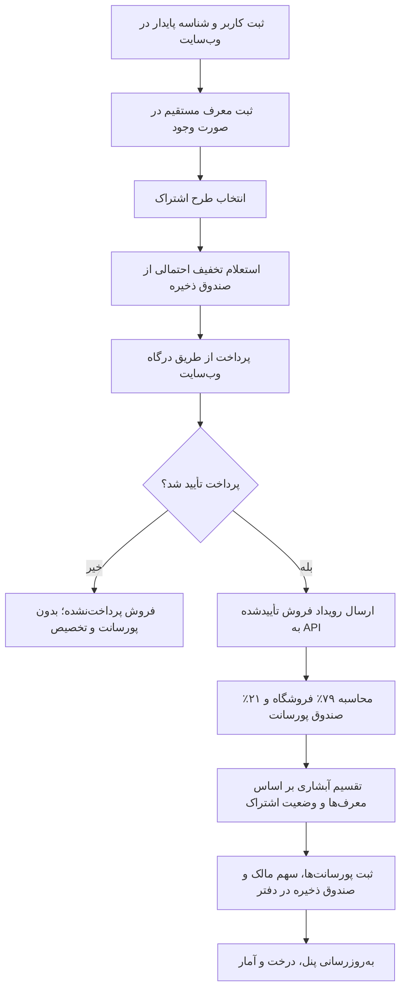

# پیشنهاد جامع و شرح فنی سامانه بازاریابی ارجاعی اشتراک

**نام سامانه:** Branch Ledger — دفتر شاخه‌ای  
**نسخه مرجع:** ۱٫۴٫۱  
**تاریخ:** ۲۲ اکتبر ۲۰۲۶  
**مخاطب:** مالک فروشگاه، مدیران، کارمندان، مشتریان، توسعه‌دهنده وب‌سایت و مسئول مالی

> این سند مدل کسب‌وکار و رفتار نسخه فعلی برنامه را توضیح می‌دهد. مبلغ‌ها در این سند با «واحد پول تنظیم‌شده در برنامه» نوشته شده‌اند؛ چون برچسب ارز در نسخه پیش‌فرض هنوز تعیین نشده است. این سند جایگزین بررسی حقوقی، مالیاتی یا حسابداری در کشور محل فعالیت نیست.

## ۱. خلاصه طرح

این سامانه فروش اشتراک را به شبکه‌ای از معرفی‌کنندگان متصل می‌کند. کارمند یا مشتری می‌تواند یک مشتری تازه را معرفی کند؛ مشتری تازه نیز می‌تواند در صورت تمایل مشتریان دیگری معرفی کند. درخت معرفی عمق ثابتی ندارد. برای هر فروش اشتراکی که پرداخت آن تأیید شده باشد، برنامه مبلغ واقعی دریافتی را بین سهم فروشگاه، پورسانت کاربران بالادستی، سهم مالک فروشگاه و صندوق ذخیره تقسیم و در دفتر مالی ثبت می‌کند.

ایجاد حساب یا معرفی افراد به‌تنهایی پورسانت ایجاد نمی‌کند. پورسانت فقط پس از ثبت فروش اشتراکِ پرداخت‌شده محاسبه می‌شود. خریدار از خرید خودش پورسانت نمی‌گیرد. برای اینکه یک کاربر در زمان فروش پایین‌دستی پورسانت خودش را دریافت کند، اشتراک شخصی او باید همان زمان فعال باشد.

اعداد پیش‌فرض برنامه چنین‌اند:

- سهم فروشگاه: ۷۹٪ مبلغ پرداخت‌شده پس از تخفیف
- کل صندوق پورسانت: ۲۱٪ همان مبلغ
- تخفیف خوش‌آمدگویی: ۵٪ قیمت طرح برای اولین اشتراک پرداخت‌شده کاربر، مشروط به بودجه صندوق ذخیره
- سهم ذخیره: ۵۰٪ مانده‌ای که پس از تقسیم سهم کاربران به ردیف مدیرعامل می‌رسد
- مدت اشتراک: یک ماه تقویمی

## ۲. هدف و ارزش پیشنهادی

هدف برنامه این است که معرفی مشتری، فروش اشتراک، واجدشرایط‌بودن کاربران، سهم‌ها، تخفیف‌ها و بازپرداخت‌ها در یک سابقه قابل پیگیری ثبت شوند. مالک می‌تواند نمای کلی فروش و درخت کامل را ببیند؛ هر کاربر نیز در پنل خودش اطلاعات حساب، اشتراک، تیم پایین‌دستی، فروش‌های تیم و پورسانت‌های ثبت‌شده را می‌بیند.

برای مشتری، ارزش اصلی باید خود اشتراک و خدماتی باشد که با خرید آن دریافت می‌کند. شبکه معرفی باید به پیدا کردن مشتریان واقعی برای فروشگاه کمک کند؛ درآمد اعضا نباید با وعده درآمد قطعی یا صرفاً با عضوگیری معرفی شود. برای فروشگاه، برنامه یک ابزار ثبت و محاسبه است و به‌تنهایی تضمین‌کننده سود یا تقاضای بازار نیست.

## ۳. نقش‌ها و ساختار درخت

### مدیرعامل / مالک فروشگاه

مدیرعامل ریشه درخت است و مانند مشتری یا کارمند در شبکه کاربران قرار نمی‌گیرد. در محاسبات، مانده‌ای که پس از سهم کاربران باقی می‌ماند به ردیف مدیرعامل می‌رسد و نصف آن به دفتر مالک و نصف دیگر به صندوق ذخیره تخصیص می‌یابد. سهم‌های کاربران غیرفعال نیز جداگانه به دفتر مالک منتقل می‌شوند.

### کاربران

در این مدل، همه افراد به‌جز مدیرعامل «کاربر» هستند. نوع کاربر یکی از این دو مورد است:

- **کارمند:** مستقیماً زیرمجموعه مدیرعامل ثبت می‌شود.
- **مشتری:** می‌تواند از سوی یک کارمند یا مشتری دیگر معرفی شود؛ فروشگاه می‌تواند مشتری بدون معرف هم ثبت کند.

هر کاربر یک معرف مستقیم دارد یا بدون معرف به فروشگاه متصل است. برنامه از ایجاد حلقه در زنجیره معرف جلوگیری می‌کند. تعداد سطوح پایین‌دستی محدود نشده است.

### تشخیص وضعیت اشتراک

اشتراک فعال، صلاحیت دریافت پورسانت از فروش پایین‌دستی را تعیین می‌کند. انقضای اشتراک حساب را از سوابق و درخت حذف نمی‌کند؛ حساب با وضعیت غیرفعال نمایش داده می‌شود تا تاریخچه و ارتباط معرف‌ها حفظ شود. سهم پورسانت آن کاربر در فروش‌هایی که هنگام غیرفعال‌بودنش پرداخت می‌شوند به مدیرعامل می‌رسد. سهم به کاربران دیگر منتقل نمی‌شود و پس از تمدید نیز به حساب قبلی بازنمی‌گردد.

پس از تمدیدِ پرداخت‌شده، کاربر برای فروش‌های بعدی دوباره واجدشرایط می‌شود. تمدید، سهم‌های گذشته‌ای را که به مدیرعامل رسیده‌اند جبران نمی‌کند.

## ۴. طرح‌های اشتراک و تنظیمات

قیمت‌های پیش‌فرض فعلی:

| طرح | قیمت فهرست |
|---|---:|
| برنزی | ۷۰۰٬۰۰۰ |
| نقره‌ای | ۱٬۵۰۰٬۰۰۰ |
| طلایی | ۳٬۰۰۰٬۰۰۰ |

مدیر می‌تواند نام و قیمت طرح‌ها، نرخ فروشگاه، نرخ صندوق پورسانت، درصد تخفیف خوش‌آمدگویی، درصد ذخیره صندوق، مدت اشتراک، برچسب ارز و دقت اعشار را تنظیم کند. نرخ سهم فروشگاه و صندوق پورسانت باید در مجموع ۱۰۰٪ باشند. مدت اشتراک از یک تا ۲۴ ماه قابل تنظیم است. دقت ارزی از صفر تا چهار رقم اعشار است و پس از ثبت سوابق مالی قفل می‌شود تا مبالغ قدیمی با واحد متفاوت تفسیر نشوند.

پیش‌فرضِ دقت اعشار صفر است و برچسب ارز خالی است. پیش از ورود داده واقعی، باید واحد مبلغ‌ها (برای مثال ریال یا تومان) و برچسب آن در برنامه و وب‌سایت یکسان تعیین شود. API مبلغ‌ها را به شکل عدد صحیح در واحد پول پیکربندی‌شده دریافت می‌کند.

## ۵. فرمول تقسیم مبلغ هر فروش

محاسبات بر پایه مبلغی انجام می‌شود که واقعاً از خریدار دریافت شده است:

**مبلغ پرداخت‌شده = قیمت فهرست − تخفیف تأییدشده**

سپس:

1. برنامه ۷۹٪ مبلغ پرداخت‌شده را به سهم فروشگاه تخصیص می‌دهد.
2. کل ۲۱٪ باقی‌مانده وارد صندوق پورسانت می‌شود.
3. از معرف مستقیم خریدار شروع می‌شود. هر کاربر بالادستی نصف مبلغ باقی‌مانده در همان مرحله را می‌گیرد.
4. پس از عبور از همه کاربران بالادستی، مانده ردیف مدیرعامل نصف می‌شود: نیمی به دفتر مدیرعامل و نیمی به صندوق ذخیره.

بنابراین سهم‌ها نسبت به کل صندوق اولیه چنین‌اند: معرف مستقیم ۵۰٪، معرف بعدی ۲۵٪، بعدی ۱۲٫۵٪، سپس ۶٫۲۵٪ و به همین ترتیب. این درصدها سهمی از صندوق ۲۱درصدی‌اند، نه سهمی جداگانه از کل قیمت.

برای فروش بدون تخفیف، سهم معرف مستقیم معادل ۱۰٫۵٪ مبلغ پرداخت‌شده است؛ معرف دوم ۵٫۲۵٪، نفر سوم ۲٫۶۲۵٪ و سهم‌های بعدی نصف می‌شوند. در نتیجه، عمق واقعی زنجیره تعیین می‌کند در پایان چه مقدار برای تقسیم میان مدیرعامل و صندوق ذخیره باقی بماند. صندوق ذخیره از پیش با نرخ ثابتی از ۲۱٪ کسر نمی‌شود.

### نمونه فروش با دو معرف بالادستی

در جدول زیر فرض شده خریدار قیمت کامل طرح را پرداخته و دو کاربر بالادستی دارد که هر دو هنگام پرداخت اشتراک فعال‌اند:

| طرح | سهم فروشگاه ۷۹٪ | صندوق اولیه ۲۱٪ | معرف مستقیم ۵۰٪ صندوق | معرف دوم ۲۵٪ صندوق | مانده صندوق | مدیرعامل | صندوق ذخیره |
|---|---:|---:|---:|---:|---:|---:|---:|
| برنزی ۷۰۰٬۰۰۰ | ۵۵۳٬۰۰۰ | ۱۴۷٬۰۰۰ | ۷۳٬۵۰۰ | ۳۶٬۷۵۰ | ۳۶٬۷۵۰ | ۱۸٬۳۷۵ | ۱۸٬۳۷۵ |
| نقره‌ای ۱٬۵۰۰٬۰۰۰ | ۱٬۱۸۵٬۰۰۰ | ۳۱۵٬۰۰۰ | ۱۵۷٬۵۰۰ | ۷۸٬۷۵۰ | ۷۸٬۷۵۰ | ۳۹٬۳۷۵ | ۳۹٬۳۷۵ |
| طلایی ۳٬۰۰۰٬۰۰۰ | ۲٬۳۷۰٬۰۰۰ | ۶۳۰٬۰۰۰ | ۳۱۵٬۰۰۰ | ۱۵۷٬۵۰۰ | ۱۵۷٬۵۰۰ | ۷۸٬۷۵۰ | ۷۸٬۷۵۰ |

اگر هیچ معرف کاربری بالادست وجود نداشته باشد، کل صندوق ۲۱درصدی به ردیف مدیرعامل می‌رسد و میان مدیرعامل و صندوق ذخیره نصف می‌شود. اگر یکی از معرف‌ها اشتراک فعال نداشته باشد، محاسبه همان مرحله همچنان انجام می‌شود؛ مبلغ آن مرحله به مدیرعامل می‌رود و نصف‌کردن مانده برای کاربر بالادستی بعدی ادامه می‌یابد.

مبالغ به واحد صحیح پول گرد می‌شوند. در تقسیم‌هایی که یک واحد پولی باقی می‌ماند، برنامه اختلاف گردکردن را نگه می‌دارد تا مجموع تخصیص‌ها با مبلغ مبنا سازگار بماند؛ در تقسیم نصف نهایی، یک واحدِ باقی‌مانده در صورت فرد بودن مبلغ به صندوق ذخیره می‌رسد.

## ۶. تخفیف خوش‌آمدگویی و صندوق ذخیره

صندوق ذخیره یک حساب جدا از دفتر مدیرعامل است. موجودی این دو حساب ممکن است به‌طور اتفاقی یکسان باشد، اما منبع و ثبت‌های مالی آن‌ها مستقل‌اند. صندوق ذخیره از نصفِ مانده صندوق پورسانت در ردیف مدیرعامل تأمین می‌شود؛ پس مبلغ واریزی به آن با تعداد کاربران بالادستی و سهم‌هایی که پیش از آن پرداخت یا به مدیرعامل منتقل شده‌اند تغییر می‌کند.

تخفیف پیش‌فرض ۵٪ قیمت فهرست و فقط برای اولین اشتراک پرداخت‌شده هر کاربر است:

| طرح | تخفیف ۵٪ | پرداخت خریدار پس از تخفیف |
|---|---:|---:|
| برنزی | ۳۵٬۰۰۰ | ۶۶۵٬۰۰۰ |
| نقره‌ای | ۷۵٬۰۰۰ | ۱٬۴۲۵٬۰۰۰ |
| طلایی | ۱۵۰٬۰۰۰ | ۲٬۸۵۰٬۰۰۰ |

در صورت استفاده از تخفیف، سهم ۷۹٪ و صندوق ۲۱٪ بر مبنای مبلغی محاسبه می‌شوند که پس از تخفیف واقعاً پرداخت شده است؛ برای مثال صندوق پورسانت فروش نقره‌ای با تخفیف، ۲۹۹٬۲۵۰ خواهد بود. ثبت تخفیف در دفتر، مبلغ تخفیف را از صندوق ذخیره کم و مبلغ متناظر را به دفتر فروشگاه به‌عنوان یارانه تخفیف اضافه می‌کند.

برنامه پیش از فروش، مانده موجود و بودجه باقی‌مانده کمپین را بررسی می‌کند. واریزی همان فروش نمی‌تواند هزینه تخفیف خودش را تأمین کند. با ذخیره پیش‌فرض ۵۰٪ و بدون تخفیف‌های قبلی، موجودی قطعی صندوق باید دست‌کم دو برابر مبلغ تخفیف باشد؛ بنابراین حداقل موجودی اولیه برای طرح‌های برنزی، نقره‌ای و طلایی به‌ترتیب ۷۰٬۰۰۰، ۱۵۰٬۰۰۰ و ۳۰۰٬۰۰۰ است. تخفیف‌های قبلاً استفاده‌شده نیز از بودجه کمپین کم می‌شوند؛ در نتیجه، برنامه علاوه بر آزمون حداقل موجودی، بودجه باقی‌مانده را هم کنترل می‌کند. اگر نرخ ذخیره ۱۰۰٪ شود، هیچ بودجه‌ای برای تخفیف قابل استفاده نیست.

خروجی API برای تخفیف، پیشنهاد موقت است. وب‌سایت باید در لحظه نهایی‌کردن پرداخت دوباره واجدشرایط‌بودن را بررسی کند؛ API این کنترل را هنگام ثبت فروش نیز تکرار می‌کند تا یک موجودی برای چند تخفیف هم‌زمان خرج نشود.

## ۷. گردش کار از معرفی تا ثبت پورسانت

### گام‌های عملیاتی

1. وب‌سایت برای هر کاربر شناسه یکتا و پایدار ذخیره می‌کند و معرف را به همان حساب متصل می‌کند.
2. برای نمایش تخفیف ممکن است وب‌سایت از مسیر استعلام قیمت تخفیف استفاده کند؛ استعلام به‌تنهایی فروش یا تخصیص مالی ایجاد نمی‌کند.
3. درگاه پرداخت وب‌سایت نتیجه پرداخت را تأیید می‌کند. API خودِ پرداخت را پردازش نمی‌کند.
4. وب‌سایت پس از تأیید پرداخت، یک رویداد فروش با شناسه سفارش یکتا، شناسه خریدار، شناسه طرح، مبلغ واقعاً وصول‌شده و زمان پرداخت به API می‌فرستد.
5. API کاربر، طرح، مبلغ، تخفیف و شناسه تکراری را بررسی می‌کند؛ سپس وضعیت اشتراک خریدار را به‌روزرسانی و محاسبات فروش را ثبت می‌کند.
6. داشبورد از همان داده‌های API آمار، صورت‌حساب و درخت را می‌خواند.
7. اگر پرداخت بعداً بازپرداخت شد، وب‌سایت رویداد بازپرداخت را می‌فرستد. برنامه ثبت‌های معکوس ایجاد می‌کند و سابقه فروش را پاک نمی‌کند.

شناسه یکتای سفارش باعث می‌شود ارسال دوباره یک رویداد یکسان، فروش تکراری نسازد. اگر همان شناسه برای اطلاعات متفاوت دوباره استفاده شود، API تعارض برمی‌گرداند.

## ۸. اشتراک، تمدید و وضعیت کاربران

پرداخت موفق، دوره اشتراک کاربر را برای مدت تنظیم‌شده فعال می‌کند. دوره پیش‌فرض یک ماه تقویمی است. تمدید پیش از انقضا از انتهای دوره قبلی ادامه پیدا می‌کند؛ تمدید پس از انقضا از تاریخ پرداخت جدید آغاز می‌شود. بنابراین فاصله بین انقضا و پرداخت مجدد، دوره غیرفعال باقی می‌ماند.

هنگام ثبت هر فروش پایین‌دستی، برنامه وضعیت اشتراک هر معرف را در زمان پرداخت همان فروش می‌سنجد. اگر فعال باشد، سهم در حساب پورسانت همان کاربر ثبت می‌شود. اگر غیرفعال باشد، سهم همان سطح به مدیرعامل می‌رسد؛ آن سهم به معرف دیگر اضافه نمی‌شود. وقتی خود کاربر اشتراک را دوباره فعال کند، فقط فروش‌های بعدی می‌توانند برای او سهم ایجاد کنند.

## ۹. دفتر مالی، فروش و بازپرداخت

برنامه برای هر رویداد مالی یک سطر در دفتر ثبت می‌کند. حساب‌های اصلی عبارت‌اند از دفتر فروشگاه/مدیرعامل، حساب پورسانت هر کاربر، صندوق ذخیره و حساب بازیابی بازپرداخت. گزارش‌ها از دفتر استخراج می‌شوند تا جمع موجودی‌ها قابل ردیابی باشد.

در نسخه مستقل مرورگری، فروش می‌تواند ابتدا در انتظار پرداخت ثبت شود. تا پیش از ثبت پرداخت، پورسانت و تخصیص نهایی ایجاد نمی‌شود. پس از تأیید، فروش به‌عنوان پرداخت‌شده ثبت می‌شود و مدت اشتراک خریدار نیز محاسبه می‌شود. نسخه API رویداد پرداخت تأییدشده را دریافت می‌کند.

بازپرداخت، فروش را حذف نمی‌کند. برنامه ثبت‌های معکوس برای سهم فروشگاه، سهم کاربران و سهم مدیرعامل می‌سازد. اگر مبلغی از صندوق ذخیره قبلاً برای تخفیف خرج شده باشد، برنامه کسری بازپرداخت را به‌عنوان «بدهی بازیابی» نگه می‌دارد؛ واریزی‌های آینده صندوق ابتدا برای تسویه آن بدهی مصرف می‌شوند. بازپرداخت‌های فروش، محاسبه پایان اشتراک را نیز دوباره به‌روز می‌کنند.

موجودی پورسانت در پنل به معنی پرداخت نقدی یا برداشت بانکی نیست. نسخه فعلی برداشت، حواله بانکی، کارمزد درگاه، مالیات، هزینه بازاریابی و هزینه‌های عملیاتی را پرداخت یا محاسبه نمی‌کند. سهم ۷۹٪ فروشگاه، درآمد تخصیص‌یافته پیش از این هزینه‌هاست و نباید سود خالص معرفی شود.

## ۱۰. پنل‌ها و گزارش‌ها

### پنل مدیر / مالک

- نمای کلی فروش پرداخت‌شده، تعداد کاربران و کاربران دارای اشتراک فعال
- فروش و درآمد بر اساس طرح، سطح خریدار و تاریخ پرداخت
- نمودار کامل درخت شامل مدیرعامل و همه کاربران پایین‌دستی
- وضعیت اشتراک، تعداد فروش و پورسانت ثبت‌شده هر کاربر
- مدیریت کاربران، معرف‌ها، فروش، تنظیمات، صندوق ذخیره و دفتر کل
- امکان انتخاب کاربر برای پیش‌نمایش پنل عضو
- سوابق تخفیف، واریزی صندوق، تعدیل‌های مدیر و بازپرداخت‌ها

### پنل عضو

- معرف، نوع کاربر، سطح در شبکه، زمان عضویت و تاریخ پایان اشتراک
- وضعیت فعلی اشتراک، آخرین طرح و آخرین پرداخت
- پورسانت ثبت‌شده کل و ماه جاری
- تعداد اعضای پایین‌دستی، تعداد کاربران فعال، تعداد فروش پرداخت‌شده تیم و حجم پرداخت تیم
- درخت معرف‌های مستقیم و غیرمستقیم پایین‌دستی، با تعداد اعضا و فروش هر شاخه
- صورت‌حساب پورسانت با نام خریدار، طرح، تاریخ و مبلغ
- گزارش سهم‌هایی که هنگام غیرفعال‌بودن کاربر به مدیرعامل منتقل شده‌اند
- وضعیت احتمالی تخفیف خرید اول و سابقه اشتراک خود کاربر

اعداد شاخه درخت و حجم فروش، شاخص فعالیت‌اند و به معنی سود یا درآمد تضمین‌شده نیستند.

## ۱۱. ورود و جداسازی داده‌ها در نسخه فعلی

صفحه برنامه پیش از ورود، فرم ورود نشان می‌دهد. رمزهای حساب محلی به‌صورت متن ساده ذخیره نمی‌شوند؛ مرورگر با PBKDF2 و نمک، مقدار هش را ذخیره می‌کند. نشست ورود در `sessionStorage` مرورگر نگهداری می‌شود.

اطلاعات محیط مستقل در `localStorage` مرورگر ذخیره می‌شوند و از بخش پشتیبان می‌توان فایل JSON صادر یا وارد کرد. این داده‌ها خودبه‌خود بین رایانه‌ها همگام نمی‌شوند.

دو حساب آزمایشیِ از پیش‌تعریف‌شده وجود دارد:

- `demo` با گذرواژه `demo12345` برای پنل نمونه کاربر
- `admin` با گذرواژه `admin12345` برای مدیریت همان محیط نمونه

این دو حساب از محیط واقعی محلی جدا هستند و اطلاعات نمونه دارند. برای محیط واقعی، مالک از گزینه «ساخت ورود مالک» حساب خود را ایجاد می‌کند؛ مالک واقعی در همان مرورگر می‌تواند کل درخت و سوابق محیط واقعی را ببیند و برای کاربران ورود بسازد یا غیرفعال کند. این تفاوت مهم است: ورود `admin` در نسخه فعلی به‌تنهایی مدیر محیط واقعی نمی‌شود.

ورود فعلی یک کنترل محلی در مرورگر است، نه سامانه احراز هویت چندکاربره وب‌سایت. API حساب کاربری و گذرواژه اعضا ایجاد نمی‌کند. هنگام اتصال به وب‌سایت واقعی، وب‌سایت باید ورود امن و نشست خود را مدیریت کند و برای هر عضو فقط گزارش همان شناسه تأییدشده را از سمت سرور درخواست کند.

## ۱۲. ساختار فنی کد

برنامه از فناوری‌های زیر استفاده می‌کند:

| بخش | فناوری | مسئولیت |
|---|---|---|
| رابط کاربری | HTML در `index.html` | ساختار صفحه ورود، پنل‌ها، فرم‌ها و بخش‌های گزارش |
| منطق مرورگر | JavaScript ساده در `app.js` | محاسبه پورسانت، اشتراک، تخفیف، درخت، ورود محلی و ذخیره محیط مستقل |
| ظاهر | CSS در `styles.css` | چیدمان، نمودار درخت، نمایش واکنش‌گرا و حالت فارسی راست‌به‌چپ |
| API وب‌سایت | Node.js در `server.js` | دریافت کاربران و فروش‌های تأییدشده، محاسبات سمت سرور، احراز کلید API و گزارش‌ها |
| ذخیره‌سازی مستقل | `localStorage` مرورگر | محیط محلی، نسخه پشتیبان JSON و نمونه آزمایشی |
| ذخیره‌سازی API | فایل JSON خصوصی روی سرور | کاربران همگام‌شده، فروش‌ها، تنظیمات، دفتر مالی و کلیدهای API |
| بسته‌بندی Docker | `Dockerfile` و `docker-compose.yml` | Nginx برای رابط وب، Node برای API و volume پایدار برای داده‌های API |

API از امکانات داخلی Node.js استفاده می‌کند و وابستگی npm جداگانه‌ای ندارد. برای اجرای مستقیم API، Node.js نسخه ۲۰ یا جدیدتر لازم است. اجرای Docker دو سرویس می‌سازد: رابط وب Nginx و API Node.js. volume به نام `branch-ledger-data` داده و کلیدهای API را پس از بازسازی یا توقف کانتینر نگه می‌دارد.

## ۱۳. API اتصال وب‌سایت

وب‌سایت باید فقط پس از تأیید پرداخت، فروش را به API بفرستد. مسیرهای اصلی فعلی:

| مسیر | کاربرد |
|---|---|
| `GET /api/v1/health` | بررسی زنده‌بودن API |
| `GET /api/v1/dashboard` | خلاصه داشبورد، فروش‌های اخیر، درخت و پورسانت‌ها |
| `GET /api/v1/stats` | آمار فروش به تفکیک طرح، سطح خریدار و روز |
| `GET /api/v1/tree` | درخت کامل کاربران و وضعیت اشتراک |
| `GET /api/v1/commissions` | مجموع و ریز ثبت‌های پورسانت |
| `GET /api/v1/users` و `GET /api/v1/sales` | فهرست کاربران و فروش‌ها |
| `GET /api/v1/plans` و `GET /api/v1/settings` | طرح‌ها و قواعد فعلی |
| `GET /api/v1/discount-quote` | بررسی اولیه تخفیف خرید اول |
| `GET /api/v1/ledger` | دفتر کامل تخصیص‌ها و تعدیل‌ها |
| `GET /api/v1/member/{userId}` | گزارش محدود به یک عضو برای مصرف سمت سرور وب‌سایت |
| `POST /api/v1/users` | ثبت کارمند یا مشتری از وب‌سایت |
| `POST /api/v1/sales` | ثبت اشتراک پس از تأیید پرداخت |
| `POST /api/v1/sales/{externalSaleId}/refund` | ثبت بازپرداخت و برگشت تخصیص‌ها |
| `PUT /api/v1/settings` | تنظیم طرح‌ها و قواعد فروش آینده |

API برای خواندن گزارش‌های کلی، کلید فقط‌خواندنی و برای ارسال یا اصلاح داده‌ها کلید نوشتن دارد. مسیر گزارش عضو از کلید نوشتن استفاده می‌کند و باید فقط از سرور وب‌سایت فراخوانی شود. کلید نوشتن نباید داخل JavaScript مرورگر یا برنامه موبایل قرار بگیرد. API از طریق CORS مبدأهای مرورگر مجاز را محدود می‌کند؛ این محدودیت جایگزین احراز هویت نیست.

داشبورد «Website API» برنامه با کلید خواندن به داده‌های API وصل می‌شود. داده‌های محیط مرورگر و فایل JSON API دو منبع داده جدا هستند؛ بازکردن داشبورد به‌تنهایی فروش‌های دستی مرورگر را به API منتقل نمی‌کند. وب‌سایت باید کاربران و رویدادهای پرداخت را با مسیرهای API همگام کند.

## ۱۴. راه‌اندازی عملیاتی پیشنهادی

۱. ابتدا واحد ارز، دوره اشتراک، قیمت‌ها، نرخ‌های ۷۹/۲۱ و سیاست تخفیف را نهایی و یکسان‌سازی کنید.  
۲. ارزش واقعی و قابل توضیح هر طرح را برای خریدار مشخص کنید: امکانات، مدت، محدودیت، تمدید و لغو.  
۳. شناسه‌های کاربری و سفارش را در وب‌سایت پایدار کنید و معرف را هنگام ثبت‌نام با رضایت و امکان بررسی ثبت کنید.  
۴. در محیط آزمایشی، فروش موفق، پرداخت ناموفق، تمدید پیش از انقضا، تمدید پس از انقضا، تخفیف، غیرفعال‌شدن معرف و بازپرداخت را با هر سه طرح مرور کنید.  
۵. API را به رویداد قطعی درگاه پرداخت وصل کنید؛ اعلان مرورگر یا بازگشت کاربر از صفحه پرداخت به‌تنهایی تأیید پرداخت نیست.  
۶. گزارش‌های نمونه و دفتر مالی را با محاسبه مستقل حسابدار تطبیق دهید؛ پیش از استفاده واقعی، روش تسویه نقدی پورسانت و مدارک هر پرداخت را تعریف کنید.  
۷. ابتدا در مقیاس محدود اجرا و ماهانه نرخ تمدید، مشتریان واقعی، تخفیف‌های مصرف‌شده، مبالغ انتقالی به مدیرعامل، هزینه‌ها و درآمد خالص را بازبینی کنید.

## ۱۵. شاخص‌هایی که برنامه نشان می‌دهد و شاخص‌هایی که هنوز ندارد

نسخه فعلی فروش پرداخت‌شده، مبلغ پرداختی، سهم تخصیص‌یافته فروشگاه، فروش طرح‌ها، فروش بر اساس سطح و تاریخ، تعداد اعضا، تعداد اشتراک‌های فعال، پورسانت‌های ثبت‌شده، مانده صندوق ذخیره، تخفیف‌های استفاده‌شده و بازپرداخت‌ها را گزارش می‌کند.

برای تصمیم تجاری کامل، شاخص‌های دیگری باید به داده‌های وب‌سایت یا سیستم مالی اضافه شوند: تعداد بازدید و نرخ تبدیل، مشتریان خریدارِ خارج از شبکه کاربران، نرخ تمدید و لغو، بازپرداخت به تفکیک طرح، هزینه جذب مشتری، کارمزد درگاه، مالیات، هزینه پشتیبانی، هزینه ارائه خدمات، مبلغ واقعی پرداخت‌شده به اعضا و سود خالص. بدون این اطلاعات، «حجم فروش تیم» یا «درآمد تخصیص‌یافته» به‌تنهایی نشان‌دهنده سود نیست.

## ۱۶. محدودیت‌های مهم نسخه فعلی

- برنامه به درگاه پرداخت وصل نیست و پرداخت را تأیید نمی‌کند؛ وب‌سایت یا اپراتور باید پرداخت را تأیید کند.
- API ذخیره‌سازی را در فایل JSON انجام می‌دهد؛ این برای نمونه و راه‌اندازی محدود ساده است، اما برای حجم بالا، چند سرور هم‌زمان، بازیابی و گزارش‌دهی عملیاتی باید معماری پایگاه داده و پشتیبان‌گیری مستقل طراحی شود.
- پنل عضو در محیط مرورگر محلی مبتنی بر همان داده‌های محلی است. برای حساب‌های واقعی در وب‌سایت، احراز هویت و کنترل دسترسی باید در سرور وب‌سایت انجام شود.
- برنامه ثبت مانده پورسانت و دفتر را انجام می‌دهد؛ پرداخت واقعی پورسانت به حساب بانکی، تأیید هویت مالی و اسناد تسویه در آن پیاده‌سازی نشده‌اند.
- سهم فروشگاه ۷۹٪، قبل از هزینه‌های درگاه، مالیات، تخفیف‌های خارج از صندوق، بازپرداخت، خدمات و عملیات است؛ برنامه فعلی سود خالص را محاسبه نمی‌کند.
- نسخه فعلی فقط وضعیت اشتراک و تخصیص‌های مربوط به آن را مدیریت می‌کند؛ سنجش کیفیت مشتری، رفتار تقلب‌آمیز، برگشت وجه در درگاه یا اختلاف سفارش‌ها باید از سیستم‌های واقعی وب‌سایت نیز دریافت شود.

## ۱۷. ملاحظه حقوقی و ادعاهای درآمدی

در این طرح، پرداخت پورسانت با فروش اشتراک فعال می‌شود و صرف معرفی حساب به‌تنهایی پرداختی ندارد. با این حال، این ویژگی به‌تنهایی ثابت نمی‌کند که طرح در هر کشور قانونی است. مدل شما علاوه بر فروش اشتراک، شرط خرید اشتراک شخصی برای دریافت پورسانت از تیم را نیز دارد؛ نحوه اثر این شرط، ارزش مستقل اشتراک برای خریدار، سهم خریداران واقعی خارج از فرصت درآمدی، انگیزه‌های ایجادشده و عملکرد واقعی برنامه می‌توانند در ارزیابی حقوقی مهم باشند.

به‌عنوان نمونه، راهنمای رسمی کمیسیون تجارت فدرال آمریکا (FTC) ارزیابی ساختارهای چندسطحی را وابسته به واقعیت عملکرد و مشوق‌های طرح می‌داند و می‌گوید صرف اینکه پاداش با فروش محصول یا خدمت فعال شود، به‌تنهایی معیار امن و قطعی برای قانونی‌بودن نیست. همان راهنما درباره ادعاهای درآمدی، بر داده معتبر درباره درآمد معمول و هزینه‌های معمول تأکید می‌کند. این منبع فقط درباره راهنمایی FTC در آمریکا است و درباره قانون کشور محل فعالیت شما حکم نمی‌دهد. پیش از دریافت پول واقعی یا تبلیغ فرصت درآمدی، متن قرارداد، لغو و بازپرداخت، ارزش اشتراک، روش پرداخت پورسانت، مالیات و پیام‌های بازاریابی را با مشاور حقوقی و مالی همان حوزه قضایی بررسی کنید.

منبع رسمی: [راهنمای FTC درباره بازاریابی چندسطحی، ساختارهای هرمی و ادعاهای درآمدی](https://www.ftc.gov/business-guidance/resources/business-guidance-concerning-multi-level-marketing)

تا زمانی که داده معتبر درآمد و هزینه شرکت‌کنندگان وجود ندارد، تبلیغاتی مثل «درآمد تضمینی»، «درآمد ثابت ماهانه» یا نتیجه‌ای که گویا برای همه قابل دستیابی است، نباید از روی محاسبات فرضی درخت ساخته شود. جدول‌های محاسبه این سند فقط نشان می‌دهند قواعد نرم‌افزار برای یک فروش فرضی چگونه عمل می‌کنند؛ آن‌ها پیش‌بینی درآمد یا تضمین بازده نیستند.

## ۱۸. جمع‌بندی

Branch Ledger در وضعیت فعلی یک نمونه قابل اجرا برای ثبت شبکه معرفی و محاسبه فروش اشتراک است. منطق مرکزی آن چنین است: از مبلغ واقعی پرداخت‌شده، ابتدا ۷۹٪ به سهم فروشگاه و کل ۲۱٪ به صندوق پورسانت تخصیص می‌یابد؛ سهم کاربران بالادستی از نزدیک‌ترین معرف شروع می‌شود و هر مرحله نصف مانده را دریافت می‌کند؛ اشتراک فعال برای دریافت سهم لازم است؛ سهم کاربر غیرفعال به مدیرعامل می‌رسد؛ مانده در ردیف مدیرعامل نصف بین دفتر مالک و صندوق ذخیره تقسیم می‌شود؛ تخفیف خرید اول فقط از موجودی قبلی و بودجه قابل مصرف صندوق قابل استفاده است.

این برنامه محاسبه و ثبت را خودکار می‌کند، اما دریافت پول، پرداخت بانکی، سود خالص، انطباق حقوقی و احراز هویت واقعی وب‌سایت را جایگزین نمی‌کند. برای استفاده واقعی، وب‌سایت باید رویدادهای تأییدشده را به API بفرستد و تیم باید قواعد مالی، تجربه واقعی مشترک و الزامات حوزه قضایی خود را پیش از عرضه نهایی بررسی کند.
